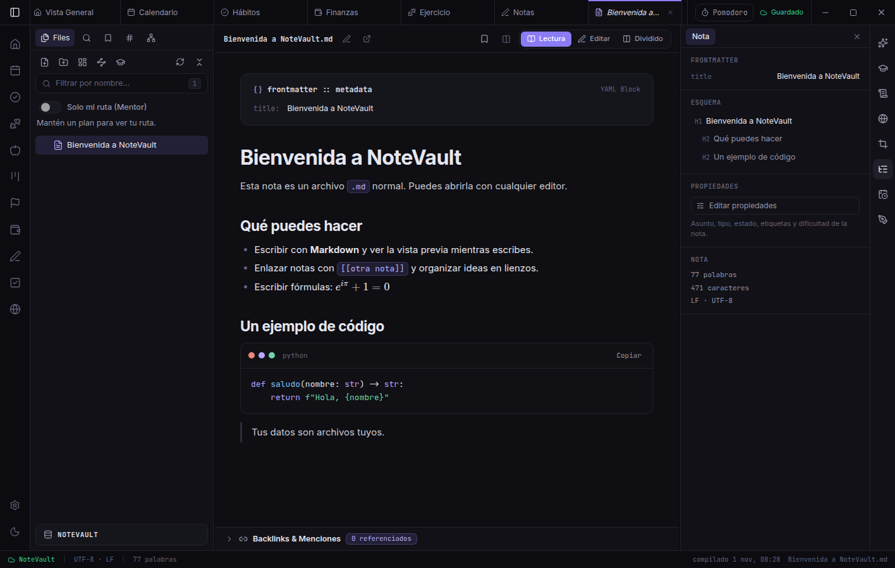
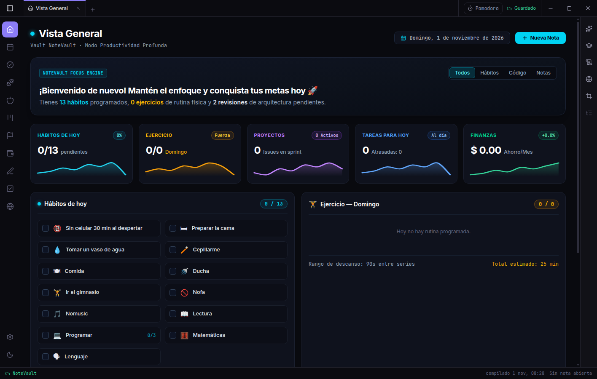

<div align="center">

# NoteVault

🇬🇧 [English](README.md) · **🇪🇸 Español**

</div>

> **🎯 Nuestra meta:** **superar a Obsidian y Notion** — tus notas, tu plan de estudio y toda tu vida en una sola app abierta y local, con **actualizaciones constantes**.

[](LICENSE)
[](https://github.com/Lessteps/NoteVault/releases/latest)
[](https://lessteps.com)
[](https://www.instagram.com/lesstepscompany/)
[](https://www.youtube.com/channel/UC9NXc30n_PoqyDWnndQE2iQ)





---

**Estudio, notas y gestión personal en una app de escritorio. Tus datos son archivos tuyos.**

NoteVault reúne notas en Markdown, tareas, calendario, hábitos, metas, proyectos, finanzas, ejercicio, alimentación y un **Mentor** que arma y sigue tu plan de estudio. Todo vive en una carpeta de tu disco: sin cuenta, sin servidor y sin telemetría. La IA es opcional y la eliges tú: una API, un modelo local o un prompt que pegas tú.

> **Somos estudiantes y no tenemos apoyo ni sustento económico.** NoteVault es gratis y seguirá siéndolo, pero necesitamos dinero para continuar: cualquier ayuda sirve. [PayPal](https://paypal.me/lessteps) · Nequi/Bre-B `0093524288` · [más formas de apoyar](#apoyar-el-proyecto)

## Por qué NoteVault — y por qué buscamos superar a Obsidian y Notion

Obsidian y Notion son productos excelentes y ponen el listón alto. Estamos construyendo la app que va más lejos:

| | **NoteVault** | Obsidian | Notion |
| :--- | :---: | :---: | :---: |
| Tus datos como archivos locales | ✅ | ✅ | ❌ nube |
| Código abierto | ✅ GPL-3.0 | ❌ | ❌ |
| Funciona con una bóveda de Obsidian | ✅ | ✅ | ❌ |
| **Mentor** de estudio: plan que cabe en tus fechas, repasos espaciados, ritmo diario por asignatura | ✅ incluido | plugins | plantillas |
| Tareas, hábitos, metas, finanzas, ejercicio y alimentación en la misma app | ✅ incluido | plugins | plantillas |
| «Skills» de IA editables y versionadas que generan notas, mapas y práctica | ✅ | ❌ | ❌ |
| IA con tu propia API **o un modelo local** | ✅ | plugins | ❌ |
| No exige cuenta | ✅ | ✅ | ❌ |

**Dónde van por delante hoy:** ecosistema de plugins, apps móviles, colaboración en tiempo real y pulido. **Esa es la distancia que estamos cerrando**, versión tras versión.

### 🚀 Actualizaciones constantes

Publicamos de forma continua. Cada mejora llega a la vista de todos: mira las [Releases](https://github.com/Lessteps/NoteVault/releases) y el [CHANGELOG](CHANGELOG.md). Lo próximo en la [hoja de ruta](https://lessteps.com/docs/es/proyecto/hoja-de-ruta.html): Android, macOS, web, actualizaciones automáticas e instalador firmado.

## Características

- Editor Markdown con vista previa en vivo, enlaces, fórmulas y lienzos (`.canvas`).
- Tareas, proyectos, calendario, hábitos y metas.
- Finanzas, ejercicio (302 ejercicios con instrucciones) y alimentación.
- **Mentor:** plan de estudio que siempre cabe en tus fechas, con repasos espaciados, Pomodoro y el ritmo necesario por asignatura.
- **Skills:** las instrucciones con las que se generan notas, mapas y práctica; editables, con historial y detección automática de piezas desactualizadas.
- Formato de bóveda abierto y documentado ([`docs/VAULT_FORMAT.md`](docs/VAULT_FORMAT.md)); compatible con Obsidian.

## Instalación

Todo va incluido: **no necesitas instalar nada más**. Descarga desde [Releases](https://github.com/Lessteps/NoteVault/releases):

- **Windows:** `NoteVault-Setup-<versión>.exe` (instalador) o `NoteVault-Portable-<versión>.exe` (sin instalar).
- **Linux:** `.deb` (Ubuntu/Debian) o `.AppImage`.
- **macOS:** por ahora, desde el código fuente (abajo).

**Desde el código fuente (Windows, Linux, macOS):** requiere Node.js 20+ y npm 10+.

```bash
git clone https://github.com/Lessteps/NoteVault.git
cd NoteVault/frontend
npm install
npm run electron:dev
```

## Desarrollo

```bash
cd frontend
npm run typecheck    # tipos TypeScript
npx vitest run       # pruebas unitarias
npm run test:e2e     # pruebas end-to-end con Electron (requiere npx vite build)
npm run electron:build   # genera el instalador en frontend/release/
```

## Documentación

Documentación completa en **<https://lessteps.com/docs/es/>** (inglés: <https://lessteps.com/docs/>). Hecha con [MkDocs Material](https://squidfunnel.github.io/mkdocs-material/) desde [`docs_site/`](docs_site/):

```bash
pip install -r requirements-docs.txt
mkdocs serve
```

## Contribuir

Lee [CONTRIBUTING.md](CONTRIBUTING.md) y el [código de conducta](CODE_OF_CONDUCT.md). Para reportar una vulnerabilidad, usa [SECURITY.md](SECURITY.md). Ideas, errores y pull requests son bienvenidos.

## Licencia

El código se publica bajo **GPL-3.0-or-later** (ver [LICENSE](LICENSE)); la documentación, bajo CC BY-SA 4.0. El nombre y el logo «NoteVault» no se licencian con el código ([TRADEMARK.md](TRADEMARK.md)). Los créditos de terceros están en [CREDITS.md](CREDITS.md).

## Apoyar el proyecto

Somos estudiantes y no tenemos apoyo ni sustento económico. NoteVault es libre y gratuito, y cualquier ayuda, por pequeña que sea, nos permite seguir desarrollándolo.

- **PayPal:** <https://paypal.me/lessteps>
- **Colombia (Bre-B / Nequi):** llave `0093524288`
- **Código QR de PayPal y Nequi:** [verlo aquí](https://drive.google.com/file/d/1ea34-aOhxh8nAmhpLI0lX2B1oQqEDQG6/view?usp=sharing)

¿No puedes donar? Dale una estrella al repo ⭐, reporta errores, mejora la documentación o cuéntaselo a alguien.

## Contacto

- ✉️ [lesstepscompany@gmail.com](mailto:lesstepscompany@gmail.com)
- 📸 [Instagram @lesstepscompany](https://www.instagram.com/lesstepscompany/)
- 👍 [Facebook](https://www.facebook.com/profile.php?id=61595351223179)
- ▶️ [YouTube](https://www.youtube.com/channel/UC9NXc30n_PoqyDWnndQE2iQ)

## Sobre el nombre

**«NoteVault» es un nombre provisional** del producto. La empresa que lo representa es **Lessteps**. Si el nombre cambia, se anunciará en este repositorio.
