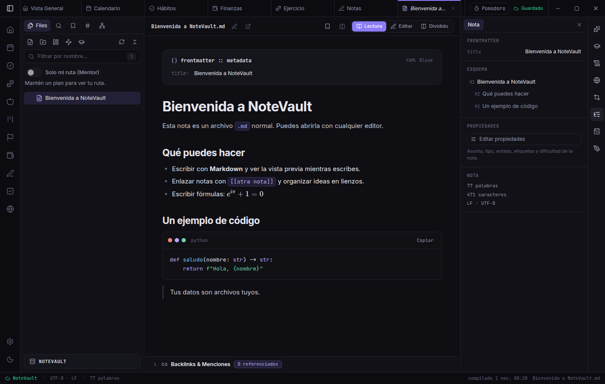
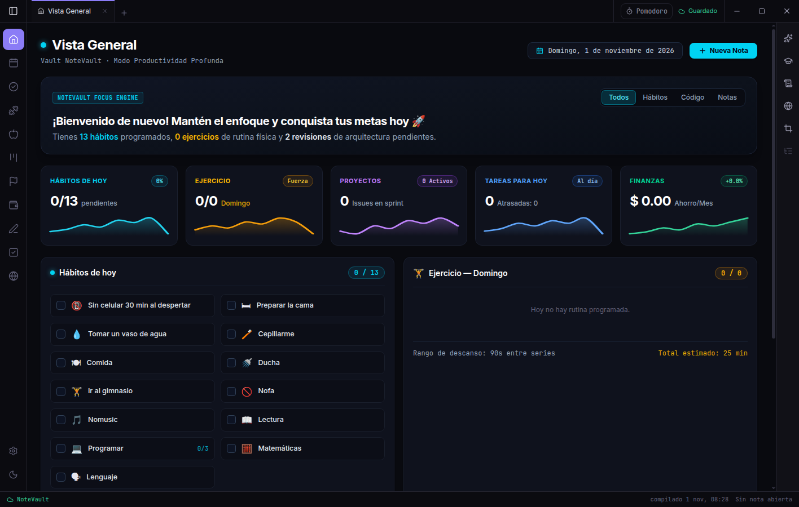

# NoteVault

**Estudio, notas y gestión personal en una app de escritorio. Tus datos son archivos tuyos.**

NoteVault reúne notas en Markdown, tareas, calendario, hábitos, metas, proyectos, finanzas, ejercicio, alimentación y un Mentor que arma y sigue tu plan de estudio. Todo vive en una carpeta de tu disco, sin cuenta, sin servidor y sin telemetría. La IA es opcional y la eliges tú: API, modelo local o un prompt que pegas en la herramienta que prefieras.

[](LICENSE)

- **Documentación:** <https://lessteps.github.io/NoteVault/docs/>
- **Sitio web:** <https://lessteps.github.io/NoteVault/>
- **Descargas:** [Releases](https://github.com/Lessteps/NoteVault/releases)





## Características

- Editor Markdown con vista previa en vivo, enlaces, fórmulas y lienzos (`.canvas`).
- Tareas, proyectos, calendario, hábitos y metas.
- Finanzas, ejercicio (302 ejercicios con instrucciones) y alimentación.
- **Mentor:** plan de estudio que cabe en tus fechas, con repasos espaciados, Pomodoro y el ritmo necesario por asignatura.
- **Skills:** las instrucciones con las que se generan notas, mapas y práctica, editables, con historial y detección automática de piezas desactualizadas.
- Formato de bóveda abierto y documentado ([`docs/VAULT_FORMAT.md`](docs/VAULT_FORMAT.md)); compatible con Obsidian.

## Instalación

**Windows:** descarga el instalador desde [Releases](https://github.com/Lessteps/NoteVault/releases).

**Desde el código fuente (Windows, Linux, macOS):** requiere Node.js 20+ y npm 10+.

```bash
git clone https://github.com/Lessteps/NoteVault.git
cd NoteVault/frontend
npm install
npm run electron:dev
```

## Desarrollo

```bash
cd frontend
npm run typecheck    # tipos TypeScript
npx vitest run       # pruebas unitarias de core y API
npm run test:e2e     # pruebas end-to-end con Electron (requiere npx vite build)
npm run electron:build   # genera el instalador en frontend/release/
```

## Documentación

La documentación está hecha con [MkDocs Material](https://squidfunnel.github.io/mkdocs-material/) en [`docs_site/`](docs_site/). Para verla en local:

```bash
pip install mkdocs-material
mkdocs serve
```

La arquitectura, los requisitos y el diseño técnico están en la sección *Ingeniería*. Las notas internas de trabajo viven en [`docs/`](docs/).

## Contribuir

Lee [CONTRIBUTING.md](CONTRIBUTING.md) y el [código de conducta](CODE_OF_CONDUCT.md). Para reportar una vulnerabilidad, usa [SECURITY.md](SECURITY.md).

## Licencia

El código se publica bajo **GPL-3.0-or-later** (ver [LICENSE](LICENSE)). La documentación se publica bajo CC BY-SA 4.0. El nombre y el logo «NoteVault» no se licencian con el código ([TRADEMARK.md](TRADEMARK.md)). Los créditos de terceros están en [CREDITS.md](CREDITS.md).

## Apoyar el proyecto

NoteVault es libre y se mantiene con el apoyo de quien lo usa. Si te sirve, puedes apoyarlo desde la [página del proyecto](https://lessteps.github.io/NoteVault/#apoyar).
