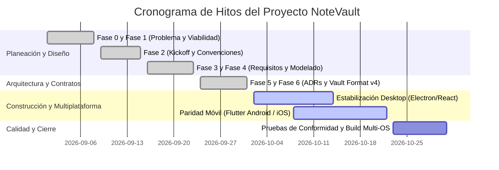

# 15. Plan Inicial de Proyecto

**Fase:** 01 — Viabilidad Temprana  
**Entregable:** 15  
**Proyecto:** NoteVault (PC, Mac, Android, iPhone)

---

## 1. Cronograma Macro de Hitos (Roadmap de 6 Semanas)

---

## 2. Marco Conceptual: Hito de Cronograma de Proyecto

1. **Entidad principal e independiente.**
2. **Es la entidad líder del conjunto de datos:** posee un identificador global único que fija una fecha límite de entrega (`milestone_id`: `MILESTONE-MULTI-PARITY`) consultado en el seguimiento del proyecto.
3. **Existe por sí misma en el cronograma sin depender de las horas invertidas por persona**, y es la única responsable de coordinar que los entregables requeridos estén completos antes de abrir la compuerta de lanzamiento.
4. **Punto de entrada y límite de consistencia:** Si un hito crítico se retrasa, se activa el protocolo de mitigación reduciendo alcance hacia el MVP estricto.

