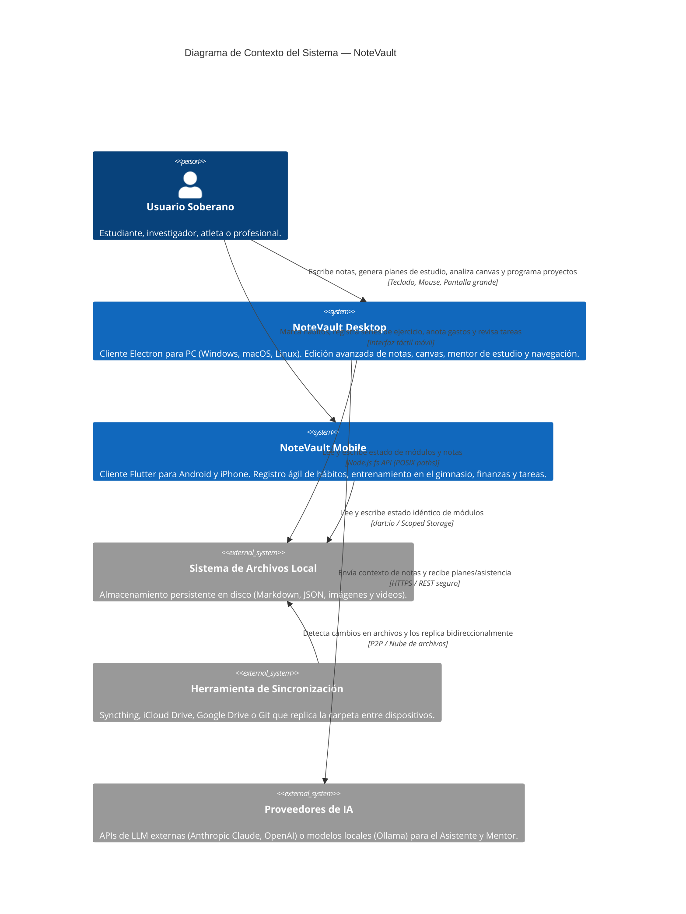

# 01. Diagrama de Contexto del Sistema

**Fase:** 03 — Ingeniería de Requisitos  
**Entregable:** 01  
**Proyecto:** NoteVault (PC, Mac, Android, iPhone)

---

## 1. Diagrama C4 Nivel 1 — Contexto de NoteVault

El siguiente diagrama formaliza las fronteras del sistema NoteVault con los actores humanos y servicios externos:

---

## 2. Marco Conceptual: Frontera del Sistema C4

1. **Entidad principal e independiente.**
2. **Es la entidad líder del conjunto de datos:** posee un identificador global único que delimita el alcance del sistema frente al entorno exterior (`system_boundary_id`: `C4-CONTEXT-NOTEVAULT`) consultado en la arquitectura empresarial.
3. **Existe por sí misma en el modelo C4 sin depender de diagramas de componentes internos**, y es la única responsable de fijar con qué actores y sistemas externos se comunica NoteVault.
4. **Punto de entrada y límite de consistencia:** Define la superficie de ataque y los canales de entrada y salida de datos del sistema.

