# 04. Elicitación de Requerimientos (FURPS+ / MoSCoW)

**Fase:** 03 — Ingeniería de Requisitos  
**Entregable:** 04 de 09  
**Proyecto:** NoteVault (PC Windows, macOS, Linux, Android, iOS / iPhone)  
**Estado:** Formalizado y Certificado  

---

## 1. Clasificación Exhaustiva de Requerimientos Candidatos (FURPS+)

A continuación se formalizan los **Requerimientos Candidatos (Candidate Requirements - CR)** derivados del análisis de necesidades de estudiantes, profesionales y desarrolladores, categorizados bajo el modelo **FURPS+** (*Functionality, Usability, Reliability, Performance, Supportability*) y priorizados según la técnica **MoSCoW** (*Must Have, Should Have, Could Have, Won't Have this time*):

| Código | Categoría FURPS+ | Declaración del Requerimiento Candidato (CR) | Módulo Destino | Prioridad MoSCoW |
| :--- | :--- | :--- | :--- | :--- |
| **CR-01** | Funcionalidad | Editor Markdown WYSIWYG híbrido con renderizado de KaTeX para fórmulas matemáticas y backlinks bidireccionales `[[...]]`. | `MOD-NOTES` | **Must Have** |
| **CR-02** | Funcionalidad | Panel matutino unificado (*Daily Hub*) con saludo horario, resumen de tareas vencidas y hábitos de hoy. | `MOD-HOME` | **Must Have** |
| **CR-03** | Funcionalidad | Lienzo infinito bidimensional interactivo compatible con formato abierto Obsidian Canvas (`.canvas`) y nodos conectados. | `MOD-CANVAS` | **Must Have** |
| **CR-04** | Funcionalidad | Calendario multiescala (mensual/semanal) agregando repasos espaciados (SRS), tareas programadas y eventos de entrenamiento. | `MOD-CALENDAR` | **Must Have** |
| **CR-05** | Funcionalidad | Sistema de seguimiento de hábitos atómicos con cálculo de rachas continuas, matriz semanal y diario reflexivo en Markdown. | `MOD-HABITS` | **Must Have** |
| **CR-06** | Funcionalidad | Registro de series de entrenamiento de fuerza con peso, reps, RPE, calculadora de 1RM y temporizador de descanso automático. | `MOD-EXERCISE` | **Must Have** |
| **CR-07** | Funcionalidad | Monitoreo de macronutrientes (proteínas, carbohidratos, grasas, calorías) y registro de hidratación con catálogo de alimentos. | `MOD-NUTRITION` | **Must Have** |
| **CR-08** | Funcionalidad | Base de datos de tareas con prioridades numéricas (P1-P4), fechas límite, subtareas y recurrencias automáticas al completar. | `MOD-TASKS` | **Must Have** |
| **CR-09** | Funcionalidad | Tablero Kanban de proyectos de ingeniería que gobierne las 12 fases metodológicas del SDLC y compuertas de calidad. | `MOD-PROJECTS` | **Must Have** |
| **CR-10** | Funcionalidad | Sistema de metas y OKRs estratégicos con resultados clave cuantitativos y ponderación de progreso porcentual. | `MOD-GOALS` | **Must Have** |
| **CR-11** | Funcionalidad | Contabilidad personal de doble partida con gestión de cuentas, categorías, presupuestos mensuales y semáforos de gasto. | `MOD-FINANCE` | **Must Have** |
| **CR-12** | Funcionalidad | Motor de repetición espaciada (SRS) basado en SuperMemo SM-2 optimizado para la base de conocimiento de Matemáticas Puras. | `MOD-STUDY` | **Must Have** |
| **CR-13** | Funcionalidad | Reproductor de audio/video con sincronización de subtítulos interactivos, bucle de repetición de frases (*shadowing*) y Mini-Player. | `MOD-ENGLISH` | **Must Have** |
| **CR-14** | Funcionalidad | Planificador curricular mensual con IA (Mentor) en modos `together`/`phased`, Pomodoro en barra superior y evaluación post-sesión. | `MOD-MENTOR` | **Must Have** |
| **CR-15** | Funcionalidad | Navegador web en partición aislada `persist:nvweb` con lista negra de distracciones durante pomodoro y recortador a Markdown. | `MOD-WEB` | **Must Have** |
| **CR-16** | Usabilidad | Interfaz de tres paneles en Desktop con pestañas arrastrables (*draggable tabs*), barra lateral replegable y división de pantalla. | `Transversal` | **Must Have** |
| **CR-17** | Usabilidad | Experiencia móvil nativa con navegación con una mano (*Bottom Navigation Bar*), hojas inferiores (*Bottom Sheets*) y gestos táctiles. | `notevault_mobile` | **Must Have** |
| **CR-18** | Confiabilidad | Cero pérdida de datos ante cortes imprevistos mediante protocolo de escritura temporal y renombramiento atómico en disco. | `Transversal` | **Must Have** |
| **CR-19** | Confiabilidad | Detección determinista de colisiones y conflictos de sincronización basada en marcas de tiempo de modificación de archivo (`mtime`). | `Transversal` | **Must Have** |
| **CR-20** | Rendimiento | Apertura y renderizado de cualquier archivo de nota o módulo en menos de 30 ms en PC y móviles. | `Transversal` | **Must Have** |
| **CR-21** | Rendimiento | Motor de búsqueda difusa global sobre hasta 4,000 notas en memoria resolviendo consultas en menos de 120 ms. | `MOD-NOTES` | **Must Have** |
| **CR-22** | Soporte / Portabilidad | Almacenamiento 100% basado en archivos planos estándar (Markdown, YAML, JSON), sin base de datos SQLite propietaria ni lock-in. | `Transversal` | **Must Have** |
| **CR-23** | Soporte / Portabilidad | Sincronización multi-dispositivo agnóstica vía sistema de archivos compatible con Syncthing, iCloud Drive, Git y Google Drive. | `Transversal` | **Must Have** |
| **CR-24** | Seguridad | Arquitectura de seguridad en Electron con aislamiento de contexto (`contextIsolation: true`) y prohibición de Node en renderizador. | `Transversal` | **Must Have** |
| **CR-25** | Seguridad | Sanitización estricta de todo HTML generado con `DOMPurify` para erradicar vulnerabilidades de Cross-Site Scripting (XSS). | `Transversal` | **Must Have** |

---

## 2. Marco Conceptual: Requerimiento Candidato (CR)

1. **Entidad principal e independiente.**
2. **Es la entidad líder del conjunto de datos:** posee un identificador global único secuencial (`candidate_req_id`: `CR-01`, `CR-02`), consultado por la matriz de trazabilidad (RTM) y el catálogo de especificación modular.
3. **Existe por sí misma en el registro de ingeniería de requisitos sin depender de la solución técnica elegida**, y es la única responsable de capturar una necesidad verificable y no ambigua del usuario final.
4. **Punto de entrada y límite de consistencia:** Alimenta directamente la especificación detallada de los 15 módulos (`MOD-XXX`) y condiciona la batería de pruebas de aceptación del sistema.

---

## 3. Matriz de Dependencias y Trazabilidad Temprana

```mermaid
graph TD
    CR01[CR-01: Notas y KaTeX] --> M1[MOD-NOTES]
    CR02[CR-02: Hub Diario] --> M2[MOD-HOME]
    CR03[CR-03: Lienzo Canvas] --> M3[MOD-CANVAS]
    CR04[CR-04: Calendario Agenda] --> M4[MOD-CALENDAR]
    CR05[CR-05: Hábitos y Rachas] --> M5[MOD-HABITS]
    CR06[CR-06: Gimnasio y Series] --> M6[MOD-EXERCISE]
    CR07[CR-07: Macronutrientes] --> M7[MOD-NUTRITION]
    CR08[CR-08: Tareas Atómicas] --> M8[MOD-TASKS]
    CR09[CR-09: Proyectos SDLC] --> M9[MOD-PROJECTS]
    CR10[CR-10: Metas y OKRs] --> M10[MOD-GOALS]
    CR11[CR-11: Finanzas Personales] --> M11[MOD-FINANCE]
    CR12[CR-12: Repaso SRS y Matemáticas] --> M12[MOD-STUDY]
    CR13[CR-13: Inglés y Shadowing] --> M13[MOD-ENGLISH]
    CR14[CR-14: Mentor IA y Pomodoro] --> M14[MOD-MENTOR]
    CR15[CR-15: Navegador y Enfoque] --> M15[MOD-WEB]
```

