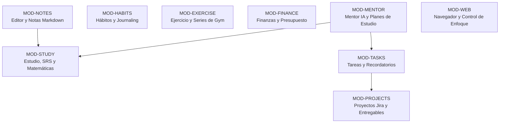

# 05. Descomposición Modular Funcional

**Fase:** 03 — Ingeniería de Requisitos  
**Entregable:** 05  
**Proyecto:** NoteVault (PC, Mac, Android, iPhone)

---

## 1. Matriz Canónica de los 9 Módulos Funcionales

| Módulo ID | Nombre Oficial | Alcance Funcional Clave | Subdirectorio en Bóveda |
| :--- | :--- | :--- | :--- |
| **MOD-NOTES** | Notas y Markdown | Edición WYSIWYG, KaTeX, backlinks `[[...]]`, tags `#tag` y adjuntos. | Raíz de la bóveda |
| **MOD-HABITS** | Hábitos y Journal | Checklist diario, cálculo de rachas continuas y diario en Markdown. | `.notevault/habits/` |
| **MOD-EXERCISE**| Ejercicio y Rutinas | Registro de series de pesas (peso/reps), videos y mapa muscular. | `.notevault/ejercicio/` |
| **MOD-TASKS** | Tareas y Agenda | Base de datos de tareas, prioridades, fechas y recurrencias. | `.notevault/tareas/` |
| **MOD-PROJECTS**| Proyectos Jira | Tablero Kanban, etapas configurables y pasos fechados. | `.notevault/proyectos/` |
| **MOD-FINANCE** | Finanzas Personales| Registro de ingresos/gastos, balances y presupuestos mensuales. | `.notevault/finanzas/` |
| **MOD-STUDY** | Estudio y Matemáticas| Repetición espaciada SRS, banco de ejercicios y temarios. | `.notevault/estudio/` |
| **MOD-MENTOR** | Mentor Inteligente | Plan mensual con IA, modos de área (`together`/`phased`) y tutor. | `.notevault/mentor/` |
| **MOD-WEB** | Navegador y Enfoque| Sesión web aislada (`persist:nvweb`), reglas de bloqueo y métricas. | `.notevault/web/` |

---

## 2. Marco Conceptual: Descomposición en Contextos Delimitados

1. **Entidad principal e independiente.**
2. **Es la entidad líder del conjunto de datos:** posee un identificador global único que aísla un subsistema funcional (`functional_module_id`: `MOD-NOTES`, `MOD-STUDY`) consultado en el enrutamiento de la aplicación.
3. **Existe por sí misma en el diseño de arquitectura sin acoplamiento circular con otros módulos**, y es la única responsable de gobernar sus propias entidades, esquemas de archivo y controladores.
4. **Punto de entrada y límite de consistencia:** Cada módulo opera sobre su propia subcarpeta dentro de `.notevault/` sin invadir el espacio de otros módulos.

