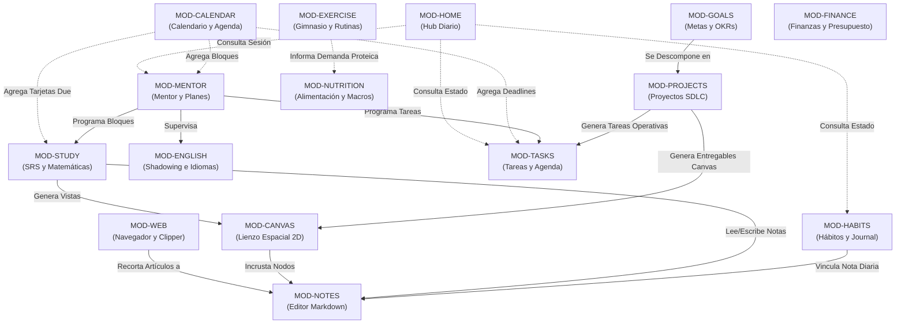

# 05. Descomposición Modular Funcional

**Fase:** 03 — Ingeniería de Requisitos  
**Entregable:** 05 de 09  
**Proyecto:** NoteVault (PC Windows, macOS, Linux, Android, iOS / iPhone)  
**Estado:** Formalizado y Certificado  

---

## 1. Matriz Canónica de los 15 Módulos Funcionales

NoteVault descompone su dominio en **15 módulos funcionales de alta cohesión y bajo acoplamiento**. Cada módulo gobierna su propia lógica de negocio y encapsula su almacenamiento dentro de la bóveda bajo una convención estricta:

| Módulo ID | Nombre Oficial | Bounded Context | Alcance Funcional Clave | Subdirectorio en Bóveda |
| :--- | :--- | :--- | :--- | :--- |
| **MOD-NOTES** | Notas y Markdown | `CoreNoteVault` | Edición WYSIWYG, KaTeX, backlinks bidireccionales `[[...]]`, tags, outline y adjuntos. | Raíz de la bóveda (`*.md`) |
| **MOD-HOME** | Vista General y Hub Diario | `DailyProductivityHub` | Morning alignment, resumen de hoy, atajos rápidos, estado de hábitos y timeline. | En memoria / `.notevault/home/` |
| **MOD-CANVAS** | Lienzo Infinito 2D | `SpatialKnowledge` | Nodos texto, markdown y grupos, aristas dirigidas, entregables y mapas conceptuales. | Raíz y carpetas (`*.canvas`) |
| **MOD-CALENDAR** | Calendario de Repaso y Agenda | `TimeSchedule` | Calendario mensual/semanal, tarjetas SRS debidas, deadlines de tareas y sesiones mentor. | En memoria / `.notevault/calendario/` |
| **MOD-HABITS** | Hábitos y Journaling | `BehaviorTracker` | Checklists diarios, cálculo riguroso de rachas continuas, matriz semanal y diario. | `.notevault/habits/` y `1.PERSONAL/Diario/` |
| **MOD-EXERCISE** | Ejercicio y Rutinas | `PhysicalTraining` | Series de pesas (peso/reps/RPE), 1RM Epley, tonelaje, rest timer y videos técnicos. | `.notevault/ejercicio/` |
| **MOD-NUTRITION** | Alimentación y Macronutrientes | `NutritionalIntake` | Desglose P, C, G, Kcal por comida, catálogo local de alimentos y contador de agua. | `.notevault/alimentacion/` |
| **MOD-TASKS** | Tareas y Agenda | `TaskExecution` | Prioridades P1-P4, estados (todo, doing, done), subtareas, fechas límite y recurrencias. | `.notevault/tareas/` |
| **MOD-PROJECTS** | Proyectos Fullstack SDLC | `SoftwareMethodology` | Tablero Kanban, gestión de las 12 fases del SDLC, quality gates y entregables. | `.notevault/proyectos/` y `2.PROYECTOS/` |
| **MOD-GOALS** | Metas y OKRs | `StrategicAlignment` | Visión anual, trimestres Q1-Q4, resultados clave cuantitativos y alineación. | `.notevault/metas/` |
| **MOD-FINANCE** | Finanzas Personales | `PersonalAccounting` | Transacciones de ingresos/gastos, balances multicuenta, presupuestos y semáforos. | `.notevault/finanzas/` |
| **MOD-STUDY** | Estudio y Matemáticas Puras | `SpacedLearning` | Repetición espaciada SM-2, tríada matemática (c., t., e.), práctica de demostraciones. | `.notevault/estudio/` y `Matematicas/` |
| **MOD-ENGLISH** | Reproductor y Shadowing | `LanguageAcquisition` | Audio/video con subtítulos interactivos (.srt/.vtt), loop de frase y Mini-Player. | `Ingles/` y `.notevault/english/` |
| **MOD-MENTOR** | Mentor IA y Planes | `AdaptiveMentorship` | Generador mensual (`together`/`phased`), Pomodoro superior y evaluación reflexiva. | `.notevault/mentor/` |
| **MOD-WEB** | Navegador y Enfoque | `FocusBrowser` | Sesión aislada `persist:nvweb`, bloqueo de distracciones y Web Clipper a Markdown. | `.notevault/web/` |

---

## 2. Grafo de Dependencias e Interacción entre Módulos

El siguiente diagrama formaliza el flujo de datos y dependencias unidireccionales del sistema. Nótese la ausencia total de dependencias circulares (*Acyclic Dependencies Principle*):

---

## 3. Marco Conceptual: Descomposición en Contextos Delimitados

1. **Entidad principal e independiente.**
2. **Es la entidad líder del conjunto de datos:** posee un identificador global único que aísla un subsistema funcional autónomo (`functional_module_id`: `MOD-NOTES`, `MOD-STUDY`, `MOD-EXERCISE`), consultado por el enrutador de la aplicación y la inyección de dependencias.
3. **Existe por sí misma en el diseño de arquitectura sin acoplamiento circular con otros módulos**, y es la única responsable de gobernar sus propias entidades de dominio, validaciones de archivo y esquemas de persistencia.
4. **Punto de entrada y límite de consistencia:** Cada módulo opera exclusivamente sobre su propio subdirectorio en `.notevault/` o sus notas asignadas, garantizando que un fallo o corrupción en un módulo jamás contamine los datos de los demás.

