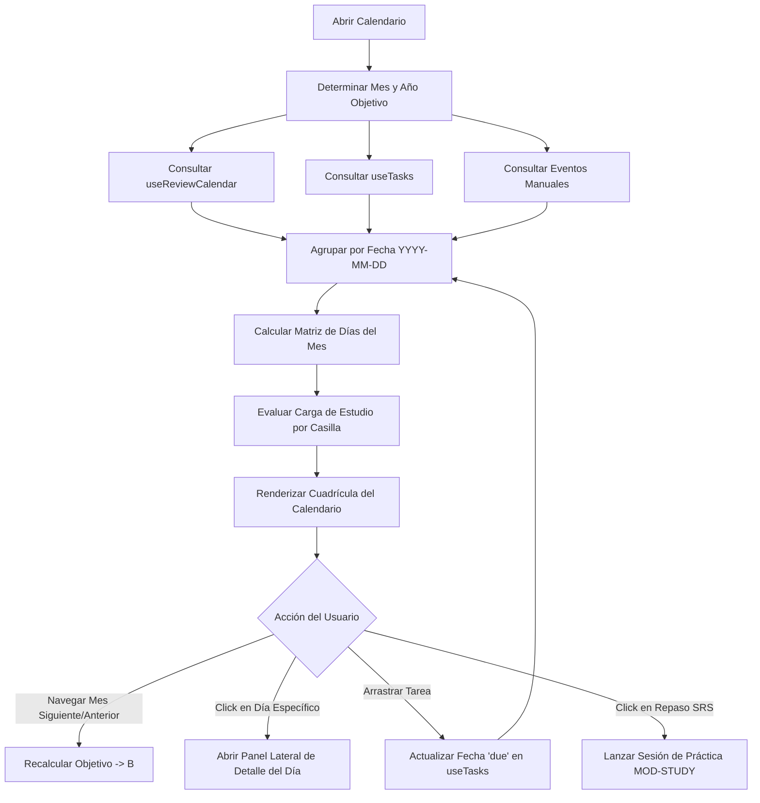

# Especificación de Módulo: MOD-CALENDAR (Calendario de Repaso y Agenda)

**Fase:** 03 — Ingeniería de Requisitos  
**Entregable:** 07 de 09 — Especificación Detallada de Módulos  
**Módulo ID:** `MOD-CALENDAR` (04 de 15)  
**Bounded Context:** `TimeSchedule` / Gestión Temporal y Repasos  
**Ubicación de Almacenamiento:** Síntesis reactiva y persistencia de eventos en `.notevault/calendario/events.json`  
**Responsable Técnico:** NoteVault Core Engineering  

---

## 1. Alcance y Responsabilidades del Módulo

El módulo `MOD-CALENDAR` unifica la agenda temporal del usuario con el motor de aprendizaje continuo, ofreciendo una perspectiva cronológica integral:

- **Calendario Unificado de Repaso SRS:** Visualización de tarjetas de estudio programadas por el algoritmo SuperMemo SM-2 (conceptos, teoremas y ejercicios matemáticos) agrupadas por día de vencimiento.
- **Agenda de Vencimientos de Tareas:** Mapeo automático de tareas del módulo `MOD-TASKS` con fechas `due` o `start`, coloreadas según su nivel de urgencia (`P1` a `P4`).
- **Bloques de Estudio del Mentor IA:** Representación de bloques horarios asignados por el Mentor para sesiones de enfoque en modo simultáneo (*together*) o secuencial (*phased*).
- **Vistas Multiescala:** Alternancia ágil entre perspectiva mensual (mapa de calor de carga de estudio), semanal (bloques de tiempo tipo time-blocking) y diaria (timeline detallado).
- **Creación y Edición Rápida:** Posibilidad de arrastrar tareas para reprogramar su fecha de entrega o hacer clic en un día libre para agendar un simulacro de examen o sesión de entrenamiento.

---

## 2. Marco Conceptual: Entidad Evento de Calendario en el Dominio

<div class="entity-card">

1. **Entidad principal e independiente.**
2. **Es la entidad líder del conjunto de datos:** posee un identificador global único que fija su coordenada temporal (`calendar_event_id`: `EVT-2026-10-25-SRS-ALGEBRA`), invocado por el planificador del mentor y el widget de la barra superior.
3. **Existe por sí misma en el registro cronológico sin depender de que la nota o tarea vinculada permanezca abierta**, y es la única responsable de validar que la fecha de inicio no sea posterior a la fecha de término antes de confirmar la programación.
4. **Punto de entrada y límite de consistencia:** Dispara las alarmas y notificaciones locales del sistema cuando el reloj alcanza la hora programada.

</div>

---

## 3. Requisitos Funcionales del Módulo (RF)

| ID RF | Declaración del Requisito Funcional | Prioridad MoSCoW | Criterio de Verificación |
| :--- | :--- | :--- | :--- |
| **RF-CAL-01** | El sistema DEBE agregar y representar en una cuadrícula mensual las tarjetas de repaso de estudio pendientes con su correspondiente código (`c.01.01`, etc.). | **Must Have** | Componente `ReviewCalendar.tsx` renderiza tarjetas SRS por fecha sin desbordamiento. |
| **RF-CAL-02** | El sistema DEBE proyectar las tareas del módulo `MOD-TASKS` en sus respectivas fechas de vencimiento con indicadores visuales de prioridad. | **Must Have** | Tarea P1 renderiza badge rojo; tarea completada renderiza texto tachado. |
| **RF-CAL-03** | El sistema DEBE permitir reprogramar una tarea arrastrándola de una casilla de día a otra (*drag and drop* temporal), actualizando el campo `due` en el archivo `.json` de tareas. | **Must Have** | Arrastrar tarea del día 20 al 22 muta el store de tareas y persiste el cambio atómico. |
| **RF-CAL-04** | El sistema DEBE ofrecer navegación rápida entre meses/semanas mediante flechas y atajo a "Hoy" (`Today`). | **Must Have** | Clic en "Hoy" centra la vista en la fecha actual en menos de 10 ms. |
| **RF-CAL-05** | El sistema DEBE permitir filtrar qué capas de eventos se visualizan (ocultar/mostrar: Repasos SRS, Tareas, Entrenamientos, Hábitos). | **Should Have** | Checkboxes de filtro en la cabecera ocultan o muestran eventos reactivamente sin recargar. |
| **RF-CAL-06** | El sistema DEBE mostrar el número total de repasos pendientes y el tiempo estimado de estudio para cada jornada. | **Should Have** | Indicador en la esquina superior de cada casilla con el total de minutos calculados. |

---

## 4. Requisitos No Funcionales del Módulo (RNF Local)

| ID RNF | Dimensión ISO 25010 | Declaración y Métrica Cuantitativa | Método de Medición |
| :--- | :--- | :--- | :--- |
| **RNF-CAL-01** | Eficiencia de Desempeño | **Tiempo de Cálculo de Agenda Mensual:** La agregación y renderizado de un mes con hasta **1000 eventos combinados** debe completarse en **< 35 ms**. | Medición con `performance.measure` en el renderizado de la cuadrícula. |
| **RNF-CAL-02** | Confiabilidad | **Determinismo de Zonas Horarias:** Todas las fechas se interpretan en la zona horaria local del dispositivo sin desfases por conversión UTC errónea. | Test unitario con mock de zona horaria `America/Bogota` y `Europe/Madrid`. |
| **RNF-CAL-03** | Usabilidad | **Compensación de Pantallas Pequeñas:** En resoluciones móviles (< 600px), la vista mensual debe condensarse automáticamente en lista de agenda cronológica. | Test responsivo con emulación viewport en Vitest. |
| **RNF-CAL-04** | Accesibilidad | **Navegación por Teclado:** Un usuario debe poder moverse entre días usando exclusivamente las flechas de dirección (`←`, `↑`, `→`, `↓`). | Test de accesibilidad de foco con simulación de eventos `KeyboardEvent`. |

---

## 5. Historias de Usuario con Criterios Gherkin

### US-CAL-01: Planificación de carga de estudio semanal
**Como** estudiante universitario preparándose para exámenes finales,  
**Quiero** ver cuántos repasos matemáticos tengo acumulados para el fin de semana,  
**Para** distribuir mi tiempo libre de forma balanceada y evitar sobrecargas de estudio.

```gherkin
Escenario: Detección de sobrecarga de estudio
  Dado que el usuario navega a la vista mensual del calendario
  Cuando el día sábado acumula más de 40 tarjetas de repaso SRS
  Entonces la casilla del día resalta con un tono ámbar de advertencia
  Y muestra el texto "42 repasos (~1h 20m)".
```

### US-CAL-02: Reprogramación ágil de tarea por arrastre
**Como** usuario con múltiples entregables pendientes,  
**Quiero** mover una tarea del viernes al lunes siguiente arrastrándola en el calendario,  
**Para** ajustar mi plan de trabajo sin tener que abrir el formulario de edición de la tarea.

```gherkin
Escenario: Arrastrar tarea a otra fecha
  Dado que la tarea "Entrega D3 Wireframes" está ubicada en el viernes 24
  Cuando el usuario la arrastra con el cursor y la suelta en el lunes 27
  Entonces el sistema actualiza el campo "due" de la tarea a "2026-10-27"
  Y el evento se dibuja inmediatamente en la nueva casilla
  Y se muestra un toast silencioso confirmando la reprogramación.
```

---

## 6. Especificación Detallada de Casos de Uso

### UC-CAL-01: Agregación Multicanal y Visualización del Calendario

| Campo | Detalle de Especificación |
| :--- | :--- |
| **ID y Nombre** | `UC-CAL-01` — Agregación Multicanal y Visualización del Calendario |
| **Actor Principal** | Usuario Registrado / Estudiante |
| **Precondición** | Existen tareas, repasos o eventos registrados en la bóveda activa. |
| **Flujo Principal** | 1. El usuario selecciona la pestaña "Calendario" en la barra de navegación.<br/>2. El módulo Calendario lee los parámetros del mes activo (año, mes, primer día de la semana).<br/>3. Consulta el índice de repetición espaciada (`useReviewCalendar`) para obtener fechas de próximo repaso.<br/>4. Consulta el store de tareas (`useTasks`) para obtener tareas con fecha asignada.<br/>5. Consolida los eventos en una matriz de días de 7x5 o 7x6 casillas.<br/>6. Renderiza la cuadrícula mensual con sus indicadores de carga.<br/>7. El usuario puede hacer clic en un día para ver la lista de eventos expandida o iniciar un repaso. |
| **Flujos Alternativos** | **A1 (Cambio a vista semanal):** El usuario pulsa el conmutador "Semana". El sistema recompone la vista en columnas de 7 días con división por horas (06:00 a 23:00). |
| **Excepciones** | **E1 (Fechas malformadas):** Si una tarea tiene una fecha corrupta (ej. "2026-02-31"), el sistema la clasifica en una bandeja de "Fechas inválidas" sin romper el renderizado del calendario. |
| **Postcondición** | El estado de navegación temporal se conserva en memoria para que al volver de otra vista se retorne al mismo mes. |

---

## 7. Diagrama de Actividad del Módulo



---

## 8. Implicación de Compuerta de Fase (Gate 3 Criteria)

- **¿Bloquea el avance a Modelado/Fase 4?:** No.
- **Condición de Pase:** La vista de calendario opera como capa visual pura sin retener copias desacopladas de las tareas o notas, garantizando que cualquier cambio en disco o sincronización remota se refleje de inmediato en la agenda.
