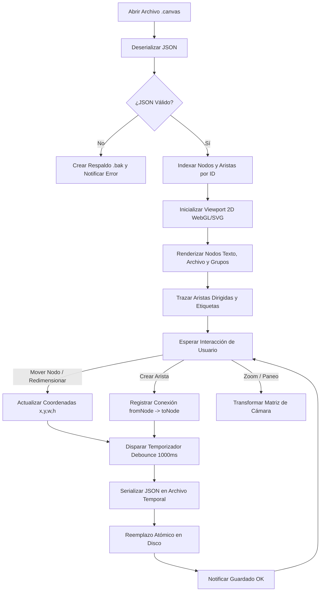

# Especificación de Módulo: MOD-CANVAS (Lienzo Infinito y Mapas Conceptuales)

**Fase:** 03 — Ingeniería de Requisitos  
**Entregable:** 07 de 09 — Especificación Detallada de Módulos  
**Módulo ID:** `MOD-CANVAS` (03 de 15)  
**Bounded Context:** `SpatialKnowledge` / Modelado Visual 2D  
**Ubicación de Almacenamiento:** Archivos `.canvas` (formato JSON Obsidian Canvas) en cualquier subdirectorio de la bóveda  
**Responsable Técnico:** NoteVault Core Engineering  

---

## 1. Alcance y Responsabilidades del Módulo

El módulo `MOD-CANVAS` proporciona un lienzo bidimensional infinito e interactivo para organizar conceptos, diagramar flujos de trabajo, estructurar mapas de conocimiento y visualizar entregables metodológicos:

- **Compatibilidad con Obsidian Canvas:** Serialización e interpretación nativa del formato estándar JSON compuesto por listas de `nodes` (texto, notas embebidas, grupos, enlaces web) y `edges` (aristas dirigidas, colores y etiquetas de flujo).
- **Generador Determinista de Entregables Fullstack:** Motor por especificación (`deliverable_canvas.py`) que transforma árboles JSON de micro-pasos en canvas estructurados sin superposición geométrica ni coordenadas manuales.
- **Mapas Conceptuales de Bases de Conocimiento:** Generación automática de grafos de estudio para Matemáticas Puras (`tools/kb_canvas.py`) mostrando conceptos precedentes, teoremas y ejercicios asociados.
- **Navegación Espacial 2D Fluida:** Zoom infinito (10% a 500%), paneo suave con aceleración por hardware (WebGL / Canvas API), selección múltiple y alineación magnética a cuadrícula (*grid snapping*).
- **Incrustación Dinámica de Markdown:** Los nodos de tipo archivo o texto renderizan Markdown completo con KaTeX sin necesidad de abrir la nota en una pestaña independiente.

---

## 2. Marco Conceptual: Entidad Documento Canvas en el Dominio

<div class="entity-card">

1. **Entidad principal e independiente.**
2. **Es la entidad líder del conjunto de datos:** posee un identificador global único que corresponde a la ruta relativa del archivo `.canvas` dentro de la bóveda (`canvas_path`: ej. `Matematicas/Algebra_Lineal.canvas`), consultado directamente por el visor espacial y el árbol de archivos.
3. **Existe por sí misma en el sistema de archivos como un archivo JSON independiente**, y es la única responsable de validar que todos los identificadores de nodos internos (`node.id`) y las conexiones dirigidas (`edge.fromNode`, `edge.toNode`) mantengan integridad referencial sin punteros rotos antes de persistir cambios.
4. **Punto de entrada y límite de consistencia:** El guardado del lienzo sobreescribe atómicamente el archivo `.canvas`, garantizando que la adición o eliminación de aristas y grupos ocurra en una única transacción de archivo.

</div>

---

## 3. Requisitos Funcionales del Módulo (RF)

| ID RF | Declaración del Requisito Funcional | Prioridad MoSCoW | Criterio de Verificación |
| :--- | :--- | :--- | :--- |
| **RF-CANVAS-01** | El sistema DEBE cargar, parsear y renderizar archivos `.canvas` con nodos de tipo `text`, `file`, `group` y `link`. | **Must Have** | Vitest: validación de esquema JSON y renderizado en DOM/WebGL sin errores. |
| **RF-CANVAS-02** | El sistema DEBE permitir crear y conectar nodos mediante aristas dirigidas con etiquetas descriptivas de flujo de hasta 45 caracteres. | **Must Have** | Creación interactiva de aristas con arrastrar y soltar desde los conectores perimetrales. |
| **RF-CANVAS-03** | El sistema DEBE implementar el estándar canónico de entregables Fullstack (micro-pasos: Encabezado -> How-to -> Example Output con flechas etiquetadas). | **Must Have** | Salida generada por `deliverable_canvas.py` pasa `check_canvas_groups.py` con 0 errores. |
| **RF-CANVAS-04** | El sistema DEBE permitir agrupar nodos dentro de cajas contenedoras (`group`) con títulos descriptivos y colores semánticos (`1` a `6`). | **Must Have** | Mover un nodo de grupo desplaza todos los nodos contenidos conservando sus posiciones relativas. |
| **RF-CANVAS-05** | El sistema DEBE renderizar fórmulas matemáticas KaTeX en el interior de los nodos de texto y notas embebidas en el canvas. | **Must Have** | Nodos con `$$...$$` renderizan fórmulas nítidas a cualquier nivel de zoom. |
| **RF-CANVAS-06** | El sistema DEBE autoguardar el estado espacial (posiciones x, y, ancho, alto y zoom) con debounce de 1000 ms tras la última interacción del usuario. | **Must Have** | Modificación de coordenadas escribe JSON válido en disco sin congelar el hilo principal. |
| **RF-CANVAS-07** | El sistema DEBE permitir exportar el lienzo activo o un área seleccionada como imagen PNG de alta resolución o formato SVG vectorial. | **Should Have** | Generación de imagen con ratio de escala 2x para documentos impresos o presentaciones. |

---

## 4. Requisitos No Funcionales del Módulo (RNF Local)

| ID RNF | Dimensión ISO 25010 | Declaración y Métrica Cuantitativa | Método de Medición |
| :--- | :--- | :--- | :--- |
| **RNF-CANVAS-01** | Eficiencia de Desempeño | **Rendimiento de Renderizado:** El lienzo debe mantener **≥ 60 FPS** durante el paneo y zoom en lienzos de hasta **500 nodos y 800 aristas**. | Medición de framerate con requestAnimationFrame y Chrome DevTools FPS Meter. |
| **RNF-CANVAS-02** | Eficiencia de Desempeño | **Tiempo de Carga de Canvas:** El parseo y posicionamiento inicial de un lienzo con 300 nodos debe completarse en **< 150 ms**. | Benchmark automatizado de carga con archivos `.canvas` reales. |
| **RNF-CANVAS-03** | Mantenibilidad | **Interoperabilidad de Formato:** 100% de los archivos creados deben poder abrirse y editarse en Obsidian sin pérdida de aristas, nodos o colores. | Test de paridad sintáctica contra el esquema JSON oficial de Obsidian Canvas. |
| **RNF-CANVAS-04** | Usabilidad | **Detección de Colisiones:** El algoritmo de autolayout nunca debe posicionar dos nodos con intersección espacial en coordenadas generadas automáticamente. | Verificación geométrica automatizada con `tools/space_canvas_labels.py`. |

---

## 5. Historias de Usuario con Criterios Gherkin

### US-CANVAS-01: Generación automatizada de mapa de entregables
**Como** arquitecto de software o desarrollador que sigue la metodología Fullstack,  
**Quiero** compilar un archivo JSON de especificación metodológica a un lienzo interactivo,  
**Para** visualizar el flujo de cómo los inputs se transforman en salidas sin calcular coordenadas manualmente.

```gherkin
Escenario: Compilación de spec de entregable a canvas
  Dado un archivo de especificación "D1.Problem_Statement.json"
  Cuando se ejecuta el generador "deliverable_canvas.py"
  Entonces el sistema produce el archivo "1.Problem_statement_h.canvas"
  Y todos los grupos de micro-pasos contienen sus nodos de Encabezado, How-to y Ejemplo
  Y cada arista posee su etiqueta correspondiente ("how to execute", "produces (example)").
```

### US-CANVAS-02: Exploración de conceptos matemáticos en mapa visual
**Como** estudiante repasando un área de matemáticas puras,  
**Quiero** navegar por un mapa conceptual de Álgebra Lineal en el canvas,  
**Para** entender qué conceptos son requisitos previos de un teorema antes de intentar su demostración.

```gherkin
Escenario: Paneo y visualización de prerequisitos
  Dado que el usuario tiene abierto el lienzo "Espacios_Vectoriales.canvas"
  Cuando hace doble clic sobre el nodo de un concepto
  Entonces el canvas hace zoom suave y centra el concepto en la pantalla
  Y destaca con color ámbar las aristas que provienen de sus conceptos antecedentes.
```

---

## 6. Especificación Detallada de Casos de Uso

### UC-CANVAS-01: Carga, Manipulación y Guardado Atómico de Lienzo

| Campo | Detalle de Especificación |
| :--- | :--- |
| **ID y Nombre** | `UC-CANVAS-01` — Carga y Manipulación de Documento Canvas |
| **Actor Principal** | Usuario Registrado / Arquitecto |
| **Precondición** | El archivo `.canvas` existe en la bóveda y contiene JSON válido. |
| **Flujo Principal** | 1. El usuario abre un archivo `.canvas` desde el explorador o una pestaña.<br/>2. El sistema deserializa las matrices `nodes` y `edges`.<br/>3. El motor de renderizado instancia el viewport espacial y calcula las coordenadas de la cámara.<br/>4. El usuario arrastra un nodo a una nueva posición o crea una nueva conexión.<br/>5. El sistema actualiza en memoria las coordenadas relativas y verifica límites de grupo.<br/>6. Al cesar la interacción por 1000 ms, el sistema serializa el árbol JSON.<br/>7. El sistema escribe atómicamente el archivo temporal y lo renombra sobre el `.canvas` de destino.<br/>8. El sistema confirma el guardado en la barra de estado. |
| **Flujos Alternativos** | **A1 (Crear nodo nota desde explorador):** El usuario arrastra un archivo `.md` desde el árbol lateral al lienzo. El sistema calcula la posición de caída (*drop coords*) e inserta un nodo de tipo `file`. |
| **Excepciones** | **E1 (Archivo JSON corrupto):** Si el `.canvas` contiene sintaxis JSON inválida, el sistema bloquea la edición destructiva, muestra alerta de parseo y genera un archivo de respaldo `.canvas.corrupt.bak`. |
| **Postcondición** | El archivo `.canvas` en disco almacena las posiciones actualizadas sin alterar notas enlazadas externamente. |

---

## 7. Diagrama de Actividad del Módulo



---

## 8. Implicación de Compuerta de Fase (Gate 3 Criteria)

- **¿Bloquea el avance a Modelado/Fase 4?:** No.
- **Condición de Pase:** El módulo `MOD-CANVAS` genera archivos 100% interoperables con el estándar abierto de Obsidian Canvas y proporciona herramientas de validación geométrica (`space_canvas_labels.py` y `check_canvas_groups.py`) completamente funcionales.
