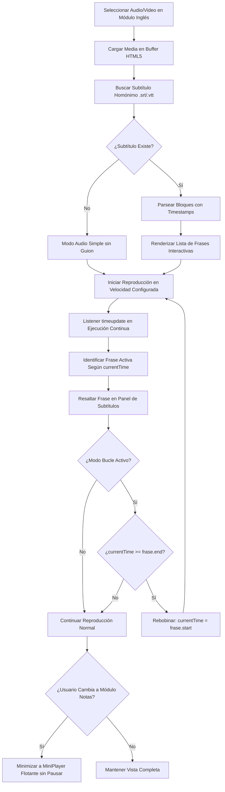

# Especificación de Módulo: MOD-ENGLISH (Reproductor de Inglés y Shadowing)

**Fase:** 03 — Ingeniería de Requisitos  
**Entregable:** 07 de 09 — Especificación Detallada de Módulos  
**Módulo ID:** `MOD-ENGLISH` (13 de 15)  
**Bounded Context:** `LanguageAcquisition` / Inmersión Lingüística y Técnica de Shadowing  
**Ubicación de Almacenamiento:** Archivos multimedia locales (`.mp4`, `.mp3`, `.srt`, `.vtt`) en `Ingles/` y estado en `.notevault/english/player_state.json`  
**Responsable Técnico:** NoteVault Core Engineering  

---

## 1. Alcance y Responsabilidades del Módulo

El módulo `MOD-ENGLISH` proporciona una plataforma avanzada de inmersión auditiva y entrenamiento fonético activo basada en la técnica de *Shadowing* (repetición imitativa sincronizada):

- **Reproductor Multimedia de Alta Fidelidad:** Soporte nativo para audio (`.mp3`, `.m4a`, `.wav`) y video (`.mp4`, `.webm`) con decodificación acelerada por hardware.
- **Sincronización Interactiva de Subtítulos:** Parseo y renderizado de archivos `.srt` y `.vtt` línea por línea. Cada subtítulo es clickeable para saltar de forma instantánea al segundo exacto de la pista.
- **Bucle de Repetición por Frase (*Sentence Shadowing Loop*):** Capacidad de reproducir en bucle continuo una sola oración o fragmento delimitado hasta dominar la prosodia, entonación y enlaces fonéticos (*connected speech*).
- **Modulación de Velocidad con Preservación de Tono (*Pitch Correction*):** Control fino de velocidad (0.5x, 0.75x, 0.9x, 1.0x, 1.2x, 1.5x) sin distorsionar el tono ni agudizar la voz.
- **Mini-Player Flotante Persistente:** Widget compacto en la esquina inferior (`MiniPlayer.tsx`) que permite continuar escuchando el audio mientras el usuario toma notas en `MOD-NOTES` o resuelve ejercicios en `MOD-STUDY`.
- **Captura Inmediata de Vocabulario:** Selección de palabras en los subtítulos para guardarlas con un clic como tarjetas o notas en la carpeta `Ingles/Vocabulario/`.

---

## 2. Marco Conceptual: Entidad Pista de Inmersión en el Dominio

<div class="entity-card">

1. **Entidad principal e independiente.**
2. **Es la entidad líder del conjunto de datos:** posee un identificador global único que corresponde a la ruta relativa del archivo multimedia dentro de la bóveda (`immersion_track_id`: `Ingles/Audios/BBC_6Minute_Artificial_Intelligence.mp3`), invocado por el reproductor principal y el mini-player.
3. **Existe por sí misma en el sistema de archivos sin depender de un catálogo externo**, y es la única responsable de validar que el archivo de subtítulos asociado tenga timestamps cronológicos coherentes antes de iniciar la sincronización.
4. **Punto de entrada y límite de consistencia:** Almacena la última posición temporal de reproducción (*playback offset*) para reanudar el audio exactamente en el segundo donde fue pausado.

</div>

---

## 3. Requisitos Funcionales del Módulo (RF)

| ID RF | Declaración del Requisito Funcional | Prioridad MoSCoW | Criterio de Verificación |
| :--- | :--- | :--- | :--- |
| **RF-ENG-01** | El sistema DEBE reproducir pistas de audio y video locales con soporte para formatos MP3, WAV, M4A, MP4 y WebM. | **Must Have** | Componente `EnglishPlayer.tsx` reproduce multimedia sin dependencias de red. |
| **RF-ENG-02** | El sistema DEBE parsear subtítulos `.srt` y `.vtt`, destacando la frase activa en sincronía con el audio en tiempo real. | **Must Have** | La línea de texto activa cambia de color con un margen de error menor a 50 ms. |
| **RF-ENG-03** | El sistema DEBE permitir activar el modo "Bucle de Frase" (*Sentence Loop*) para repetir indefinidamente la oración activa. | **Must Have** | Al llegar al timestamp final de la frase, el reproductor rebobina automáticamente al inicio. |
| **RF-ENG-04** | El sistema DEBE permitir modular la velocidad de reproducción entre 0.5x y 1.5x conservando el tono natural de la voz. | **Must Have** | La propiedad `preservesPitch = true` del elemento de audio previene el efecto ardilla. |
| **RF-ENG-05** | El sistema DEBE proveer un Mini-Player flotante que permanezca visible al navegar a otros módulos de NoteVault. | **Must Have** | Componente `MiniPlayer.tsx` persiste en el DOM global y responde a play/pausa/saltar frase. |
| **RF-ENG-06** | El sistema DEBE permitir hacer clic sobre cualquier frase del guion para saltar la reproducción a ese instante temporal. | **Should Have** | Clic en el subtítulo actualiza `currentTime` y continúa la reproducción fluidamente. |
| **RF-ENG-07** | El sistema DEBE guardar la posición de reproducción al cerrar la app para reanudar en el mismo punto al volver. | **Should Have** | Persistencia en `.notevault/english/player_state.json` del último timestamp por archivo. |

---

## 4. Requisitos No Funcionales del Módulo (RNF Local)

| ID RNF | Dimensión ISO 25010 | Declaración y Métrica Cuantitativa | Método de Medición |
| :--- | :--- | :--- | :--- |
| **RNF-ENG-01** | Eficiencia de Desempeño | **Latencia de Salto por Subtítulo:** El tiempo entre hacer clic en una frase y la emisión del audio correspondiente debe ser **< 30 ms**. | Medición con AudioContext / HTMLMediaElement eventos de seek. |
| **RNF-ENG-02** | Eficiencia de Recursos | **Consumo de Memoria en Segundo Plano:** El Mini-Player en reproducción de fondo no debe consumir más de **25 MB** de memoria RAM adicional. | Monitoreo del proceso de renderizado en el Administrador de Tareas. |
| **RNF-ENG-03** | Confiabilidad | **Resiliencia ante Subtítulos Corruptos:** Si un archivo SRT contiene timestamps desordenados, el sistema los auto-ordena sin crashear el reproductor. | Test unitario de parseo con subtítulos deliberadamente malformados. |
| **RNF-ENG-04** | Accesibilidad | **Control Total por Atajos de Teclado:** Teclas dedicadas: `Espacio` (play/pause), `J` (retroceder 5s), `L` (avanzar 5s), `[` (frase anterior), `]` (frase siguiente), `R` (activar/desactivar bucle). | Prueba de eventos de teclado en `player.test.ts`. |

---

## 5. Historias de Usuario con Criterios Gherkin

### US-ENG-01: Práctica de Shadowing con bucle de frase
**Como** estudiante aprendiendo pronunciación avanzada en inglés,  
**Quiero** activar el bucle continuo en una frase difícil de un podcast,  
**Para** repetir en voz alta junto al hablante nativo hasta replicar exactamente su ritmo y entonación.

```gherkin
Escenario: Activación de repetición en bucle de una frase
  Dado que el usuario está escuchando un archivo de audio con subtítulos sincronizados
  Cuando presiona la tecla "R" o pulsa el botón "Bucle de Frase"
  Entonces el sistema marca visualmente la frase activa con un contorno brillante
  Y al finalizar la frase, el audio rebobina inmediatamente al segundo inicial de la misma frase
  Y la repetición continúa cíclicamente hasta que el usuario pulse avanzar o desactive el bucle.
```

### US-ENG-02: Uso del Mini-Player mientras se toma notas
**Como** usuario que toma apuntes de un curso en inglés,  
**Quiero** que el reproductor se reduzca a un mini-player flotante cuando cambio a la pestaña de Notas,  
**Para** escribir mis notas sin perder el control de reproducción del audio.

```gherkin
Escenario: Transición automática a Mini-Player
  Dado que una pista de audio está en reproducción activa en el módulo de inglés
  Cuando el usuario hace clic en el módulo "Notas" en la barra lateral
  Entonces la vista completa de video se desacopla y aparece el Mini-Player en la esquina inferior
  Y el audio continúa sonando sin interrupción
  Y los botones de pausar, retroceder y frase siguiente permanecen accesibles en el Mini-Player.
```

---

## 6. Especificación Detallada de Casos de Uso

### UC-ENG-01: Cargar Pista Multimedia y Practicar Shadowing

| Campo | Detalle de Especificación |
| :--- | :--- |
| **ID y Nombre** | `UC-ENG-01` — Cargar Pista Multimedia y Practicar Shadowing |
| **Actor Principal** | Estudiante de Idiomas |
| **Precondición** | Existen archivos multimedia y sus correspondientes subtítulos en la carpeta `Ingles/`. |
| **Flujo Principal** | 1. El usuario selecciona un archivo de audio o video en el explorador de pistas de inglés.<br/>2. El sistema carga el archivo en el elemento multimedia HTML5 nativo.<br/>3. Busca automáticamente un archivo de subtítulos con el mismo nombre y extensión `.srt` o `.vtt`.<br/>4. Parsea los bloques de texto con sus marcas de tiempo inicial y final (`start`, `end`).<br/>5. Presenta la transcripción sincronizada en el panel lateral de subtítulos.<br/>6. El usuario inicia la reproducción y ajusta la velocidad a 0.9x.<br/>7. El sistema resalta en tiempo real la frase que se está pronunciando.<br/>8. El usuario presiona el botón de "Bucle de Frase" sobre una oración específica.<br/>9. El reproductor itera en esa porción mientras el usuario practica el shadowing.<br/>10. El usuario desactiva el bucle y continúa escuchando. |
| **Flujos Alternativos** | **A1 (Pista sin archivo de subtítulos):** El sistema reproduce el archivo como audio/video estándar y ofrece una opción para "Importar archivo de subtítulos manualmente". |
| **Excepciones** | **E1 (Códec multimedia no soportado):** Si el formato del video no es soportado por el motor Chromium/Electron, el sistema muestra advertencia sugiriendo transcodificar a MP4 estándar H.264. |
| **Postcondición** | La posición temporal alcanzada se guarda en memoria y en `player_state.json`. |

---

## 7. Diagrama de Actividad del Módulo



---

## 8. Implicación de Compuerta de Fase (Gate 3 Criteria)

- **¿Bloquea el avance a Modelado/Fase 4?:** No.
- **Condición de Pase:** El reproductor multimedia y el Mini-Player gestionan la memoria y los eventos de audio sin fugas de memoria (*memory leaks*), con soporte total de subtítulos offline.
