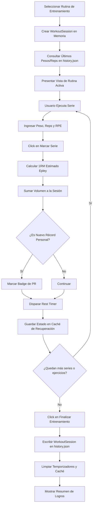

# Especificación de Módulo: MOD-EXERCISE (Ejercicio y Rutinas de Gimnasio)

**Fase:** 03 — Ingeniería de Requisitos  
**Entregable:** 07 de 09 — Especificación Detallada de Módulos  
**Módulo ID:** `MOD-EXERCISE` (06 de 15)  
**Bounded Context:** `PhysicalTraining` / Registro Fisiológico y Sobrecarga Progresiva  
**Ubicación de Almacenamiento:** `.notevault/ejercicio/` (`routines.json`, `history.json`, `exercises.json`)  
**Responsable Técnico:** NoteVault Core Engineering  

---

## 1. Alcance y Responsabilidades del Módulo

El módulo `MOD-EXERCISE` gestiona el entrenamiento de fuerza, la periodización atlética y el registro riguroso de sobrecarga progresiva en el gimnasio:

- **Catálogo Anatómico de Ejercicios:** Base de datos de movimientos clasificados por grupo muscular primario y secundario (pecho, espalda, cuadríceps, femorales, hombros, brazos, core) con enlaces a videos demostrativos locales o web para verificar la técnica.
- **Creador de Rutinas Personalizadas:** Configuración de plantillas de entrenamiento (Push/Pull/Legs, Upper/Lower, Fullbody) con ejercicios ordenados, series objetivo y rangos de repeticiones.
- **Registro de Sesión en Vivo:** Interfaz interactiva de alta velocidad optimizada para móviles y PC que permite registrar cada serie en segundos: peso (kg o lbs), repeticiones completadas, RPE (esfuerzo percibido) y tipo de serie (calentamiento, efectiva, al fallo, drop-set).
- **Temporizador de Descanso Inteligente (*Rest Timer*):** Cronómetro automático tras registrar una serie (ej. 90s, 120s, 180s) con alerta sonora y visual en la barra superior al expirar.
- **Métricas de Rendimiento y 1RM:** Cálculo automático de la repetición máxima estimada (fórmulas de Epley y Brzycki), tonelaje total de la sesión (`peso × reps`) y gráficos históricos de progresión.
- **Coach de Entrenamiento Inteligente:** Módulo analítico (`exerciseCoach.ts`) que audita el volumen semanal y sugiere aumentos de carga o descargas cuando detecta estancamiento.

---

## 2. Marco Conceptual: Entidad Sesión de Entrenamiento en el Dominio

<div class="entity-card">

1. **Entidad principal e independiente.**
2. **Es la entidad líder del conjunto de datos:** posee un identificador global único que combina la fecha y el tipo de rutina (`workout_session_id`: `wrk_2026-10-20_push_hipertrofia`), invocado por el historial de progreso y el evaluador de sobrecarga.
3. **Existe por sí misma en el registro `.notevault/ejercicio/history.json` sin depender de una rutina previa**, y es la única responsable de validar que todas las series registradas contengan peso y repeticiones no negativos antes de archivar la sesión.
4. **Punto de entrada y límite de consistencia:** Al finalizar la sesión, consolida el volumen total levantado y actualiza los récords personales (PRs) del usuario.

</div>

---

## 3. Requisitos Funcionales del Módulo (RF)

| ID RF | Declaración del Requisito Funcional | Prioridad MoSCoW | Criterio de Verificación |
| :--- | :--- | :--- | :--- |
| **RF-GYM-01** | El sistema DEBE permitir registrar sesiones de entrenamiento en tiempo real ingresando series con peso, repeticiones y RPE. | **Must Have** | Componente `ExerciseModule.tsx` añade filas de series y las persiste en `history.json`. |
| **RF-GYM-02** | El sistema DEBE disparar automáticamente un temporizador de descanso con cuenta regresiva al marcar una serie como completada. | **Must Have** | Store `useRestTimer` inicia cuenta regresiva y emite bip sonoro al llegar a 0. |
| **RF-GYM-03** | El sistema DEBE calcular el 1RM estimado por serie utilizando la fórmula de Epley: `1RM = peso * (1 + reps / 30)`. | **Must Have** | Test unitario valida cálculo exacto: 100 kg x 10 reps = 133.3 kg. |
| **RF-GYM-04** | El sistema DEBE presentar la referencia de la sesión anterior (último peso y reps logrados) al lado de cada serie para guiar la sobrecarga. | **Must Have** | La UI muestra etiqueta en gris tenue con los datos de la última sesión registrada. |
| **RF-GYM-05** | El sistema DEBE calcular el tonelaje acumulado de la sesión en tiempo real a medida que se completan series. | **Should Have** | Indicador en cabecera: `Volumen Total: 8,450 kg`. |
| **RF-GYM-06** | El sistema DEBE permitir vincular videos locales en formato MP4 o enlaces web para inspección de técnica biomecánica. | **Should Have** | Botón de video abre un reproductor modal sin perder el estado de la sesión activa. |
| **RF-GYM-07** | El sistema DEBE emitir advertencias de sobreentrenamiento si el volumen semanal para un grupo muscular supera las 22 series efectivas. | **Could Have** | Alerta visual del coach sugiriendo programar un día de descanso o recuperación activa. |

---

## 4. Requisitos No Funcionales del Módulo (RNF Local)

| ID RNF | Dimensión ISO 25010 | Declaración y Métrica Cuantitativa | Método de Medición |
| :--- | :--- | :--- | :--- |
| **RNF-GYM-01** | Eficiencia de Desempeño | **Velocidad de Ingreso de Serie:** El tiempo para registrar peso y reps con teclado numérico o stepper táctil debe ser **< 2 segundos**. | Test de interacción cronometrado en dispositivo móvil real. |
| **RNF-GYM-02** | Confiabilidad | **Preservación de Sesión Activa:** Si la aplicación se cierra inesperadamente en medio de un entrenamiento, el estado de la sesión debe restaurarse al 100%. | Almacenamiento en `localStorage` o archivo temporal tras cada serie completada. |
| **RNF-GYM-03** | Portabilidad | **Soporte de Unidades Doble:** Conversión bidireccional inmediata entre kilogramos (kg) y libras (lbs) con precisión de un decimal. | Test de conversión matemática con redondeo estandarizado a discos olímpicos. |
| **RNF-GYM-04** | Accesibilidad | **Contraste de Temporizador de Descanso:** El cronómetro debe ser legible a 2 metros de distancia con tipografía de alto contraste (mínimo 28px). | Verificación visual y pruebas de contraste WCAG 2.1 AA. |

---

## 5. Historias de Usuario con Criterios Gherkin

### US-GYM-01: Registro de sobrecarga progresiva en press de banca
**Como** atleta de fuerza o levantador en el gimnasio,  
**Quiero** ver cuánto peso y cuántas repeticiones hice la semana pasada en press de banca,  
**Para** intentar hacer una repetición extra hoy y garantizar sobrecarga progresiva.

```gherkin
Escenario: Visualización de marca previa y nuevo récord
  Dado que en la sesión anterior el usuario registró "80 kg x 8 reps" en press de banca
  Cuando el usuario abre la rutina de hoy
  Entonces el sistema muestra "Anterior: 80 kg × 8 reps"
  Y cuando el usuario ingresa "80 kg x 9 reps" y marca la casilla
  Entonces el sistema detecta un nuevo récord de repeticiones (PR)
  Y muestra un distintivo visual de logro superado.
```

### US-GYM-02: Control de descansos entre series con alerta sonora
**Como** usuario entrenando con alta intensidad,  
**Quiero** que un cronómetro me avise exactamente cuándo terminan mis 2 minutos de descanso,  
**Para** no distraerme con el teléfono y mantener la densidad óptima del entrenamiento.

```gherkin
Escenario: Temporizador de descanso finalizado
  Dado que el usuario completa una serie de sentadillas y la marca como realizada
  Cuando el temporizador inicia una cuenta regresiva de 120 segundos
  Y el contador llega a 00:00
  Entonces el sistema emite una señal acústica nítida y una vibración háptica en móvil
  Y la barra superior muestra el mensaje "¡Descanso finalizado! Inicia la serie 2".
```

---

## 6. Especificación Detallada de Casos de Uso

### UC-GYM-01: Iniciar Sesión de Ejercicio y Registrar Series

| Campo | Detalle de Especificación |
| :--- | :--- |
| **ID y Nombre** | `UC-GYM-01` — Iniciar Sesión de Ejercicio y Registrar Series |
| **Actor Principal** | Usuario Registrado / Atleta |
| **Precondición** | Existen ejercicios catalogados en `.notevault/ejercicio/exercises.json`. |
| **Flujo Principal** | 1. El usuario selecciona una rutina predeterminada o crea una sesión libre.<br/>2. El sistema carga los ejercicios y busca el último registro de cada uno en el historial.<br/>3. El usuario realiza la primera serie e ingresa el peso utilizado y las repeticiones logradas.<br/>4. El usuario presiona el botón "Completar Serie".<br/>5. El sistema marca la serie en verde, recalcula el 1RM estimado y el volumen total.<br/>6. El sistema arranca automáticamente el temporizador de descanso configurado para ese ejercicio.<br/>7. El usuario repite los pasos 3 a 6 para las series restantes.<br/>8. El usuario presiona "Finalizar Entrenamiento".<br/>9. El sistema archiva la sesión en `.notevault/ejercicio/history.json` mediante guardado atómico y muestra el resumen de volumen y PRs logrados. |
| **Flujos Alternativos** | **A1 (Añadir ejercicio improvisado):** El usuario pulsa "+ Agregar Ejercicio", busca "Dominadas" en el catálogo y lo añade a la sesión activa conservando el orden de ejecución. |
| **Excepciones** | **E1 (Cierre accidental de la app):** Al volver a abrir NoteVault, el sistema detecta una sesión no finalizada con antigüedad menor a 4 horas y ofrece "Continuar entrenamiento en curso". |
| **Postcondición** | El archivo `history.json` contiene la nueva sesión registrada y los gráficos de progresión se actualizan. |

---

## 7. Diagrama de Actividad del Módulo



---

## 8. Implicación de Compuerta de Fase (Gate 3 Criteria)

- **¿Bloquea el avance a Modelado/Fase 4?:** No.
- **Condición de Pase:** El motor de registro de series y el temporizador de descanso operan en un estado desacoplado de la UI principal, con serialización atómica que previene la pérdida de entrenamientos ante apagados del dispositivo.
