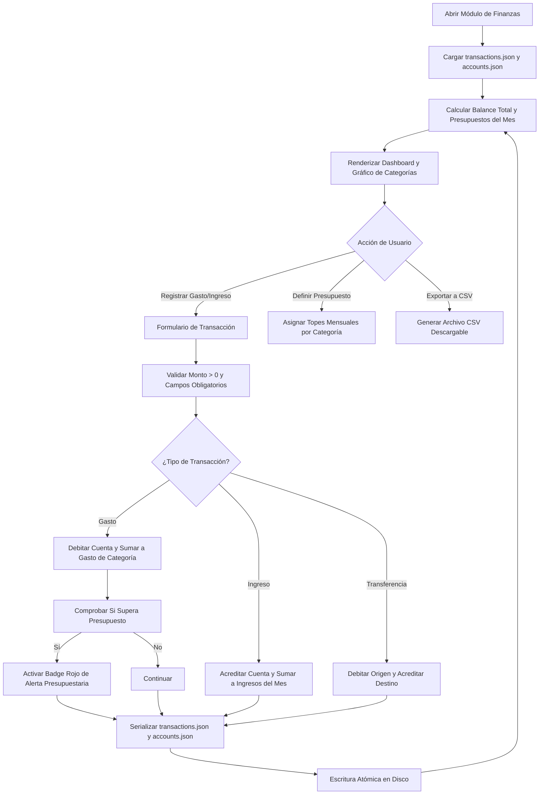

# Especificación de Módulo: MOD-FINANCE (Finanzas Personales y Presupuesto)

**Fase:** 03 — Ingeniería de Requisitos  
**Entregable:** 07 de 09 — Especificación Detallada de Módulos  
**Módulo ID:** `MOD-FINANCE` (11 de 15)  
**Bounded Context:** `PersonalAccounting` / Contabilidad Personal y Presupuestos  
**Ubicación de Almacenamiento:** `.notevault/finanzas/` (`transactions.json`, `budgets.json`, `accounts.json`)  
**Responsable Técnico:** NoteVault Core Engineering  

---

## 1. Alcance y Responsabilidades del Módulo

El módulo `MOD-FINANCE` proporciona un sistema local de contabilidad de doble partida simplificada, gestión de presupuestos y control de flujo de caja:

- **Libro Diario de Transacciones:** Registro minucioso de ingresos (*income*), gastos (*expense*) y transferencias entre cuentas, capturando fecha, monto numérico, moneda, categoría, cuenta origen/destino y notas descriptivas.
- **Gestión de Cuentas Financieras:** Soporte para múltiples cuentas (Efectivo, Cuenta Bancaria, Tarjeta de Crédito, Billetera Digital, Ahorro/Inversión) con balance actualizado en tiempo real.
- **Presupuestos Mensuales por Categoría:** Asignación de topes de gasto mensual (Vivienda, Alimentación, Transporte, Educación, Entretenimiento, Salud) con barras de ejecución en semáforo (Verde < 70%, Ámbar 70-95%, Rojo > 100%).
- **Análisis Gráfico de Flujo de Caja:** Gráficos interactivos de ingresos vs gastos mensuales, tasa de ahorro acumulada y desglose porcentual de gastos por categoría.
- **Coach Financiero Local:** Motor analítico (`financeCoach.ts`) que identifica gastos recurrentes, detecta desvíos atípicos en categorías y proyecta la fecha estimada de cumplimiento de metas de ahorro.
- **Privacidad Financiera Absoluta:** 100% de los datos bancarios y montos residen en disco en formato JSON cifrable localmente, sin conexión a agregadores bancarios de terceros.

---

## 2. Marco Conceptual: Entidad Transacción Financiera en el Dominio

<div class="entity-card">

1. **Entidad principal e independiente.**
2. **Es la entidad líder del conjunto de datos:** posee un identificador global único alfanumérico inmutable (`transaction_id`: `txn_20261020_exp_supermercado`), invocado por los balances de cuentas y el cálculo presupuestario.
3. **Existe por sí misma en el registro `.notevault/finanzas/transactions.json` sin depender de una cuenta padre**, y es la única responsable de validar que el monto sea un valor estrictamente positivo y que la fecha corresponda a un formato ISO válido antes de ser persistida.
4. **Punto de entrada y límite de consistencia:** Cada inserción o anulación de transacción actualiza atómicamente el saldo disponible de las cuentas asociadas y el acumulado de la categoría correspondiente.

</div>

---

## 3. Requisitos Funcionales del Módulo (RF)

| ID RF | Declaración del Requisito Funcional | Prioridad MoSCoW | Criterio de Verificación |
| :--- | :--- | :--- | :--- |
| **RF-FIN-01** | El sistema DEBE permitir registrar transacciones de ingreso, gasto y transferencia indicando monto, fecha, categoría y cuenta. | **Must Have** | Componente `FinanceModule.tsx` agrega la transacción y actualiza saldos al instante. |
| **RF-FIN-02** | El sistema DEBE calcular y mostrar el balance neto actual sumando todas las cuentas financieras activas. | **Must Have** | Balance Total = Suma(Ingresos) - Suma(Gastos) en el mes seleccionado. |
| **RF-FIN-03** | El sistema DEBE permitir definir presupuestos mensuales máximos por categoría y mostrar el porcentaje consumido. | **Must Have** | Alerta visual en rojo si `gasto_categoria > presupuesto_asignado`. |
| **RF-FIN-04** | El sistema DEBE permitir crear, editar y archivar cuentas bancarias o billeteras con su saldo inicial. | **Must Have** | Las transacciones imputadas a una cuenta debitan o acreditan su saldo reactivamente. |
| **RF-FIN-05** | El sistema DEBE presentar un gráfico mensual de distribución de gastos agrupado por categorías principales. | **Should Have** | Gráfico de dona o barras horizontales renderiza proporciones exactas. |
| **RF-FIN-06** | El sistema DEBE permitir exportar el historial de transacciones a formato CSV para auditorías en hojas de cálculo externas. | **Should Have** | Generación de archivo descargable con campos: ID, Fecha, Tipo, Categoría, Monto, Cuenta. |
| **RF-FIN-07** | El sistema DEBE emitir advertencias proactivas mediante `financeCoach.ts` cuando el ritmo de gasto proyecte agotar el presupuesto antes de fin de mes. | **Could Have** | Alerta no intrusiva: "Al ritmo actual, el presupuesto de Ocio se superará el día 22". |

---

## 4. Requisitos No Funcionales del Módulo (RNF Local)

| ID RNF | Dimensión ISO 25010 | Declaración y Métrica Cuantitativa | Método de Medición |
| :--- | :--- | :--- | :--- |
| **RNF-FIN-01** | Eficiencia de Desempeño | **Velocidad de Balance:** El cálculo de saldos y agregaciones sobre un historial de **10,000 transacciones** debe tardar **< 20 ms**. | Benchmark de agregación de arrays en `useFinance`. |
| **RNF-FIN-02** | Confiabilidad | **Precisión Monetaria:** Todas las operaciones de montos deben almacenarse en centavos enteros o con aritmética decimal fija para evitar errores de coma flotante (`0.1 + 0.2`). | Test unitario con sumas fraccionarias acumuladas. |
| **RNF-FIN-03** | Seguridad | **Privacidad Local:** El módulo jamás debe enviar montos, descripciones o balances a ningún servidor o servicio analítico remoto. | Inspección de tráfico de red en tests E2E certificando 0 peticiones salientes. |
| **RNF-FIN-04** | Usabilidad | **Soporte de Moneda Configurable:** Capacidad de formatear montos en moneda local (USD, EUR, COP, MXN, etc.) con sus símbolos y separadores de miles/decimales. | Test de formateo con `Intl.NumberFormat`. |

---

## 5. Historias de Usuario con Criterios Gherkin

### US-FIN-01: Registro rápido de gasto y actualización de presupuesto
**Como** usuario que cuida sus finanzas personales,  
**Quiero** registrar un gasto de supermercado de $45.00 en mi cuenta bancaria,  
**Para** verificar cuánto dinero me queda disponible en mi presupuesto de Alimentación para el resto del mes.

```gherkin
Escenario: Registro de gasto e impacto presupuestario
  Dado que el presupuesto de "Alimentación" tiene un tope de $300.00 y lleva gastado $180.00
  Cuando el usuario registra un gasto de $45.00 con categoría "Alimentación"
  Entonces el sistema debita $45.00 del saldo de la cuenta
  Y el acumulado de la categoría sube a $225.00 (75% del presupuesto)
  Y la barra de progreso cambia de verde a color ámbar de advertencia
  Y la transacción se guarda atómicamente en "transactions.json".
```

---

## 6. Especificación Detallada de Casos de Uso

### UC-FIN-01: Registrar Transacción Financiera

| Campo | Detalle de Especificación |
| :--- | :--- |
| **ID y Nombre** | `UC-FIN-01` — Registrar Transacción Financiera |
| **Actor Principal** | Usuario Registrado |
| **Precondición** | Existe al menos una cuenta financiera configurada en `.notevault/finanzas/accounts.json`. |
| **Flujo Principal** | 1. El usuario pulsa "+ Nueva Transacción".<br/>2. Selecciona el tipo: Gasto, Ingreso o Transferencia.<br/>3. Ingresa el monto numérico y la fecha (por defecto hoy).<br/>4. Selecciona la categoría (ej. "Transporte") y la cuenta (ej. "Efectivo").<br/>5. Añade una nota descriptiva opcional.<br/>6. Pulsa "Confirmar Transacción".<br/>7. El sistema valida que el monto sea > 0 y genera el ID de transacción.<br/>8. Añade la transacción al registro en memoria y actualiza el saldo de la cuenta.<br/>9. Si es un gasto, suma el monto al presupuesto de la categoría correspondiente.<br/>10. Ejecuta la escritura atómica en `.notevault/finanzas/transactions.json`.<br/>11. Muestra la transacción en la parte superior del listado histórico. |
| **Flujos Alternativos** | **A1 (Transferencia entre cuentas):** Si el tipo es "Transferencia", el usuario selecciona cuenta origen y cuenta destino. El sistema debita la cuenta origen y acredita la cuenta destino en una única transacción atómica. |
| **Excepciones** | **E1 (Monto negativo o cero):** El sistema bloquea el registro y resalta el campo de monto con mensaje "El monto debe ser superior a 0". |
| **Postcondición** | El archivo `transactions.json` almacena el registro y el balance global de la cuenta queda actualizado. |

---

## 7. Diagrama de Actividad del Módulo



---

## 8. Implicación de Compuerta de Fase (Gate 3 Criteria)

- **¿Bloquea el avance a Modelado/Fase 4?:** No.
- **Condición de Pase:** Las rutinas de cálculo financiero utilizan precisión decimal exacta sin desbordamiento de punto flotante y operan con persistencia local simétrica entre plataformas.
