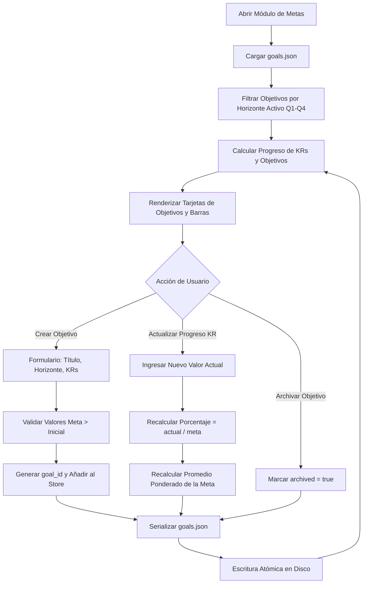

# Especificación de Módulo: MOD-GOALS (Metas y OKRs)

**Fase:** 03 — Ingeniería de Requisitos  
**Entregable:** 07 de 09 — Especificación Detallada de Módulos  
**Módulo ID:** `MOD-GOALS` (10 de 15)  
**Bounded Context:** `StrategicAlignment` / Definición de Objetivos y Resultados Clave  
**Ubicación de Almacenamiento:** `.notevault/metas/goals.json`  
**Responsable Técnico:** NoteVault Core Engineering  

---

## 1. Alcance y Responsabilidades del Módulo

El módulo `MOD-GOALS` gestiona la visión estratégica a mediano y largo plazo del usuario, utilizando el marco de Objetivos y Resultados Clave (OKRs):

- **Jerarquía Estratégica:** Definición estructurada en tres niveles temporales: Visión Anual, Objetivos Trimestrales (Q1 a Q4) y Metas Mensuales.
- **Resultados Clave Cuantitativos (Key Results):** Cada objetivo define entre 1 y 5 resultados clave medibles cuantitativamente (ej. "Aprobar 8 materias", "Alcanzar 12% de grasa corporal", "Desarrollar 3 aplicaciones en Flutter").
- **Conexión Operativa:** Vinculación directa con proyectos de `MOD-PROJECTS`, hábitos de `MOD-HABITS` y temas de estudio de `MOD-STUDY`.
- **Cálculo Automático de Progreso:** Ponderación porcentual de avance basada en el cumplimiento de los resultados clave asociados.
- **Panel de Alineación y Retrospectiva:** Indicadores de desviación temporal y reflexión sobre metas alcanzadas o descartadas.

---

## 2. Marco Conceptual: Entidad Meta en el Dominio

<div class="entity-card">

1. **Entidad principal e independiente.**
2. **Es la entidad líder del conjunto de datos:** posee un identificador global único (`goal_id`: `gol_2026_q4_certificacion_matematicas`), invocado por el planificador del mentor y el tablero de control anual.
3. **Existe por sí misma en el registro `.notevault/metas/goals.json` sin depender de las tareas operativas asociadas**, y es la única responsable de validar que los valores meta cuantitativos sean mayores al valor inicial antes de confirmar la planificación.
4. **Punto de entrada y límite de consistencia:** El avance registrado en sus resultados clave actualiza el porcentaje de cumplimiento sin generar efectos secundarios no deseados en los registros de tareas individuales.

</div>

---

## 3. Requisitos Funcionales del Módulo (RF)

| ID RF | Declaración del Requisito Funcional | Prioridad MoSCoW | Criterio de Verificación |
| :--- | :--- | :--- | :--- |
| **RF-GOL-01** | El sistema DEBE permitir crear objetivos estratégicos asignándoles horizonte temporal (Año, Trimestre, Mes) y categoría. | **Must Have** | Componente `GoalsModule.tsx` persiste nuevos objetivos en `goals.json`. |
| **RF-GOL-02** | El sistema DEBE permitir añadir resultados clave cuantificables con valor inicial, valor actual y valor meta con su unidad de medida. | **Must Have** | Vitest: KR con inicial 0, actual 50 y meta 100 reporta 50% de progreso. |
| **RF-GOL-03** | El sistema DEBE calcular el avance porcentual del objetivo promediando el progreso ponderado de todos sus resultados clave. | **Must Have** | Visualización de barra de progreso con gradiente de color según el porcentaje. |
| **RF-GOL-04** | El sistema DEBE permitir asociar un objetivo a proyectos específicos de `MOD-PROJECTS` o materias de `MOD-STUDY`. | **Should Have** | Al completar proyectos vinculados, se sugiere la actualización del resultado clave asociado. |
| **RF-GOL-05** | El sistema DEBE proveer un resumen de retrospectiva al finalizar el trimestre para archivar metas y extraer aprendizajes. | **Should Have** | Botón "Cerrar Trimestre" genera un resumen estructurado exportable a Markdown. |
| **RF-GOL-06** | El sistema DEBE emitir avisos de desaceleración si el ritmo de progreso actual proyecta no alcanzar la meta antes de la fecha límite. | **Could Have** | Alerta visual en la tarjeta del objetivo indicando desfase temporal estimado. |

---

## 4. Requisitos No Funcionales del Módulo (RNF Local)

| ID RNF | Dimensión ISO 25010 | Declaración y Métrica Cuantitativa | Método de Medición |
| :--- | :--- | :--- | :--- |
| **RNF-GOL-01** | Eficiencia de Desempeño | **Tiempo de Recálculo de Progreso:** La actualización del avance porcentual en memoria tras modificar un KR debe tomar **< 5 ms**. | Medición de ejecución en el store `useGoals`. |
| **RNF-GOL-02** | Confiabilidad | **Preservación Histórica:** Las metas archivadas de trimestres pasados deben ser inmutables contra sobreescrituras accidentales. | Flag `archived: true` bloquea edición destructiva en la interfaz. |
| **RNF-GOL-03** | Usabilidad | **Claridad Visual de Prioridad:** Las metas deben ordenarse por impacto estratégico y proximidad de la fecha límite. | Evaluación visual de contraste y jerarquía tipográfica. |
| **RNF-GOL-04** | Seguridad | **Validación de Límites Numéricos:** El sistema debe impedir valores de meta negativos o divisiones por cero en el cálculo de ratios. | Test unitario con casos borde (`target == initial`). |

---

## 5. Historias de Usuario con Criterios Gherkin

### US-GOL-01: Seguimiento de resultado clave trimestral
**Como** estudiante enfocado en dominar Álgebra Abstracta este trimestre,  
**Quiero** actualizar el progreso de mi resultado clave "Resolver 60 ejercicios del libro",  
**Para** ver cómo se incrementa el porcentaje de mi objetivo general de semestre.

```gherkin
Escenario: Actualización de avance en resultado clave
  Dado que el KR "Resolver ejercicios" tiene valor inicial 0, actual 20 y meta 60 (33.3%)
  Cuando el usuario actualiza el valor actual a 30
  Entonces el sistema recalcula el progreso individual a 50%
  Y actualiza inmediatamente el porcentaje general del objetivo padre
  Y persiste el nuevo valor en ".notevault/metas/goals.json".
```

---

## 6. Especificación Detallada de Casos de Uso

### UC-GOL-01: Crear Objetivo Estratégico y Definir KRs

| Campo | Detalle de Especificación |
| :--- | :--- |
| **ID y Nombre** | `UC-GOL-01` — Crear Objetivo Estratégico y Definir KRs |
| **Actor Principal** | Usuario Registrado |
| **Precondición** | La aplicación NoteVault está abierta y el store `useGoals` inicializado. |
| **Flujo Principal** | 1. El usuario navega al módulo "Metas" y presiona "+ Nuevo Objetivo".<br/>2. Ingresa el título del objetivo (ej. "Dominar Desarrollo Multiplataforma") y el horizonte (ej. "Q4 2026").<br/>3. Presiona "+ Añadir Resultado Clave".<br/>4. Define el KR (ej. "Construir 2 aplicaciones en Flutter"), especificando meta: 2, unidad: "apps".<br/>5. Presiona "Guardar Objetivo".<br/>6. El sistema genera el identificador único, valida los parámetros numéricos y lo almacena en memoria.<br/>7. Ejecuta la escritura atómica sobre `.notevault/metas/goals.json`.<br/>8. El nuevo objetivo se muestra en el panel del trimestre activo con barra de progreso en 0%. |
| **Flujos Alternativos** | **A1 (Objetivo cualitativo):** Si el objetivo es binario (ej. "Lanzar versión 1.0"), se define un único KR de tipo completado (0 o 1). |
| **Excepciones** | **E1 (Meta menor o igual a valor inicial):** Si el usuario ingresa un valor meta ≤ valor inicial, el sistema impide el guardado y resalta el campo con un mensaje de validación. |
| **Postcondición** | El archivo `goals.json` refleja el nuevo objetivo y el resumen estratégico anual se recalcula. |

---

## 7. Diagrama de Actividad del Módulo



---

## 8. Implicación de Compuerta de Fase (Gate 3 Criteria)

- **¿Bloquea el avance a Modelado/Fase 4?:** No.
- **Condición de Pase:** El esquema de metas y OKRs modela con exactitud la trazabilidad entre visión estratégica y ejecución diaria, con persistencia determinista local.
