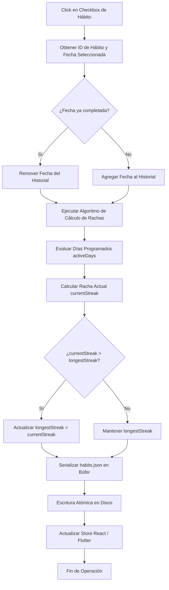

# Especificación de Módulo: MOD-HABITS (Hábitos y Journaling)

**Fase:** 03 — Ingeniería de Requisitos  
**Entregable:** 07 de 09 — Especificación Detallada de Módulos  
**Módulo ID:** `MOD-HABITS` (05 de 15)  
**Bounded Context:** `BehaviorTracker` / Formación de Hábitos y Registro Reflexivo  
**Ubicación de Almacenamiento:** `.notevault/habits/habits.json` y notas de diario en `1.PERSONAL/Diario/`  
**Responsable Técnico:** NoteVault Core Engineering  

---

## 1. Alcance y Responsabilidades del Módulo

El módulo `MOD-HABITS` gestiona la disciplina diaria, el seguimiento de hábitos atómicos y la reflexión consciente del usuario:

- **Catálogo de Hábitos Configurables:** Definición estructurada de hábitos según el modelo de Charles Duhigg y James Clear: Señal (*Cue*), Rutina (*Routine*) y Recompensa (*Reward*), frecuencia (diaria, días específicos de la semana) y meta cuantitativa o binaria.
- **Registro Diario y Rachas Continuas:** Checkbox diario interactivo con cálculo automático y riguroso de racha actual (*current streak*), racha histórica récord (*longest streak*) y porcentaje de adherencia global.
- **Matriz Semanal y Heatmap Mensual:** Visualización gráfica del progreso a lo largo de los días de la semana y mapa de calor visual de cumplimiento acumulado.
- **Vínculo con el Diario Personal (Journaling):** Generación y enlace con notas de reflexión diaria en Markdown (`YYYY-MM-DD.md`) que capturan el estado de ánimo, lecciones aprendidas y dificultades superadas.
- **Persistencia Local Determinista:** Almacenamiento directo en el archivo `.notevault/habits/habits.json` con respaldo automático y sincronización simétrica entre clientes de escritorio y móviles.

---

## 2. Marco Conceptual: Entidad Hábito en el Dominio

<div class="entity-card">

1. **Entidad principal e independiente.**
2. **Es la entidad líder del conjunto de datos:** posee un identificador global único inmutable (`habit_id`: `hbt_lectura_matutina_01`), invocado por el panel Home, el cálculo de rachas y los informes de progreso.
3. **Existe por sí misma en el registro `.notevault/habits/habits.json` sin depender de una nota padre**, y es la única responsable de validar que el historial de fechas cumplidas sea coherente y no contenga duplicados antes de confirmar cambios.
4. **Punto de entrada y límite de consistencia:** El registro de completitud de un día actualiza atómicamente el estado del hábito y recalcula las rachas sin requerir recálculos masivos de la base de datos.

</div>

---

## 3. Requisitos Funcionales del Módulo (RF)

| ID RF | Declaración del Requisito Funcional | Prioridad MoSCoW | Criterio de Verificación |
| :--- | :--- | :--- | :--- |
| **RF-HAB-01** | El sistema DEBE permitir crear, editar, archivar y eliminar hábitos con nombre, frecuencia de días, señal, rutina y recompensa. | **Must Have** | Operaciones CRUD completas persisten en `.notevault/habits/habits.json`. |
| **RF-HAB-02** | El sistema DEBE calcular automáticamente la racha continua de días cumplidos basándose en la fecha actual y la zona horaria local. | **Must Have** | Si un hábito diario no se cumple un día programado, la racha actual reinicia a 0. |
| **RF-HAB-03** | El sistema DEBE permitir marcar o desmarcar el cumplimiento de un hábito para la fecha de hoy o fechas pasadas del mes activo. | **Must Have** | Mutación reactiva actualiza la vista inmediatamente y guarda en < 50 ms. |
| **RF-HAB-04** | El sistema DEBE mostrar una matriz semanal que presente los últimos 7 días con estados completado/pendiente por cada hábito. | **Must Have** | Componente `HabitsModule.tsx` renderiza la grilla con estados visuales contrastados. |
| **RF-HAB-05** | El sistema DEBE enlazar la fecha seleccionada con la nota de diario correspondiente en `1.PERSONAL/Diario/YYYY-MM-DD.md`. | **Should Have** | Clic en el botón "Abrir Diario" abre la nota en el editor o la crea con plantilla base. |
| **RF-HAB-06** | El sistema DEBE calcular el índice de consistencia mensual (`(días_cumplidos / días_programados) * 100`). | **Should Have** | Indicador porcentual con badge coloreado (Verde ≥ 80%, Amarillo 50-79%, Rojo < 50%). |
| **RF-HAB-07** | El sistema DEBE permitir reordenar la lista de hábitos mediante arrastrar y soltar (*drag and drop*). | **Could Have** | La posición serializada en el array JSON refleja el nuevo orden elegido por el usuario. |

---

## 4. Requisitos No Funcionales del Módulo (RNF Local)

| ID RNF | Dimensión ISO 25010 | Declaración y Métrica Cuantitativa | Método de Medición |
| :--- | :--- | :--- | :--- |
| **RNF-HAB-01** | Eficiencia de Desempeño | **Latencia de Registro de Checkbox:** El tiempo desde el clic del usuario hasta la confirmación visual debe ser **< 16 ms**. | Medición con `requestAnimationFrame` en suite de tests Vitest. |
| **RNF-HAB-02** | Confiabilidad | **Algoritmo de Racha Determinista:** El cálculo de rachas no debe arrojar falsos ceros al cruzar cambios de mes o años bisiestos. | Suite de tests unitarios con fechas límite (28 Feb -> 1 Mar, 31 Dic -> 1 Ene). |
| **RNF-HAB-03** | Portabilidad | **Paridad de Formato Desktop-Móvil:** El archivo `habits.json` debe ser consumido de forma idéntica por el cliente Flutter en Android y el cliente React en PC. | Test de integración cruzada leyendo el mismo JSON sintético. |
| **RNF-HAB-04** | Seguridad | **Cero Pérdida de Datos en Sobrescritura:** Cada escritura a `habits.json` debe ejecutarse con reemplazo atómico de archivo temporal. | Test de corte abrupto de proceso I/O durante escritura. |

---

## 5. Historias de Usuario con Criterios Gherkin

### US-HAB-01: Registro de cumplimiento diario de hábito
**Como** persona que busca afianzar el hábito de meditación matutina,  
**Quiero** marcar el hábito como cumplido hoy y ver cómo aumenta mi racha,  
**Para** mantenerme motivado mediante el refuerzo visual del progreso acumulado.

```gherkin
Escenario: Incremento de racha al completar hábito hoy
  Dado que el hábito "Meditación 10 min" tiene una racha actual de 14 días
  Y hoy aún no ha sido marcado como completado
  Cuando el usuario hace clic en el checkbox del día de hoy
  Entonces el sistema marca la casilla con un ícono de verificación
  Y la racha actual se actualiza inmediatamente a 15 días
  Y el archivo "habits.json" registra la fecha "2026-10-20" en la lista de completados.
```

### US-HAB-02: Creación de nuevo hábito con días personalizados
**Como** estudiante universitario,  
**Quiero** crear un hábito de repaso de inglés aplicable únicamente de lunes a viernes,  
**Para** que los fines de semana no penalicen ni rompan mi racha de consistencia.

```gherkin
Escenario: Hábito con días laborales exclusivamente
  Dado que el usuario abre el modal de "Nuevo Hábito"
  Cuando ingresa "Listening 20m" y desmarca los días Sábado y Domingo
  Entonces el sistema guarda la configuración "activeDays: [1, 2, 3, 4, 5]"
  Y el cálculo de racha no penaliza la ausencia de registro durante los fines de semana.
```

---

## 6. Especificación Detallada de Casos de Uso

### UC-HAB-01: Marcar Hábito y Recalcular Rachas

| Campo | Detalle de Especificación |
| :--- | :--- |
| **ID y Nombre** | `UC-HAB-01` — Marcar Hábito y Recalcular Rachas |
| **Actor Principal** | Usuario Registrado |
| **Precondición** | El archivo `.notevault/habits/habits.json` existe y contiene al menos un hábito activo. |
| **Flujo Principal** | 1. El usuario visualiza la grilla de hábitos del módulo o del widget Home.<br/>2. El usuario hace clic sobre el checkbox de un hábito para la fecha indicada.<br/>3. El sistema valida si la fecha ya estaba marcada: si no lo estaba, la agrega al array `completedDates`; si lo estaba, la remueve (*toggle*).<br/>4. El sistema ejecuta el algoritmo de cálculo de racha hacia atrás desde la fecha actual evaluando los días programados.<br/>5. Si la racha actual supera la histórica, actualiza `longestStreak`.<br/>6. El sistema serializa el JSON actualizado a un archivo temporal `.notevault/habits/habits.tmp`.<br/>7. El sistema renombra atómicamente el archivo temporal sobre `habits.json`.<br/>8. El sistema actualiza los componentes dependientes en la UI (Home, Estadísticas). |
| **Flujos Alternativos** | **A1 (Hábito cuantitativo):** Si el hábito requiere registrar un valor numérico (ej. "Litros de agua: 2.5 L"), el sistema abre un micro-input numérico y valida que sea ≥ al objetivo antes de marcar el día. |
| **Excepciones** | **E1 (Corrupción de JSON):** Si `habits.json` no puede parsearse, el sistema lo renombra a `habits.corrupt.bak`, inicializa una lista vacía y alerta al usuario permitiendo restaurar el respaldo. |
| **Postcondición** | El historial del hábito refleja la nueva fecha y las métricas de racha se mantienen consistentes. |

---

## 7. Diagrama de Actividad del Módulo



---

## 8. Implicación de Compuerta de Fase (Gate 3 Criteria)

- **¿Bloquea el avance a Modelado/Fase 4?:** No.
- **Condición de Pase:** El esquema de persistencia de hábitos está blindado ante inconsistencias de calendario y cuenta con pruebas unitarias exhaustivas para escenarios de cambio de año y días no programados.
