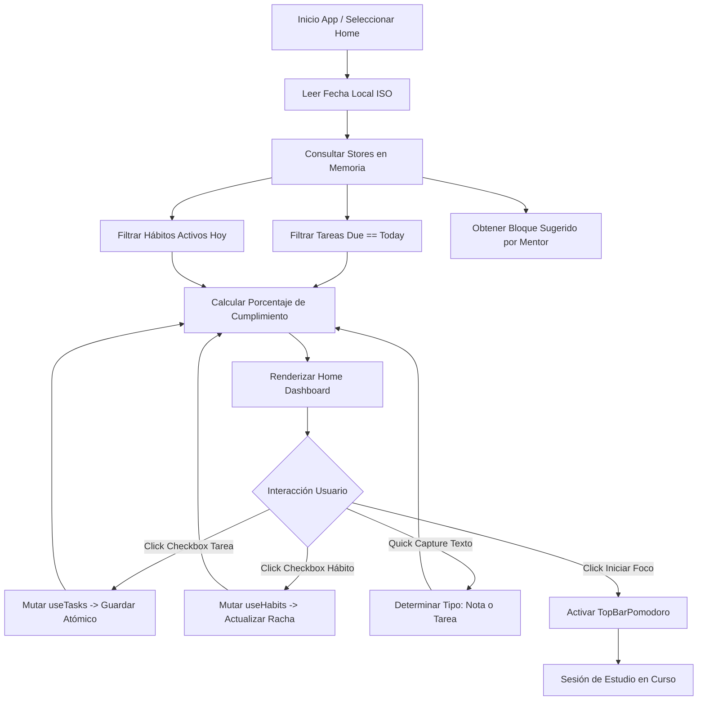

# Especificación de Módulo: MOD-HOME (Vista General y Hub Diario)

**Fase:** 03 — Ingeniería de Requisitos  
**Entregable:** 07 de 09 — Especificación Detallada de Módulos  
**Módulo ID:** `MOD-HOME` (02 de 15)  
**Bounded Context:** `DailyProductivityHub` / Tablero de Comando  
**Ubicación de Almacenamiento:** Síntesis reactiva en memoria y configuración en `.notevault/home/preferences.json`  
**Responsable Técnico:** NoteVault Core Engineering  

---

## 1. Alcance y Responsabilidades del Módulo

El módulo `MOD-HOME` es la pantalla de bienvenida y centro de mando matutino de NoteVault. Consolida en un solo panel interactivo el pulso integral del usuario para la jornada:

- **Alineación Matutina y Bienvenida:** Saludo dinámico dependiente de la franja horaria, fecha en lenguaje natural y frase de enfoque o reflexión diaria.
- **Resumen Ejecutivo de Tareas:** Proyección inmediata de tareas vencidas, tareas prioritarias programadas para hoy (`P1` y `P2`) y atajo de completado rápido con un solo clic.
- **Widget de Rachas y Hábitos:** Lista interactiva de hábitos diarios con checkboxes directos y medidor visual de completitud porcentual de la rutina.
- **Acceso Rápido al Pomodoro y Mentor:** Panel de inicio de sesión de estudio con selector de materia (Matemáticas, Programación, Inglés) y cuenta regresiva activa.
- **Captura Rápida de Pensamientos (*Quick Capture*):** Entrada de texto veloz para registrar una nota borrador o una tarea imprevista sin navegar a otros módulos.
- **Línea de Tiempo del Día:** Representación cronológica de eventos programados, descansos y bloques de trabajo.

---

## 2. Marco Conceptual: Entidad Hub Diario en el Dominio

<div class="entity-card">

1. **Entidad principal e independiente.**
2. **Es la entidad líder del conjunto de datos:** posee un identificador global único basado en la fecha ISO local del usuario (`daily_hub_id`: `2026-10-20`), invocado para agregar todas las métricas de desempeño de la jornada.
3. **Existe por sí misma en el almacenamiento de estado diario sin depender de las entidades secundarias que agrega**, y es la única responsable de computar el índice de adherencia global del día antes de archivar el balance diario.
4. **Punto de entrada y límite de consistencia:** Centraliza la apertura de la sesión de trabajo y valida que los estados transitorios de la interfaz se persistan correctamente.

</div>

---

## 3. Requisitos Funcionales del Módulo (RF)

| ID RF | Declaración del Requisito Funcional | Prioridad MoSCoW | Criterio de Verificación |
| :--- | :--- | :--- | :--- |
| **RF-HOME-01** | El sistema DEBE presentar al iniciar la aplicación un panel central unificado que agregue tareas de hoy, hábitos diarios y el estado del mentor. | **Must Have** | Componente `HomeModule.tsx` carga sin errores en < 20 ms. |
| **RF-HOME-02** | El sistema DEBE permitir marcar tareas y hábitos como completados directamente desde la vista Home sin cambiar de módulo. | **Must Have** | Al pulsar el checkbox en Home, se propaga la mutación atómica a los stores `useTasks` y `useHabits`. |
| **RF-HOME-03** | El sistema DEBE mostrar el porcentaje de avance de la jornada mediante una barra de progreso calculada sobre hábitos y tareas del día. | **Must Have** | Cálculo reactivo de `(completados / total) * 100` con actualización instantánea. |
| **RF-HOME-04** | El sistema DEBE proveer un campo de entrada rápida (*Quick Capture*) que cree una nota en la bandeja de entrada o una tarea según la sintaxis ingresada. | **Should Have** | Prefijo `[]` o `TODO:` crea una tarea; texto libre crea un borrador en `Inbox/`. |
| **RF-HOME-05** | El sistema DEBE ofrecer un botón de inicio rápido de sesión Pomodoro configurado con los parámetros definidos por el Mentor IA. | **Should Have** | Al hacer clic en "Iniciar Foco", arranca el temporizador en la barra superior (`TopBarPomodoro`). |
| **RF-HOME-06** | El sistema DEBE actualizar en tiempo real el reloj digital y el saludo según la hora del sistema (Mañana, Tarde, Noche). | **Could Have** | Actualización por temporizador de 60 segundos sin re-renderizar componentes estáticos. |

---

## 4. Requisitos No Funcionales del Módulo (RNF Local)

| ID RNF | Dimensión ISO 25010 | Declaración y Métrica Cuantitativa | Método de Medición |
| :--- | :--- | :--- | :--- |
| **RNF-HOME-01** | Eficiencia de Desempeño | **Tiempo de Ensamblaje Inicial:** El panel de Home debe montarse y renderizar sus widgets agregados en **< 25 ms**. | Medición con `performance.mark` en montaje de componente. |
| **RNF-HOME-02** | Usabilidad | **Eficiencia Operativa:** Un usuario debe poder completar el 100% de su revisión matutina en **< 30 segundos** sin abrir más de una pantalla. | Test de usabilidad con 5 usuarios y cronometrado de flujos. |
| **RNF-HOME-03** | Confiabilidad | **Resiliencia ante Fallos de Módulos Subordinados:** Si el módulo de finanzas o ejercicio falla, el panel Home debe renderizar los módulos sanos sin crashear. | Test unitario con store mockeado arrojando excepción. |
| **RNF-HOME-04** | Accesibilidad | **Contraste de Indicadores:** Los porcentajes y estados completados deben tener un contraste cromático **≥ 4.5:1** contra el fondo de superficie. | Auditoría automatizada con `styles.contrast.test.ts`. |

---

## 5. Historias de Usuario con Criterios Gherkin

### US-HOME-01: Revisión matutina rápida de hábitos y tareas
**Como** profesional o estudiante al comenzar la jornada,  
**Quiero** ver de inmediato qué hábitos debo cumplir y qué tareas vencen hoy,  
**Para** planificar mi mañana sin dispersar mi atención en múltiples carpetas.

```gherkin
Escenario: Apertura matutina del Hub Diario
  Dado que es un nuevo día laborable y el usuario abre NoteVault
  Cuando el sistema presenta la pantalla Home
  Entonces se muestran las tareas pendientes con fecha de hoy
  Y la lista de hábitos del día aparece desmarcada con progreso 0%
  Y el saludo matutino refleja el horario local.
```

### US-HOME-02: Completado rápido de hábito desde el Dashboard
**Como** usuario enfocado en mantener su racha de actividad física o lectura,  
**Quiero** hacer clic en el hábito dentro de la pantalla Home,  
**Para** registrar mi progreso sin salir a la sección detallada de hábitos.

```gherkin
Escenario: Marcar hábito como realizado
  Dado que el hábito "20 min Lectura" aparece pendiente en el Hub
  Cuando el usuario hace clic sobre el checkbox circular del hábito
  Entonces el ícono se marca como completado con animación sutil
  Y el store de hábitos guarda el cambio atómico en ".notevault/habits/habits.json"
  Y el medidor de progreso general del Home incrementa su porcentaje.
```

---

## 6. Especificación Detallada de Casos de Uso

### UC-HOME-01: Carga y Agregación Reactiva del Dashboard Diario

| Campo | Detalle de Especificación |
| :--- | :--- |
| **ID y Nombre** | `UC-HOME-01` — Carga y Agregación Reactiva del Dashboard Diario |
| **Actor Principal** | Usuario Registrado |
| **Precondición** | La aplicación NoteVault está abierta y el store global de estado está hidratado. |
| **Flujo Principal** | 1. El usuario navega al tab "Vista General" o la app inicia en él de forma predeterminada.<br/>2. El módulo Home consulta en memoria: tareas para hoy (`tasks`), estado de hábitos diarios (`habits`), balance del mes (`finance`) y recomendación del mentor (`mentor`).<br/>3. El sistema calcula la métrica unificada de avance del día.<br/>4. El sistema presenta las tarjetas agregadas de resumen.<br/>5. El usuario interactúa marcando elementos o lanzando un pomodoro.<br/>6. El sistema actualiza en segundo plano los stores correspondientes. |
| **Flujos Alternativos** | **A1 (Bóveda sin hábitos ni tareas configuradas):** El sistema muestra tarjetas de bienvenida con sugerencias de "Primeros Pasos" para configurar el entorno. |
| **Excepciones** | **E1 (Error al leer configuración de Home):** Si el archivo `.notevault/home/preferences.json` está corrupto, el sistema adopta la configuración por defecto y regenera el archivo sin interrumpir la sesión. |
| **Postcondición** | La interfaz permanece en estado interactivo y lista para recibir atajos de teclado o capturas rápidas. |

---

## 7. Diagrama de Actividad del Módulo



---

## 8. Implicación de Compuerta de Fase (Gate 3 Criteria)

- **¿Bloquea el avance a Modelado/Fase 4?:** No.
- **Condición de Pase:** La vista Home opera como consumidor puro de los stores modulares desacoplados, garantizando que el borrado o creación de tareas y hábitos en Home mantenga paridad transaccional con sus fuentes de datos originales.
