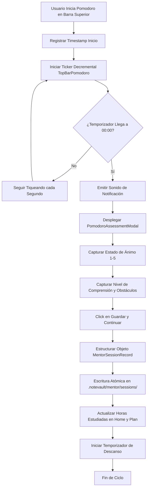

# Especificación de Módulo: MOD-MENTOR (Mentor IA y Planes de Estudio)

**Fase:** 03 — Ingeniería de Requisitos  
**Entregable:** 07 de 09 — Especificación Detallada de Módulos  
**Módulo ID:** `MOD-MENTOR` (14 de 15)  
**Bounded Context:** `AdaptiveMentorship` / Tutoría Inteligente y Planificación Curricular  
**Ubicación de Almacenamiento:** `.notevault/mentor/` (`plans/`, `sessions/`, `mentor_memory.json`, `route.json`)  
**Responsable Técnico:** NoteVault Core Engineering  

---

## 1. Alcance y Responsabilidades del Módulo

El módulo `MOD-MENTOR` actúa como el tutor pedagógico y estratega de aprendizaje de NoteVault, orquestando el ritmo de estudio y evaluando la retención del estudiante:

- **Generador de Planes Mensuales Curriculares:** Algoritmo de planificación de estudio que distribuye temas de Matemáticas, Programación e Inglés a lo largo de 4 semanas según la disponibilidad horaria del usuario.
- **Estrategias de Aprendizaje Configurables:**
  - Modo Simultáneo (*Together*): Las tres áreas avanzan de forma equilibrada en paralelo dentro de cada semana.
  - Modo Secuencial (*Phased*): Bloques de inmersión profunda concentrados en una materia antes de transicionar a la siguiente.
- **Temporizador Pomodoro Integrado con Ticker Superior:** Control de intervalos de trabajo profundo (25 min, 50 min) y descansos (5 min, 10 min) visible en todo momento desde `TopBarPomodoro.tsx`.
- **Evaluación Post-Sesión (*Pomodoro Assessment Modal*):** Al expirar una sesión de estudio, se abre un modal de reflexión para registrar: estado anímico (1 a 5), nivel de comprensión percibido, notas clave y obstáculos encontrados.
- **Memoria Continua del Mentor (*Mentor Memory*):** Registro de correcciones y retroalimentaciones pasadas (`mentor_memory.json`) para afinar futuras recomendaciones de estudio y no repetir consejos ineficaces.
- **Chat Conversacional con Asistente Pedagógico:** Interfaz de diálogo contextual que responde dudas sobre el temario, propone ejercicios alternativos y guía el proceso metacognitivo.

---

## 2. Marco Conceptual: Entidad Plan de Mentor en el Dominio

<div class="entity-card">

1. **Entidad principal e independiente.**
2. **Es la entidad líder del conjunto de datos:** posee un identificador global único que fija la ventana temporal del plan (`mentor_plan_id`: `pln_2026_11_together_core`), invocado por el calendario de estudio y el generador de sesiones.
3. **Existe por sí misma en el registro `.notevault/mentor/plans/` sin depender de las notas individuales**, y es la única responsable de validar que el total de horas programadas no exceda la capacidad semanal declarada por el estudiante antes de ser activado.
4. **Punto de entrada y límite de consistencia:** Al activarse un plan, propaga los bloques horarios hacia la agenda del calendario y fija los entregables clave del mes.

</div>

---

## 3. Requisitos Funcionales del Módulo (RF)

| ID RF | Declaración del Requisito Funcional | Prioridad MoSCoW | Criterio de Verificación |
| :--- | :--- | :--- | :--- |
| **RF-MEN-01** | El sistema DEBE generar planes mensuales de estudio en modo `together` o `phased` calculando la distribución horaria por tema. | **Must Have** | Componente `MentorModule.tsx` genera el esqueleto del plan y lo serializa en JSON. |
| **RF-MEN-02** | El sistema DEBE proveer un temporizador Pomodoro en la barra superior con soporte para iniciar, pausar, resetear y cambiar de bloque. | **Must Have** | Store `usePomodoro` y componente `TopBarPomodoro.tsx` reflejan el tiempo en segundos en tiempo real. |
| **RF-MEN-03** | El sistema DEBE desplegar automáticamente el modal de evaluación post-sesión al finalizar cada bloque Pomodoro de estudio. | **Must Have** | Al llegar a 00:00, se abre `PomodoroAssessmentModal.tsx` capturando autoevaluación obligatoria. |
| **RF-MEN-04** | El sistema DEBE registrar el historial de sesiones de estudio en `.notevault/mentor/sessions/` con fecha, tema, duración y calificación. | **Must Have** | Cada sesión finalizada escribe un registro estructurado con guardado atómico. |
| **RF-MEN-05** | El sistema DEBE calcular el índice de adherencia al plan (`horas_estudiadas / horas_planeadas * 100`). | **Should Have** | Visualización de gráfico de barras comparando lo planificado vs lo ejecutado por semana. |
| **RF-MEN-06** | El sistema DEBE mantener una memoria de correcciones metodológicas (`mentor_memory.json`) que persista retroalimentaciones del usuario. | **Should Have** | El asistente consulta la memoria antes de emitir sugerencias para evitar consejos descartados. |
| **RF-MEN-07** | El sistema DEBE ofrecer una interfaz de chat con el Mentor IA con historial persistente por sesión. | **Could Have** | Las conversaciones se almacenan localmente y permiten reanudar hilos de discusión pasados. |

---

## 4. Requisitos No Funcionales del Módulo (RNF Local)

| ID RNF | Dimensión ISO 25010 | Declaración y Métrica Cuantitativa | Método de Medición |
| :--- | :--- | :--- | :--- |
| **RNF-MEN-01** | Eficiencia de Desempeño | **Tiempo de Generación de Plan:** El algoritmo de asignación horaria para 120 horas mensuales de estudio debe resolverse en **< 100 ms**. | Benchmark de ejecución sobre `mentorPlanBuild.ts`. |
| **RNF-MEN-02** | Confiabilidad | **Precisión de Temporizador en Segundo Plano:** El Pomodoro no debe atrasarse ni pausarse cuando la ventana de NoteVault esté minimizada. | Verificación de sincronización con `Date.now()` para evitar desfases del event loop. |
| **RNF-MEN-03** | Seguridad | **Privacidad de Reflexiones:** Las notas y estados de ánimo del estudiante jamás se transmiten fuera del equipo local. | Monitoreo de peticiones de red certificando operación aislada. |
| **RNF-MEN-04** | Usabilidad | **Alertas No Intrusivas:** Las notificaciones de finalización de Pomodoro deben sonar de forma clara pero no estridente (máximo 70 dB). | Pruebas de audio con archivos de sonido estandarizados en `assets/`. |

---

## 5. Historias de Usuario con Criterios Gherkin

### US-MEN-01: Generación de plan mensual equilibrado (Together)
**Como** estudiante universitario cursando matemáticas y programación,  
**Quiero** generar un plan mensual donde dedique 15 horas semanales distribuidas equilibradamente,  
**Para** avanzar de forma constante en ambas materias sin descuidar ninguna.

```gherkin
Escenario: Creación de plan mensual en modo Together
  Dado que el usuario solicita un plan para Noviembre indicando 15 horas/semana y modo "Together"
  Cuando el algoritmo procesa los temas pendientes del temario
  Entonces genera un plan de 4 semanas dividiendo equitativamente el tiempo entre Matemáticas y Código
  Y distribuye los bloques de estudio de lunes a viernes
  Y guarda el plan en ".notevault/mentor/plans/plan_2026_11.json".
```

### US-MEN-02: Evaluación post-pomodoro de comprensión
**Como** estudiante que acaba de terminar un bloque de 50 minutos de teoría de grupos,  
**Quiero** registrar que me costó comprender la noción de subgrupo normal,  
**Para** que el Mentor lo registre en mi memoria de estudio y programe un refuerzo específico.

```gherkin
Escenario: Registro de obstáculo post-sesión
  Dado que el temporizador Pomodoro llega a 00:00 en un bloque de Matemáticas
  Cuando se despliega el modal de evaluación
  Entonces el usuario califica su comprensión con 2/5 e ingresa la nota "Dificultad con subgrupos normales"
  Y al confirmar, el sistema archiva el registro de sesión
  Y añade la recomendación de revisión conceptual a la lista de prioridades del día siguiente.
```

---

## 6. Especificación Detallada de Casos de Uso

### UC-MEN-01: Ejecutar Sesión Pomodoro y Evaluación Post-Sesión

| Campo | Detalle de Especificación |
| :--- | :--- |
| **ID y Nombre** | `UC-MEN-01` — Ejecutar Sesión Pomodoro y Evaluación Post-Sesión |
| **Actor Principal** | Estudiante / Usuario Registrado |
| **Precondición** | La aplicación NoteVault está abierta. |
| **Flujo Principal** | 1. El usuario selecciona la materia de estudio (ej. "Matemáticas") y presiona "Iniciar Pomodoro" en la barra superior.<br/>2. El temporizador arranca una cuenta regresiva de 50 minutos con indicación en el ticker superior.<br/>3. El usuario realiza su sesión de estudio concentrado.<br/>4. El temporizador alcanza 00:00.<br/>5. El sistema reproduce un sonido de campana suave y abre el modal `PomodoroAssessmentModal.tsx`.<br/>6. El usuario selecciona su nivel de concentración (1 a 5 estrellas) y escribe brevemente qué logró aprender.<br/>7. Presiona "Guardar y Descansar".<br/>8. El sistema guarda el registro de la sesión en `.notevault/mentor/sessions/session_YYYYMMDD_HHMM.json`.<br/>9. Inicia automáticamente la cuenta regresiva del descanso de 10 minutos.<br/>10. Actualiza las métricas de minutos estudiados hoy en el panel Home. |
| **Flujos Alternativos** | **A1 (Pausa manual):** El usuario puede pausar el temporizador si surge una emergencia y reanudarlo cuando esté listo sin perder los minutos transcurridos. |
| **Excepciones** | **E1 (Cierre de app durante Pomodoro):** Al reabrir la app, el sistema calcula el tiempo transcurrido mediante `Date.now()`. Si el tiempo expiró mientras la app estaba cerrada, abre el modal de evaluación indicando el bloque culminado. |
| **Postcondición** | La sesión queda registrada formalmente en el histórico y suma al cumplimiento del plan mensual. |

---

## 7. Diagrama de Actividad del Módulo



---

## 8. Implicación de Compuerta de Fase (Gate 3 Criteria)

- **¿Bloquea el avance a Modelado/Fase 4?:** No.
- **Condición de Pase:** El generador de planes y el temporizador Pomodoro desacoplan su lógica del motor de renderizado, garantizando precisión cronométrica ininterrumpida y persistencia de evaluaciones.
