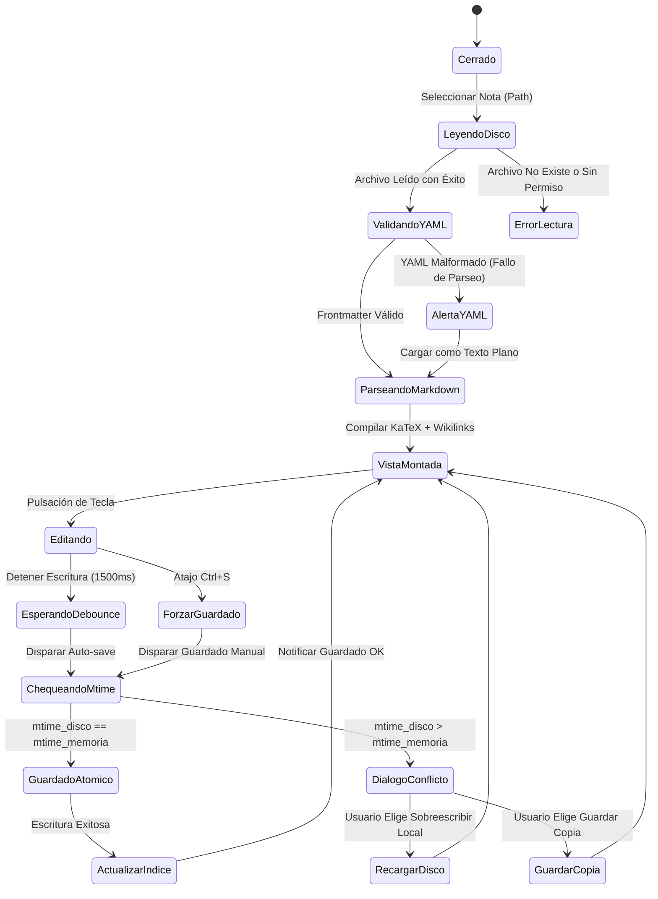

# Especificación de Módulo: MOD-NOTES (Notas y Markdown)

**Fase:** 03 — Ingeniería de Requisitos  
**Entregable:** 07 de 09 — Especificación Detallada de Módulos  
**Módulo ID:** `MOD-NOTES` (01 de 15)  
**Bounded Context:** `CoreNoteVault` / Gestión del Conocimiento  
**Ubicación de Almacenamiento:** Raíz de la bóveda (`*.md`) y subcarpetas temáticas (`1.PERSONAL/`, `2.PROYECTOS/`, etc.)  
**Responsable Técnico:** NoteVault Core Engineering  

---

## 1. Alcance y Responsabilidades del Módulo

El módulo `MOD-NOTES` es el motor central de edición de texto plano, estructuración del conocimiento y enlace semántico de NoteVault:

- **Editor Híbrido WYSIWYG / Markdown:** Implementado sobre CodeMirror 6 y Milkdown Kit, permitiendo alternar entre vista de lectura (*read*), edición de código fuente (*edit*) y vista dividida sincronizada (*split*).
- **Renderizado Matemático:** Integración nativa de KaTeX para fórmulas matemáticas complejas en línea (`$...$`) y en bloque (`$$...$$`).
- **Parseo y Preservación de Frontmatter:** Lectura, validación y escritura determinista de metadatos YAML delimitados por triples guiones (`---`) al inicio del archivo.
- **Grafo de Enlaces Bidireccionales:** Detección de wikilinks `[[Nombre de Nota]]`, resolución de alias `[[Nota|Texto alternativo]]` y generación de panel de backlinks (menciones vinculadas y no vinculadas).
- **Gestión de Adjuntos Locales:** Almacenamiento de imágenes, audios y documentos en subcarpetas `attachments/` contiguas a la nota sin intermediación de servidores externos.
- **Búsqueda Global y Outline:** Indexación en memoria acotada (máx. 4000 notas) para búsqueda de texto completo y generación de tabla de contenidos (TOC) interactiva por encabezados (`#` a `######`).

---

## 2. Marco Conceptual: Entidad Nota en el Dominio

<div class="entity-card">

1. **Entidad principal e independiente.**
2. **Es la entidad líder del conjunto de datos:** posee un identificador global único correspondiente a su ruta relativa POSIX dentro de la bóveda (`note_path`: ej. `1.PERSONAL/Estudio/Algebra.md`), invocado directamente por el buscador, el grafo y el conmutador rápido.
3. **Existe por sí misma en el sistema de archivos sin depender de una base de datos central**, y es la única responsable de validar que su frontmatter YAML y sintaxis Markdown sean válidos antes de permitir guardar cambios a disco.
4. **Punto de entrada y límite de consistencia:** El guardado se ejecuta de forma atómica sobre su propio archivo `.md` mediante reemplazo seguro de archivo temporal para evitar corrupción ante fallas de energía.

</div>

---

## 3. Requisitos Funcionales del Módulo (RF)

| ID RF | Declaración del Requisito Funcional | Prioridad MoSCoW | Criterio de Verificación |
| :--- | :--- | :--- | :--- |
| **RF-NOTES-01** | El sistema DEBE cargar y renderizar cualquier archivo `.md` de la bóveda respetando el estándar CommonMark y GitHub Flavored Markdown (GFM). | **Must Have** | Vitest: renderizado de tablas, listas de tareas `[ ]`, bloques de código y citas. |
| **RF-NOTES-02** | El sistema DEBE parsear expresiones matemáticas LaTeX encerradas en `$...$` y `$$...$$` usando KaTeX sin ejecutar scripts externos. | **Must Have** | Prueba E2E: renderizado de matrices, sumatorias e integrales en menos de 15 ms. |
| **RF-NOTES-03** | El sistema DEBE resolver enlaces bidireccionales `[[...]]`, permitiendo navegar a la nota destino o sugerir su creación inmediata si no existe. | **Must Have** | Navegación por clic o `Ctrl + Click` con apertura en pestaña activa o nueva. |
| **RF-NOTES-04** | El sistema DEBE extraer y mostrar los backlinks de la nota activa, diferenciando menciones explícitas (`[[Nota]]`) de menciones de texto no vinculadas. | **Should Have** | Panel lateral derecho lista notas entrantes con contexto de línea. |
| **RF-NOTES-05** | El sistema DEBE guardar el contenido a disco de manera atómica con detección de conflictos basada en el timestamp de modificación (`mtime`). | **Must Have** | Si `mtime` en disco > `mtime` en memoria, notificar al usuario y bloquear sobreescritura accidental. |
| **RF-NOTES-06** | El sistema DEBE permitir copiar o arrastrar imágenes al editor, guardándolas automáticamente en la carpeta `attachments/` y generando la sintaxis `![[adjunto.png]]`. | **Must Have** | Copia de imagen desde portapapeles escribe archivo binario en disco y añade markdown. |
| **RF-NOTES-07** | El sistema DEBE proveer un conmutador rápido (*Quick Switcher*) invocado con `Ctrl + O` / `Cmd + O` que filtre notas por nombre en tiempo real. | **Must Have** | Búsqueda difusa (*fuzzy matching*) con respuesta en < 16 ms. |
| **RF-NOTES-08** | El sistema DEBE ofrecer tres modos de vista: Solo Lectura, Solo Edición y Pantalla Dividida (*Split View*) con scroll sincronizado. | **Should Have** | Alternancia fluida con botón de toolbar o atajo de teclado sin perder el cursor. |

---

## 4. Requisitos No Funcionales del Módulo (RNF Local)

| ID RNF | Dimensión ISO 25010 | Declaración y Métrica Cuantitativa | Método de Medición |
| :--- | :--- | :--- | :--- |
| **RNF-NOTES-01** | Eficiencia de Desempeño | **Latencia de Apertura:** La lectura desde disco y montaje en el DOM debe tomar **< 30 ms** para archivos de hasta 10,000 líneas. | Benchmark automatizado Vitest con archivos sintéticos de prueba. |
| **RNF-NOTES-02** | Eficiencia de Desempeño | **Respuesta de Mecanografía:** El retraso entre pulsación de tecla y actualización del búfer de texto debe ser **< 16 ms** (60 FPS estables). | Perfilado con Chrome DevTools Performance Timeline. |
| **RNF-NOTES-03** | Confiabilidad | **Integridad Transaccional:** Cero bytes corruptos ante terminación forzosa del proceso (*kill signal*). | Test de estrés con guardado simultáneo e interrupción abrupta de hilo. |
| **RNF-NOTES-04** | Seguridad | **Sanitización HTML:** 100% de los elementos HTML embebidos deben ser sanitizados con `DOMPurify` antes de inyectarse en el DOM. | Test de inyección XSS con payloads `<script>` y `onerror=alert()`. |
| **RNF-NOTES-05** | Mantenibilidad | **Compatibilidad Estándar:** El archivo generado debe ser 100% legible y editable en Obsidian, VS Code o editores estándar de texto plano. | Validación cruzada de archivo sin dependencias propietarias. |

---

## 5. Historias de Usuario con Criterios Gherkin

### US-NOTES-01: Edición y renderizado matemático fluido
**Como** estudiante o investigador que estudia matemáticas y computación,  
**Quiero** escribir fórmulas LaTeX complejas dentro de mis notas y visualizarlas instantáneamente,  
**Para** documentar teoremas y demostraciones sin recurrir a software externo.

```gherkin
Escenario: Renderizado de fórmula matemática en bloque
  Dado que el usuario tiene una nota abierta en modo edición o split
  Cuando escribe "$$\int_{-\infty}^{\infty} e^{-x^2} dx = \sqrt{\pi}$$"
  Entonces KaTeX compila la fórmula a nodos SVG/HTML nativos
  Y la visualización se actualiza en menos de 20 ms sin parpadeo de pantalla.
```

### US-NOTES-02: Navegación por backlinks bidireccionales
**Como** creador de conocimiento en NoteVault,  
**Quiero** ver qué otras notas hacen referencia al concepto que estoy leyendo,  
**Para** descubrir conexiones conceptuales emergentes en mi bóveda.

```gherkin
Escenario: Detección automática de mención vinculada
  Dado que la nota "Calculo_Diferencial.md" contiene el enlace "[[Teorema_de_Taylor]]"
  Cuando el usuario abre la nota "Teorema_de_Taylor.md" y despliega el panel de backlinks
  Entonces el sistema muestra "Calculo_Diferencial.md" en la sección de menciones vinculadas
  Y al hacer clic sobre el resultado, abre la nota origen posicionando el cursor sobre el enlace.
```

### US-NOTES-03: Detección de conflicto de guardado concurrente
**Como** usuario que sincroniza su bóveda vía Syncthing o Git,  
**Quiero** ser advertido si el archivo en disco fue modificado externamente mientras lo editaba,  
**Para** evitar sobreescribir datos valiosos de otro dispositivo.

```gherkin
Escenario: Conflicto de modificación externa detectado
  Dado que la nota "Ideas.md" fue modificada en disco por un proceso externo a las 10:05:00
  Y el usuario en la aplicación intenta guardar cambios locales basados en la versión de las 10:00:00
  Cuando se dispara el evento de guardado
  Entonces el puente I/O retorna conflicto de concurrencia
  Y la UI muestra un diálogo modal permitiendo elegir entre "Recargar de disco" o "Guardar como copia de conflicto".
```

---

## 6. Especificación Detallada de Casos de Uso

### UC-NOTES-01: Abrir y Editar Nota con Guardado Atómico

| Campo | Detalle de Especificación |
| :--- | :--- |
| **ID y Nombre** | `UC-NOTES-01` — Abrir y Editar Nota Markdown |
| **Actor Principal** | Usuario Registrado / Estudiante |
| **Precondición** | La bóveda está seleccionada e inicializada con permisos de lectura y escritura en el sistema de archivos. |
| **Flujo Principal** | 1. El usuario selecciona una nota en el explorador de archivos o la busca mediante `Ctrl + O`.<br/>2. El sistema lee el archivo desde disco, extrae el frontmatter YAML y el cuerpo Markdown.<br/>3. El sistema registra el `mtime` del archivo en disco en el estado de la nota.<br/>4. El sistema monta la sesión en CodeMirror 6 y renderiza el contenido visual.<br/>5. El usuario realiza modificaciones de texto.<br/>6. El sistema detecta la inactividad (*debounce* de 1500 ms) o el atajo `Ctrl + S`.<br/>7. El sistema serializa el frontmatter YAML y el texto en un archivo temporal contiguo (`note.tmp`).<br/>8. El sistema reemplaza atómicamente el archivo original por el archivo temporal.<br/>9. El sistema actualiza el timestamp `mtime` en memoria y emite notificación de éxito silenciosa en la barra de estado. |
| **Flujos Alternativos** | **A1 (Nota nueva inexistente):** Si el usuario navega a un enlace roto `[[Nota Nueva]]`, el sistema crea la estructura básica en memoria con frontmatter mínimo (`title`, `created`) y permite su edición inmediata. |
| **Excepciones** | **E1 (Conflicto de mtime):** Si el archivo en disco tiene un `mtime` mayor al guardado en memoria, el sistema cancela el reemplazo, emite un toast de advertencia `warning` y muestra la comparativa de diferencias.<br/>**E2 (Disco lleno o sin permisos):** Si la escritura falla a nivel del sistema operativo, el sistema mantiene el búfer intacto en memoria y presenta alerta de error con opción de reintentar. |
| **Postcondición** | El archivo `.md` en disco refleja los cambios exactos y el índice de búsqueda en memoria actualiza el contenido de la nota. |

---

## 7. Diagrama de Actividad del Módulo



---

## 8. Implicación de Compuerta de Fase (Gate 3 Criteria)

- **¿Bloquea el avance a Modelado/Fase 4?:** No.
- **Condición de Pase:** El módulo `MOD-NOTES` cuenta con su contrato de datos formalizado, suite de pruebas unitarias de parseo y renderizado en verde, y su interfaz de almacenamiento local desacoplada del motor de renderizado.
