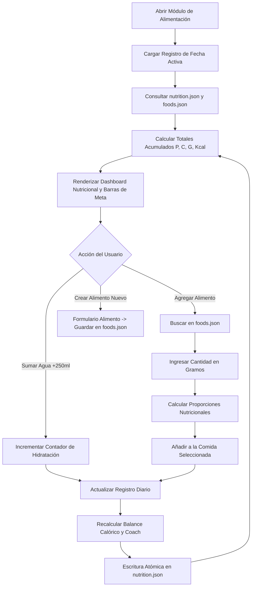

# Especificación de Módulo: MOD-NUTRITION (Alimentación y Macronutrientes)

**Fase:** 03 — Ingeniería de Requisitos  
**Entregable:** 07 de 09 — Especificación Detallada de Módulos  
**Módulo ID:** `MOD-NUTRITION` (07 de 15)  
**Bounded Context:** `NutritionalIntake` / Balance Energético y Macronutrientes  
**Ubicación de Almacenamiento:** `.notevault/alimentacion/` (`nutrition.json`, `foods.json`)  
**Responsable Técnico:** NoteVault Core Engineering  

---

## 1. Alcance y Responsabilidades del Módulo

El módulo `MOD-NUTRITION` gestiona la ingesta dietética, el balance energético y la composición de macronutrientes esenciales del usuario:

- **Seguimiento de Macronutrientes en Tiempo Real:** Cálculo acumulativo de Proteínas (g), Carbohidratos (g), Grasas (g) y Calorías totales (kcal) con medidores visuales en anillo o barras de progreso.
- **Estructuración por Comidas:** Registro organizado en franjas diarias configurables: Desayuno, Almuerzo, Merienda/Pre-entreno, Cena y Snacks.
- **Base de Datos Local de Alimentos:** Catálogo sin dependencias web con valores nutricionales por cada 100 gramos o por porción estándar, permitiendo agregar alimentos personalizados rápidamente.
- **Registro de Hidratación:** Marcador rápido de consumo diario de agua en mililitros (ml) o vasos (250 ml) con meta configurable.
- **Coach Nutricional Automatizado:** Motor de análisis (`nutritionCoach.ts`) que evalúa la distribución de proteínas en relación con las sesiones de fuerza registradas en `MOD-EXERCISE` y emite sugerencias de ajuste calórico.
- **Modos de Objetivo Fisiológico:** Configuración de metas según la fase atlética: Déficit Calórico (Definición/Pérdida de grasa), Mantenimiento Normocalórico o Superávit Calórico (Volumen e Hipertrofia).

---

## 2. Marco Conceptual: Entidad Registro Diario Nutricional en el Dominio

<div class="entity-card">

1. **Entidad principal e independiente.**
2. **Es la entidad líder del conjunto de datos:** posee un identificador global único asociado a la fecha del día (`nutrition_day_id`: `nut_2026-10-20`), invocado por el panel Home y el coach de entrenamiento.
3. **Existe por sí misma en el registro `.notevault/alimentacion/nutrition.json` sin depender de un plan alimentario externo**, y es la única responsable de validar que las cantidades de alimentos sean mayores a cero y que los totales de macronutrientes cuadren con el balance calórico (`4*P + 4*C + 9*G ≈ Kcal`) antes de persistir los datos.
4. **Punto de entrada y límite de consistencia:** Centraliza el cierre diario de alimentación y calcula la desviación respecto a las metas nutricionales fijadas.

</div>

---

## 3. Requisitos Funcionales del Módulo (RF)

| ID RF | Declaración del Requisito Funcional | Prioridad MoSCoW | Criterio de Verificación |
| :--- | :--- | :--- | :--- |
| **RF-NUT-01** | El sistema DEBE permitir registrar alimentos ingeridos en franjas horarias específicas indicando porción en gramos o unidades. | **Must Have** | Componente `NutritionModule.tsx` agrega ítems y actualiza totales en tiempo real. |
| **RF-NUT-02** | El sistema DEBE calcular automáticamente las calorías y gramos de proteína, carbohidrato y grasa según la porción ingresada. | **Must Have** | Vitest: 150g de pechuga de pollo (31g P/100g) = 46.5g de proteína y 247.5 kcal. |
| **RF-NUT-03** | El sistema DEBE presentar barras de progreso contra las metas diarias de calorías y macronutrientes fijadas por el usuario. | **Must Have** | Barras cambian a color ámbar al superar el 100% de la meta o verde al estar en rango ±5%. |
| **RF-NUT-04** | El sistema DEBE permitir crear nuevos alimentos en el catálogo local (`foods.json`) con sus valores por 100g. | **Must Have** | Formulario valida campos obligatorios y persiste el alimento inmediatamente. |
| **RF-NUT-05** | El sistema DEBE ofrecer un contador de consumo de agua diario con botones de incremento rápido (+250ml, +500ml). | **Should Have** | Clic en "+250ml" actualiza el total acumulado y guarda en el registro diario. |
| **RF-NUT-06** | El sistema DEBE proveer un resumen semanal del promedio calórico y distribución de macronutrientes. | **Should Have** | Vista gráfica presenta media de 7 días para evaluar cumplimiento de déficit/superávit. |
| **RF-NUT-07** | El sistema DEBE emitir recomendaciones mediante `nutritionCoach.ts` si la ingesta de proteína es inferior a 1.6 g/kg de peso corporal. | **Could Have** | Alerta no intrusiva sugiriendo fuentes proteicas para alcanzar el umbral óptimo. |

---

## 4. Requisitos No Funcionales del Módulo (RNF Local)

| ID RNF | Dimensión ISO 25010 | Declaración y Métrica Cuantitativa | Método de Medición |
| :--- | :--- | :--- | :--- |
| **RNF-NUT-01** | Eficiencia de Desempeño | **Búsqueda Instantánea de Alimentos:** El filtrado sobre el catálogo local de alimentos debe responder en **< 10 ms**. | Búsqueda difusa en memoria sobre catálogo de hasta 2,000 ítems. |
| **RNF-NUT-02** | Usabilidad | **Registro Rápido de Comida Habitual:** Un usuario debe poder registrar una comida frecuente completa en **< 3 toques/clics**. | Medición de pasos de interacción en prueba de usuario. |
| **RNF-NUT-03** | Confiabilidad | **Precisión Aritmética:** Los totales nutricionales se calculan sin errores de redondeo de punto flotante en la suma acumulativa. | Uso de redondeo estandarizado a 1 decimal en macros y enteros en calorías. |
| **RNF-NUT-04** | Portabilidad | **Autonomía Offline:** El módulo opera con 100% de sus funcionalidades sin conexión a internet ni llamadas a APIs de terceros. | Validación de operación en modo avión sin fallos de red. |

---

## 5. Historias de Usuario con Criterios Gherkin

### US-NUT-01: Registro de almuerzo y control calórico
**Como** persona en etapa de definición muscular,  
**Quiero** ingresar rápidamente mi almuerzo de arroz, pollo y aguacate,  
**Para** saber exactamente cuántas calorías y cuánta proteína me quedan disponibles para la cena.

```gherkin
Escenario: Registro de comida y cálculo de remanente
  Dado que la meta calórica del usuario es 2200 kcal y lleva consumidas 700 kcal en el desayuno
  Cuando registra en el Almuerzo: 200g Arroz (260 kcal), 150g Pollo (248 kcal), 50g Aguacate (80 kcal)
  Entonces el sistema suma 588 kcal al consumo del día (total: 1288 kcal)
  Y actualiza el indicador de presupuesto remanente a "912 kcal restantes"
  Y el desglose de proteínas refleja el incremento de 50 gramos.
```

### US-NUT-02: Creación de alimento personalizado en catálogo local
**Como** usuario que consume un suplemento proteico o producto local específico,  
**Quiero** guardar su información nutricional en mi base de datos interna,  
**Para** reutilizarlo en futuros registros sin volver a escribir sus datos.

```gherkin
Escenario: Guardar nuevo alimento en el catálogo
  Dado que el usuario abre el modal de "+ Crear Alimento"
  Cuando ingresa "Proteína Aislada Whey", Porción "30g", Proteína "25g", Carbohidratos "1g", Grasas "0.5g", Calorías "110 kcal"
  Entonces el sistema convierte los valores a la base de 100 gramos
  Y guarda el registro en ".notevault/alimentacion/foods.json"
  Y el alimento queda disponible inmediatamente en el buscador.
```

---

## 6. Especificación Detallada de Casos de Uso

### UC-NUT-01: Registrar Ingesta de Alimentos en una Comida

| Campo | Detalle de Especificación |
| :--- | :--- |
| **ID y Nombre** | `UC-NUT-01` — Registrar Ingesta de Alimentos en una Comida |
| **Actor Principal** | Usuario Registrado |
| **Precondición** | El catálogo de alimentos `foods.json` está accesible y la fecha activa está seleccionada. |
| **Flujo Principal** | 1. El usuario selecciona la sección de la comida (ej. "Almuerzo") y pulsa "+ Agregar Alimento".<br/>2. El sistema despliega el buscador rápido con autocompletado en memoria.<br/>3. El usuario escribe las primeras letras del alimento (ej. "Avena") y lo selecciona de la lista.<br/>4. El usuario especifica la cantidad consumida en gramos (ej. "80g").<br/>5. El sistema calcula proporcionalmente los macronutrientes y las calorías.<br/>6. El usuario confirma la adición.<br/>7. El sistema agrega el ítem a la comida, actualiza los totales del día y las barras de progreso.<br/>8. El sistema persiste el estado en `.notevault/alimentacion/nutrition.json` de forma atómica. |
| **Flujos Alternativos** | **A1 (Alimento rápido sin catálogo):** El usuario ingresa manualmente sólo el nombre y las calorías estimadas ("Snack imprevisto: 250 kcal"). El sistema lo registra sin forzar el desglose de macronutrientes. |
| **Excepciones** | **E1 (Cantidad inválida):** Si el usuario ingresa un valor negativo o no numérico, el sistema bloquea la confirmación y resalta el campo en rojo. |
| **Postcondición** | El registro diario almacena la comida y las métricas agregadas del panel Home se actualizan reactivamente. |

---

## 7. Diagrama de Actividad del Módulo



---

## 8. Implicación de Compuerta de Fase (Gate 3 Criteria)

- **¿Bloquea el avance a Modelado/Fase 4?:** No.
- **Condición de Pase:** La persistencia de datos nutricionales opera íntegramente en archivos locales JSON bajo `.notevault/alimentacion/` sin dependencias externas, con pruebas unitarias de cálculo calórico en verde.
