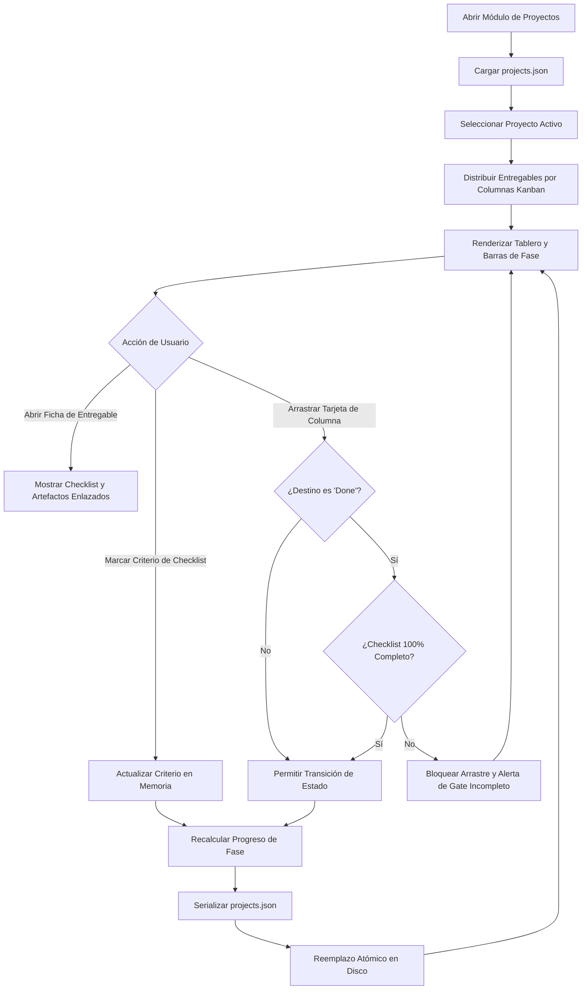

# Especificación de Módulo: MOD-PROJECTS (Proyectos y Metodología Fullstack)

**Fase:** 03 — Ingeniería de Requisitos  
**Entregable:** 07 de 09 — Especificación Detallada de Módulos  
**Módulo ID:** `MOD-PROJECTS` (09 de 15)  
**Bounded Context:** `SoftwareMethodology` / Ciclo de Vida del Software y Gestión de Proyectos  
**Ubicación de Almacenamiento:** `.notevault/proyectos/projects.json` y carpetas de proyecto en `2.PROYECTOS/`  
**Responsable Técnico:** NoteVault Core Engineering  

---

## 1. Alcance y Responsabilidades del Módulo

El módulo `MOD-PROJECTS` gobierna el avance de proyectos de ingeniería de software siguiendo rigurosamente la metodología Fullstack Development:

- **Gobierno del SDLC en 12 Fases:** Estructuración nativa de proyectos en etapas metodológicas: Fase 0 (Problem Recognition), Fase 1 (Early Viability), Fase 2 (Kickoff), Fase 3 (Requirements), Fase 4 (Modeling), Fase 5 (Architecture), Fase 6 (Technical Design), Fase 7 (Implementation), Fase 8 (QA), Fase 9 (Deployment), Fase 10 (Operations) y Fase 11 (Documentation).
- **Tablero Kanban de Entregables:** Interfaz visual con columnas de flujo: `Backlog`, `To Do`, `In Progress`, `Review / Quality Gate` y `Done / Certified`.
- **Ficha de Entregable Detallada:** Cada entregable registra código (`P3-D07`), título, propósito, responsable, horas estimadas vs invertidas, checklist de criterios de aceptación y enlaces directos a sus artefactos generados (`.md`, `.canvas`, `.json`).
- **Compuertas de Calidad (Quality Gates):** Validación obligatoria de condiciones de pase (*Pass Conditions*) antes de permitir arrastrar un entregable a la columna "Done".
- **Métricas de Avance y Quemado (*Burndown*):** Cálculo automático del porcentaje de completitud global del proyecto y estimación de fecha de finalización.

---

## 2. Marco Conceptual: Entidad Proyecto en el Dominio

<div class="entity-card">

1. **Entidad principal e independiente.**
2. **Es la entidad líder del conjunto de datos:** posee un identificador global único (`project_id`: `prj_notevault_v4_core`), invocado por el tablero Kanban, el conmutador de proyectos y los reportes de progreso.
3. **Existe por sí misma en el registro `.notevault/proyectos/projects.json` sin depender de una tarea subordinada**, y es la única responsable de validar que la jerarquía de fases, entregables y compuertas de calidad se mantengan consistentes antes de permitir guardar cambios.
4. **Punto de entrada y límite de consistencia:** El cierre de una fase metodológica audita que el 100% de los entregables de esa fase posean su veredicto aprobado antes de habilitar la siguiente fase.

</div>

---

## 3. Requisitos Funcionales del Módulo (RF)

| ID RF | Declaración del Requisito Funcional | Prioridad MoSCoW | Criterio de Verificación |
| :--- | :--- | :--- | :--- |
| **RF-PRJ-01** | El sistema DEBE permitir crear proyectos de software inicializados opcionalmente con la plantilla canónica de las 12 fases Fullstack. | **Must Have** | Al seleccionar la plantilla Fullstack, se generan los entregables D1 a D13 automáticamente. |
| **RF-PRJ-02** | El sistema DEBE proveer un tablero Kanban interactivo con arrastrar y soltar (*drag and drop*) entre columnas de estado. | **Must Have** | Componente `ProjectsModule.tsx` reubica tarjetas y actualiza el estado en memoria y disco. |
| **RF-PRJ-03** | El sistema DEBE validar los criterios de aceptación antes de permitir que un entregable pase a la columna "Done". | **Must Have** | Si un ítem del checklist está pendiente, el sistema bloquea el paso y muestra advertencia. |
| **RF-PRJ-04** | El sistema DEBE permitir enlazar un entregable con su archivo de documentación en `docs/` o su lienzo en `docs/canvas_specs/`. | **Should Have** | Botón "Ver Artefacto" abre la nota o canvas correspondiente en una pestaña adyacente. |
| **RF-PRJ-05** | El sistema DEBE calcular el porcentaje de progreso de cada fase y del proyecto global en tiempo real (`entregables_completados / total * 100`). | **Should Have** | Barras de progreso en cabecera se actualizan con cada movimiento de tarjeta. |
| **RF-PRJ-06** | El sistema DEBE permitir registrar horas dedicadas por entregable y compararlas contra la estimación inicial. | **Could Have** | Visualización de desvío horario (Horas reales vs Horas estimadas) con indicador cromático. |

---

## 4. Requisitos No Funcionales del Módulo (RNF Local)

| ID RNF | Dimensión ISO 25010 | Declaración y Métrica Cuantitativa | Método de Medición |
| :--- | :--- | :--- | :--- |
| **RNF-PRJ-01** | Eficiencia de Desempeño | **Fluidez de Arrastre en Kanban:** La animación de arrastrar una tarjeta debe mantener **60 FPS** sin tirones (*jank*). | Perfilado con DevTools Performance en tableros con más de 100 entregables. |
| **RNF-PRJ-02** | Confiabilidad | **Atomicidad en Cambio de Columna:** El movimiento de una tarjeta debe actualizarse en memoria y persistir en disco en **< 30 ms**. | Test de estrés en Vitest con múltiples operaciones simultáneas de drag-and-drop. |
| **RNF-PRJ-03** | Mantenibilidad | **Estructura Abierta:** Los datos del proyecto se almacenan en JSON legible por humanos, facilitando auditorías de control de versiones en Git. | Inspección de diffs limpios en git al modificar una propiedad de entregable. |
| **RNF-PRJ-04** | Usabilidad | **Claridad Visual de Fases:** Cada una de las fases metodológicas debe poseer una paleta de color distintiva pero armoniosa dentro del modo oscuro. | Validación de estilos con tokens CSS del diseño del sistema. |

---

## 5. Historias de Usuario con Criterios Gherkin

### US-PRJ-01: Avance de entregable en tablero Kanban con validación de Quality Gate
**Como** líder técnico o desarrollador de NoteVault,  
**Quiero** mover el entregable "D07 Especificación de Módulos" de "In Progress" a "Done",  
**Para** certificar que todos los requisitos han sido documentados formalmente antes de iniciar el modelado.

```gherkin
Escenario: Intento de mover entregable con checklist incompleto
  Dado que el entregable "D07 Especificación de Módulos" tiene 14 de 15 módulos completados
  Cuando el usuario intenta arrastrar la tarjeta a la columna "Done"
  Entonces el sistema rechaza el movimiento regresando la tarjeta a "In Progress"
  Y presenta un toast informativo: "Falta completar la especificación de MOD-ENGLISH antes de cerrar la compuerta".
```

### US-PRJ-02: Inicialización de nuevo proyecto con plantilla metodológica
**Como** arquitecto de software iniciando un nuevo producto,  
**Quiero** seleccionar "Nuevo Proyecto -> Metodología Fullstack SDLC",  
**Para** contar con la estructura preconfigurada de fases, entregables y criterios de aceptación sin crearlos manualmente.

```gherkin
Escenario: Creación de proyecto con plantilla oficial
  Dado que el usuario abre el diálogo de creación de proyecto
  Cuando ingresa el nombre "Sistema de Inventarios" y selecciona "Plantilla Fullstack"
  Entonces el sistema genera el archivo de proyecto con las 12 fases canónicas
  Y crea las carpetas correspondientes en la bóveda
  Y el tablero Kanban muestra los entregables de Fase 0 listos para iniciar en el Backlog.
```

---

## 6. Especificación Detallada de Casos de Uso

### UC-PRJ-01: Gestionar Entregables en Tablero Kanban

| Campo | Detalle de Especificación |
| :--- | :--- |
| **ID y Nombre** | `UC-PRJ-01` — Gestionar Entregables en Tablero Kanban |
| **Actor Principal** | Desarrollador / Arquitecto |
| **Precondición** | Existe un proyecto activo en `.notevault/proyectos/projects.json`. |
| **Flujo Principal** | 1. El usuario abre la vista de "Proyectos" y selecciona el proyecto activo en el selector superior.<br/>2. El sistema renderiza las columnas del tablero Kanban (`Backlog`, `To Do`, `In Progress`, `Review`, `Done`).<br/>3. El usuario pulsa sobre una tarjeta de entregable para ver su checklist de criterios.<br/>4. Marca los ítems completados en la sesión de trabajo.<br/>5. Arrastra la tarjeta de la columna `In Progress` a `Review` o `Done`.<br/>6. El sistema audita las condiciones de compuerta.<br/>7. Si se satisfacen, ubica la tarjeta en la nueva columna, actualiza el porcentaje global del proyecto y escribe el cambio en disco mediante reemplazo atómico.<br/>8. El sistema muestra la barra de progreso actualizada. |
| **Flujos Alternativos** | **A1 (Filtro por fase):** El usuario selecciona en el dropdown "Fase 3 — Requisitos". El tablero muestra exclusivamente las tarjetas de esa fase, permitiendo un enfoque focalizado. |
| **Excepciones** | **E1 (Violación de compuerta):** Si faltan condiciones obligatorias para marcar `Done`, el sistema cancela la transición y resalta los ítems pendientes en rojo. |
| **Postcondición** | El archivo del proyecto registra el nuevo estado del entregable y la trazabilidad hacia los commits de código queda asegurada. |

---

## 7. Diagrama de Actividad del Módulo



---

## 8. Implicación de Compuerta de Fase (Gate 3 Criteria)

- **¿Bloquea el avance a Modelado/Fase 4?:** No.
- **Condición de Pase:** El módulo `MOD-PROJECTS` permite gobernar formalmente las fases del SDLC y modela de manera exacta los entregables requeridos por la metodología Fullstack Development.
