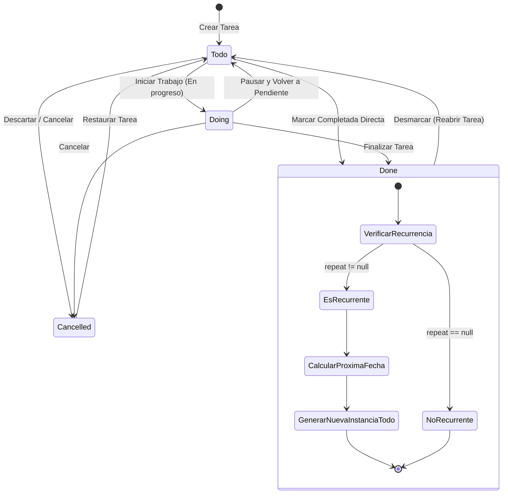

# Especificación de Módulo: MOD-TASKS (Tareas y Agenda)

**Fase:** 03 — Ingeniería de Requisitos  
**Entregable:** 07 de 09 — Especificación Detallada de Módulos  
**Módulo ID:** `MOD-TASKS` (08 de 15)  
**Bounded Context:** `TaskExecution` / Gestión de Tareas y Compromisos  
**Ubicación de Almacenamiento:** `.notevault/tareas/tasks.json` (o archivos de tarea individuales `.json`)  
**Responsable Técnico:** NoteVault Core Engineering  

---

## 1. Alcance y Responsabilidades del Módulo

El módulo `MOD-TASKS` proporciona un sistema ágil y robusto para la captura, priorización, programación y ejecución de tareas cotidianas y profesionales:

- **Estructura Atómica de Tareas:** Cada tarea almacena identificador único, nombre, fecha de creación, fecha de inicio (`start`), hora de inicio (`start_time`), fecha de vencimiento (`due`), hora límite (`due_time`), estado, materia/área (`subject`), nivel de prioridad numérico (1: Urgente a 4: Baja), cuerpo/descripción en Markdown y reglas de recurrencia (`repeat`).
- **Estados de Ciclo de Vida:** Máquina de estados formal: `todo` (Por hacer), `doing` (En progreso), `done` (Completada) y `cancelled` (Descartada/Cancelada).
- **Matriz de Priorización:** Clasificación inspirada en la Matriz de Eisenhower con 4 niveles visuales contrastados: `P1` (Rojo - Urgente e Importante), `P2` (Ámbar - Importante no urgente), `P3` (Azul - Tarea regular) y `P4` (Gris - Baja prioridad / backlog).
- **Vistas Múltiples de Trabajo:** Alternancia instantánea entre vista de lista agrupada por fecha/prioridad, vista de filtros rápidos (Hoy, Próximas, Vencidas, Sin fecha) y tablero Kanban de estados.
- **Gestión de Subtareas y Checklist:** Capacidad de descomponer una tarea compleja en pasos atómicos marcables individualmente.
- **Reglas de Recurrencia Automática:** Replicación automática de tareas periódicas (diaria, días laborales, semanal, quincenal, mensual) tras marcar la instancia actual como completada.

---

## 2. Marco Conceptual: Entidad Tarea en el Dominio

<div class="entity-card">

1. **Entidad principal e independiente.**
2. **Es la entidad líder del conjunto de datos:** posee un identificador global único alfanumérico inmutable (`task_id`: `tsk_7a9f2e31`), invocado directamente por el calendario, el hub Home y el conmutador rápido.
3. **Existe por sí misma en el almacenamiento de tareas sin depender de una carpeta o proyecto padre**, y es la única responsable de validar que su estado, prioridad y fechas límites sean consistentes antes de confirmar cualquier modificación.
4. **Punto de entrada y límite de consistencia:** El cambio de estado a `done` desencadena atómicamente la generación de la siguiente instancia si la tarea posee regla de recurrencia activa.

</div>

---

## 3. Requisitos Funcionales del Módulo (RF)

| ID RF | Declaración del Requisito Funcional | Prioridad MoSCoW | Criterio de Verificación |
| :--- | :--- | :--- | :--- |
| **RF-TSK-01** | El sistema DEBE permitir crear, editar, eliminar y cambiar de estado tareas con soporte para nombre, fechas, prioridad y descripción Markdown. | **Must Have** | Operaciones CRUD persisten en `tasks.json` con guardado atómico. |
| **RF-TSK-02** | El sistema DEBE proveer filtros rápidos para: "Hoy", "Vencidas", "Próximos 7 días", "Completadas" y "Por Prioridad (P1-P4)". | **Must Have** | Componente `TasksModule.tsx` filtra reactivamente en memoria en < 5 ms. |
| **RF-TSK-03** | El sistema DEBE permitir marcar una tarea como `done` con un solo clic en su checkbox, registrando la fecha de finalización. | **Must Have** | La tarea pasa a la sección de completadas con estilo tachado y se persiste en disco. |
| **RF-TSK-04** | El sistema DEBE regenerar automáticamente una nueva instancia con la próxima fecha calculada si la tarea completada tiene regla `repeat`. | **Must Have** | Test unitario: Tarea diaria completada el 20 de Octubre crea nueva tarea para el 21 de Octubre. |
| **RF-TSK-05** | El sistema DEBE soportar subtareas embebidas con barra de progreso porcentual (`subtareas_completadas / total`). | **Should Have** | Al completar todas las subtareas, se sugiere marcar la tarea principal como realizada. |
| **RF-TSK-06** | El sistema DEBE permitir buscar tareas por texto en tiempo real en títulos y cuerpos de descripción. | **Should Have** | Búsqueda filtra al escribir el segundo carácter en menos de 10 ms. |
| **RF-TSK-07** | El sistema DEBE permitir ordenar tareas por fecha de vencimiento, prioridad o fecha de creación de forma ascendente/descendente. | **Should Have** | Selectores de ordenamiento reordenan la lista instantáneamente sin I/O adicional. |

---

## 4. Requisitos No Funcionales del Módulo (RNF Local)

| ID RNF | Dimensión ISO 25010 | Declaración y Métrica Cuantitativa | Método de Medición |
| :--- | :--- | :--- | :--- |
| **RNF-TSK-01** | Eficiencia de Desempeño | **Tiempo de Carga y Filtrado:** El renderizado de una lista de **1,000 tareas** debe completarse en **< 30 ms** usando virtualización de lista. | Benchmark Vitest con `useTasks` poblado sintéticamente. |
| **RNF-TSK-02** | Confiabilidad | **Prevención de Pérdida en Recurrencia:** La generación de la siguiente tarea recurrente debe ejecutarse en la misma transacción que el completado de la tarea actual. | Test de concurrencia y corte abrupto durante la mutación de estado. |
| **RNF-TSK-03** | Portabilidad | **Paridad Estricta de Campos JSON:** Todos los campos deben ser serializados con nombres idénticos en snake_case o camelCase según el contrato para clientes Web y Móvil. | Validación de esquema JSON Schema automatizada. |
| **RNF-TSK-04** | Accesibilidad | **Accionabilidad por Teclado:** Se debe poder navegar con `Tab`/flechas y marcar una tarea con la tecla `Espacio`. | Prueba de accesibilidad WAI-ARIA en `TasksModule.test.tsx`. |

---

## 5. Historias de Usuario con Criterios Gherkin

### US-TSK-01: Creación de tarea urgente con fecha límite
**Como** profesional gestionando entregables críticos,  
**Quiero** crear una tarea asignándole prioridad P1 y fecha de vencimiento para hoy a las 18:00,  
**Para** asegurarme de que aparezca destacada en mi panel Home y en mi calendario.

```gherkin
Escenario: Creación de tarea prioritaria
  Dado que el usuario pulsa "+ Nueva Tarea"
  Cuando ingresa el título "Entregar Documentación MkDocs", prioridad "P1", fecha de vencimiento "Hoy 18:00"
  Y confirma la creación con "Enter"
  Entonces el sistema inserta la tarea al inicio de la lista de tareas de hoy
  Y le asigna un badge rojo "P1"
  Y la tarea se propaga inmediatamente al widget de tareas del panel Home.
```

### US-TSK-02: Completado de tarea recurrente semanal
**Como** usuario con compromisos periódicos como la revisión contable semanal,  
**Quiero** marcar la tarea como completada hoy y que automáticamente se agende para la próxima semana,  
**Para** no tener que volver a crear la tarea manualmente cada 7 días.

```gherkin
Escenario: Renovación automática de tarea semanal
  Dado que la tarea "Revisión Contable" tiene la regla "repeat: weekly" y vence hoy 20 de Octubre
  Cuando el usuario hace clic en el checkbox de completado
  Entonces la tarea actual se archiva en estado "done"
  Y el sistema crea una nueva tarea idéntica con estado "todo" y vencimiento "2026-10-27"
  Y ambas modificaciones se guardan en el archivo "tasks.json".
```

---

## 6. Especificación Detallada de Casos de Uso

### UC-TSK-01: Crear, Mutar Estado y Guardar Tarea

| Campo | Detalle de Especificación |
| :--- | :--- |
| **ID y Nombre** | `UC-TSK-01` — Crear, Mutar Estado y Guardar Tarea |
| **Actor Principal** | Usuario Registrado |
| **Precondición** | La aplicación NoteVault está en ejecución y el store `useTasks` está inicializado. |
| **Flujo Principal** | 1. El usuario abre el modal o la línea de captura rápida de tareas.<br/>2. Ingresa el título de la tarea y selecciona parámetros opcionales (fecha `due`, prioridad `P1-P4`, materia, recurrencia).<br/>3. El sistema valida que el título contenga al menos un carácter no vacío.<br/>4. Genera un identificador único seguro (`tsk_` + UUID v4 corto).<br/>5. Añade la tarea a la lista en memoria y reordena la vista según la prioridad elegida.<br/>6. Dispara la escritura atómica sobre `.notevault/tareas/tasks.json`.<br/>7. Más tarde, el usuario marca el checkbox de la tarea.<br/>8. El sistema cambia su estado a `done`, evalúa si tiene recurrencia (si la tiene, dispara el flujo A1) y persiste la actualización en disco. |
| **Flujos Alternativos** | **A1 (Generar recurrencia):** Si la tarea posee regla `repeat`, el sistema calcula la siguiente fecha según el intervalo (diario, semanal, mensual) y añade la nueva tarea como pendiente (`todo`). |
| **Excepciones** | **E1 (Error de I/O en disco):** Si falla la escritura en disco, el sistema reintenta 3 veces con retroceso exponencial (*exponential backoff*); si persiste la falla, conserva el estado en memoria y alerta al usuario mediante toast de error. |
| **Postcondición** | El archivo `tasks.json` contiene el estado fiel y consistente de todas las tareas. |

---

## 7. Diagrama de Actividad del Módulo



---

## 8. Implicación de Compuerta de Fase (Gate 3 Criteria)

- **¿Bloquea el avance a Modelado/Fase 4?:** No.
- **Condición de Pase:** El esquema de tareas soporta todas las combinaciones de fechas y prioridades requeridas, con pruebas automatizadas que certifican la integridad del cálculo de recurrencias sin duplicación infinita de tareas.
