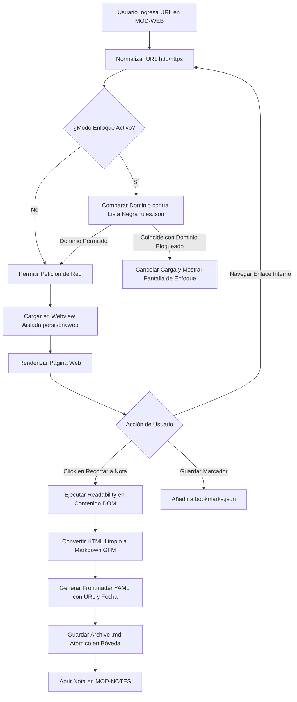

# Especificación de Módulo: MOD-WEB (Navegador Aislado y Control de Enfoque)

**Fase:** 03 — Ingeniería de Requisitos  
**Entregable:** 07 de 09 — Especificación Detallada de Módulos  
**Módulo ID:** `MOD-WEB` (15 de 15)  
**Bounded Context:** `FocusBrowser` / Navegación Aislada y Recorte de Contenido  
**Ubicación de Almacenamiento:** Partición Electron `persist:nvweb` y configuración en `.notevault/web/` (`rules.json`, `bookmarks.json`)  
**Responsable Técnico:** NoteVault Core Engineering  

---

## 1. Alcance y Responsabilidades del Módulo

El módulo `MOD-WEB` provee un entorno de navegación web integrado, confinado y protegido contra la dispersión mental:

- **Sesión de Navegación Aislada:** Opera dentro de una partición de Electron dedicada (`persist:nvweb`), manteniendo cookies, caché y sesiones completamente aisladas del navegador personal del sistema operativo para evitar rastreadores y recomendaciones algorítmicas adictivas.
- **Motor de Bloqueo de Distracciones (*Focus Guard*):** Bloqueo a nivel de red de dominios distractores (redes sociales, portales de noticias sensacionalistas, streaming no académico) activo de forma permanente o sincronizado con el temporizador Pomodoro.
- **Recortador de Contenido a Markdown (*Web Clipper*):** Extracción con un clic del contenido principal de artículos, documentación técnica y papers (eliminando publicidad, encabezados y menús molestos) y conversión limpia a archivos `.md` en la bóveda.
- **Gestor de Pestañas y Marcadores Académicos:** Interfaz lateral (`WebRail.tsx`) que organiza páginas de documentación técnica (`MDN`, `WolframAlpha`, `Arxiv`, `StackOverflow`) asociadas a temas de estudio.
- **Protección contra Inyección de Scripts:** Política de Seguridad de Contenido (CSP) estricta y aislamiento de contexto que impide que páginas web externas accedan al puente IPC de Electron o a los archivos del sistema operativo.

---

## 2. Marco Conceptual: Entidad Marcador y Regla de Enfoque en el Dominio

<div class="entity-card">

1. **Entidad principal e independiente.**
2. **Es la entidad líder del conjunto de datos:** posee un identificador global único (`web_rule_id`: `rul_block_youtube_study_mode`), invocado por el interceptor de red de Electron y el conmutador de modo enfoque.
3. **Existe por sí misma en el registro `.notevault/web/rules.json` sin depender de las páginas abiertas**, y es la única responsable de validar que los patrones de URL (regex o wildcard) sean sintácticamente correctos antes de activar el filtrado de red.
4. **Punto de entrada y límite de consistencia:** Intercepta cada solicitud HTTP antes de que los paquetes salgan a internet y redirige los dominios bloqueados a una pantalla de advertencia reflexiva.

</div>

---

## 3. Requisitos Funcionales del Módulo (RF)

| ID RF | Declaración del Requisito Funcional | Prioridad MoSCoW | Criterio de Verificación |
| :--- | :--- | :--- | :--- |
| **RF-WEB-01** | El sistema DEBE embeber un navegador web interactivo en Electron configurado con la partición aislada `persist:nvweb`. | **Must Have** | Componente `WebModule.tsx` navega a URLs con barra de dirección y botones de retroceso/avance. |
| **RF-WEB-02** | El sistema DEBE interceptar y bloquear solicitudes a dominios listados en la lista negra de distracciones durante el modo de enfoque. | **Must Have** | Peticiones a dominios bloqueados retornan redirección local a `about:blank` o vista de bloqueo. |
| **RF-WEB-03** | El sistema DEBE permitir recortar el artículo web activo, convirtiéndolo a Markdown limpio mediante Mozilla Readability y guardándolo en la bóveda. | **Must Have** | Clic en "Recortar a Nota" genera archivo `.md` con título, URL origen y cuerpo formateado. |
| **RF-WEB-04** | El sistema DEBE gestionar pestañas web independientes en la barra lateral sin interferir con las pestañas de notas del usuario. | **Must Have** | Apertura, cierre y conmutación de pestañas web persisten en el store `useWebPages`. |
| **RF-WEB-05** | El sistema DEBE garantizar que ningún sitio web externo pueda invocar métodos del puente IPC (`window.api`). | **Must Have** | Test de penetración: script inyectado en webview no puede acceder a funciones de Node.js ni Electron. |
| **RF-WEB-06** | El sistema DEBE permitir guardar marcadores categorizados por materia de estudio (ej. "Álgebra", "Documentación React"). | **Should Have** | Marcadores se listan en el panel lateral y se abren con un solo clic. |
| **RF-WEB-07** | El sistema DEBE limpiar cookies y datos de navegación de sitios no marcados al cerrar la sesión de estudio si el usuario lo configura. | **Could Have** | Opción "Modo Efímero" purga la caché al terminar el Pomodoro. |

---

## 4. Requisitos No Funcionales del Módulo (RNF Local)

| ID RNF | Dimensión ISO 25010 | Declaración y Métrica Cuantitativa | Método de Medición |
| :--- | :--- | :--- | :--- |
| **RNF-WEB-01** | Seguridad | **Aislamiento Total del Contexto:** `contextIsolation: true`, `nodeIntegration: false`, y `webSecurity: true` en todas las sesiones de webview. | Auditoría automatizada de configuración de Electron `webPreferences`. |
| **RNF-WEB-02** | Eficiencia de Desempeño | **Tiempo de Recorte de Artículo:** La extracción del contenido DOM y serialización a Markdown debe tomar **< 300 ms** para páginas de hasta 5,000 palabras. | Medición de tiempo de ejecución de la función de clipping. |
| **RNF-WEB-03** | Confiabilidad | **Resiliencia ante Caídas de Proceso Web:** Si una página web externa sufre un error fatal (*renderer crash*), la ventana principal de NoteVault no debe cerrarse ni afectarse. | Manejo del evento `render-process-gone` recargando solo el contenedor web. |
| **RNF-WEB-04** | Privacidad | **Cero Telemetría a Servidores de Publicidad:** La partición web bloquea el envío de identificadores del hardware a redes publicitarias. | Análisis de encabezados HTTP con Wireshark en entorno de pruebas. |

---

## 5. Historias de Usuario con Criterios Gherkin

### US-WEB-01: Bloqueo de distracción durante sesión Pomodoro
**Como** estudiante propenso a distraerse con videos o redes sociales mientras estudia,  
**Quiero** que NoteVault bloquee el acceso a sitios de ocio mientras el Pomodoro esté corriendo,  
**Para** proteger mi concentración y no romper mi estado de flujo mental.

```gherkin
Escenario: Intento de acceder a dominio bloqueado durante estudio
  Dado que el temporizador Pomodoro está activo y la regla "Bloquear Redes Sociales" está habilitada
  Cuando el usuario intenta navegar a "https://www.youtube.com" en el navegador web integrado
  Entonces el interceptor de red de Electron cancela la carga de la página
  Y muestra una pantalla con el mensaje "Sitio bloqueado durante tu sesión de enfoque. Vuelve a tus notas".
```

### US-WEB-02: Recorte de artículo técnico a nota Markdown
**Como** investigador que encuentra un tutorial excelente en la web,  
**Quiero** presionar el botón "Recortar a Nota",  
**Para** tener una copia permanente en Markdown dentro de mi bóveda que pueda leer sin anuncios ni conexión a internet.

```gherkin
Escenario: Recorte limpio de página web
  Dado que el usuario tiene abierta la página "https://developer.mozilla.org/.../Array/reduce"
  Cuando pulsa el ícono de la tijera "Recortar Artículo"
  Entonces el sistema extrae el título y el contenido limpio del artículo
  Y genera el archivo "MDN_Array_reduce.md" en la carpeta "1.PERSONAL/Recortes/"
  Y abre la nota inmediatamente en el editor en una pestaña contigua.
```

---

## 6. Especificación Detallada de Casos de Uso

### UC-WEB-01: Navegar con Protección de Enfoque y Recortar Contenido

| Campo | Detalle de Especificación |
| :--- | :--- |
| **ID y Nombre** | `UC-WEB-01` — Navegar con Protección de Enfoque y Recortar Contenido |
| **Actor Principal** | Usuario Registrado |
| **Precondición** | El proceso principal de Electron tiene configurada la partición `persist:nvweb`. |
| **Flujo Principal** | 1. El usuario abre el módulo "Navegador Web" e introduce una URL en la barra superior.<br/>2. El sistema valida la URL contra la lista negra de `.notevault/web/rules.json`.<br/>3. Si el dominio está permitido, carga la página dentro del contenedor web aislado.<br/>4. El usuario lee el contenido técnico y resalta un párrafo relevante.<br/>5. Pulsa el botón "Recortar a Nota".<br/>6. El sistema ejecuta el extractor Readability, eliminando estilos ajenos y scripts.<br/>7. Convierte el árbol HTML limpio a Markdown (tablas, encabezados, bloques de código con sintaxis).<br/>8. Añade frontmatter con metadatos: `title`, `url`, `clipped_at`.<br/>9. Escribe el archivo `.md` de forma atómica en la carpeta de la bóveda.<br/>10. Emite un toast informando "Nota creada con éxito" y ofrece abrirla. |
| **Flujos Alternativos** | **A1 (Dominio bloqueado):** Si el dominio coincide con un patrón de distracción activo, el sistema cancela la navegación y renderiza la pantalla de protección de enfoque con botón para volver a la página anterior. |
| **Excepciones** | **E1 (Página protegida contra scraping o sin contenido textual):** Si el extractor no encuentra un artículo legible (ej. una aplicación interactiva en lienzo), genera una nota con el enlace, el título de la página y una captura de pantalla PNG incrustada. |
| **Postcondición** | La nota en disco preserva el conocimiento extraído y el historial web se mantiene local. |

---

## 7. Diagrama de Actividad del Módulo



---

## 8. Implicación de Compuerta de Fase (Gate 3 Criteria)

- **¿Bloquea el avance a Modelado/Fase 4?:** No.
- **Condición de Pase:** La arquitectura de seguridad del navegador confinado está validada con políticas CSP estrictas, y el motor de clipping produce Markdown estándar compatible con el editor principal.
