# 04. Domain Model & ERD Conceptual

**Fase:** 04 — Modelado del Sistema  
**Entregable:** 04 de 15  
**Proyecto:** NoteVault (PC Windows, macOS, Linux, Android, iOS / iPhone)  
**Estado:** Formalizado y Certificado  

---

## 1. Diagrama de Dominio Integral y Agregados (15 Módulos)

El siguiente Diagrama de Clases UML formaliza el modelo de dominio conceptual de NoteVault, estructurado en torno a la raíz de agregación universal (`Boveda`) y las entidades líderes de cada uno de los 15 contextos delimitados:

```mermaid
classDiagram
    direction TB

    class Boveda {
        +string vault_path
        +int format_version
        +string active_theme
        +open()
        +validate()
        +sync()
    }

    class Nota {
        +string note_path
        +string title
        +object frontmatter
        +string body
        +int mtime
        +bool bookmarked
        +save_atomic()
    }

    class DocumentoCanvas {
        +string canvas_path
        +list nodes
        +list edges
        +save_atomic()
        +auto_layout()
    }

    class HubDiario {
        +string date_id
        +list quick_notes
        +float adherence_rate
        +aggregate_metrics()
    }

    class EventoCalendario {
        +string event_id
        +string start_date
        +string end_date
        +string event_type
        +reschedule()
    }

    class RegistroHabito {
        +string habit_id
        +string name
        +list active_days
        +list completed_dates
        +int current_streak
        +int longest_streak
        +toggle_date()
    }

    class SesionEntrenamiento {
        +string workout_session_id
        +string routine_id
        +datetime start_time
        +list sets_log
        +float total_tonnage
        +calculate_1rm()
        +finish_session()
    }

    class RegistroNutricional {
        +string nutrition_day_id
        +float protein_grams
        +float carb_grams
        +float fat_grams
        +int total_kcal
        +int water_ml
        +add_food()
    }

    class Tarea {
        +string task_id
        +string name
        +string status
        +int priority
        +string due_date
        +string repeat_rule
        +list subtasks
        +mark_done()
    }

    class ProyectoSDLC {
        +string project_id
        +string title
        +int active_phase
        +list deliverables
        +float progress_pct
        +advance_stage()
    }

    class MetaOKR {
        +string goal_id
        +string horizon
        +list key_results
        +float progress_pct
        +update_kr()
    }

    class TransaccionFinanciera {
        +string transaction_id
        +string account_id
        +float amount
        +string type
        +string category
        +commit_ledger()
    }

    class TarjetaRepasoSRS {
        +string srs_card_id
        +string note_reference
        +float ease_factor
        +int interval_days
        +int repetitions
        +string next_due
        +evaluate(grade)
    }

    class PistaInmersion {
        +string immersion_track_id
        +string media_path
        +string subtitle_path
        +float playback_offset
        +bool loop_active
        +seek_sentence()
    }

    class PlanMentor {
        +string plan_id
        +string month_id
        +string area_mode
        +list weekly_blocks
        +float adherence_pct
        +build_plan()
    }

    class ReglaEnfoqueWeb {
        +string web_rule_id
        +string domain_pattern
        +bool block_during_pomodoro
        +list bookmarks
        +intercept_request()
        +clip_article()
    }

    %% Relaciones de Agregación Raíz
    Boveda "1" *-- "*" Nota : almacena
    Boveda "1" *-- "*" DocumentoCanvas : almacena
    Boveda "1" *-- "1" HubDiario : proyecta
    Boveda "1" *-- "*" EventoCalendario : agenda
    Boveda "1" *-- "*" RegistroHabito : rastrea
    Boveda "1" *-- "*" SesionEntrenamiento : registra
    Boveda "1" *-- "*" RegistroNutricional : contabiliza
    Boveda "1" *-- "*" Tarea : coordina
    Boveda "1" *-- "*" ProyectoSDLC : gestiona
    Boveda "1" *-- "*" MetaOKR : planifica
    Boveda "1" *-- "*" TransaccionFinanciera : audita
    Boveda "1" *-- "*" TarjetaRepasoSRS : programa
    Boveda "1" *-- "*" PistaInmersion : reproduce
    Boveda "1" *-- "*" PlanMentor : orquesta
    Boveda "1" *-- "*" ReglaEnfoqueWeb : confina
```

---

## 2. Marco Conceptual: Raíz de Agregado del Dominio (Aggregate Root)

1. **Entidad principal e independiente.**
2. **Es la entidad líder del conjunto de datos:** posee un identificador global único que fija la identidad física de cada registro (`note_path`, `task_id`, `habit_id`, `workout_session_id`, `srs_card_id`, `project_id`), invocado directamente por los stores de interfaz y controladores I/O.
3. **Existe por sí misma en el sistema de almacenamiento sin depender de un catálogo central relacional**, y es la única responsable de validar sus invariantes de negocio (no duplicación de fechas, montos positivos, sintaxis Markdown válida) antes de autorizar escrituras a disco.
4. **Punto de entrada y límite de consistencia:** Define la frontera de transaccionalidad atómica; el reemplazo de su archivo representativo en disco actualiza el estado de la entidad sin dejar registros en estados intermedios inconsistentes.

