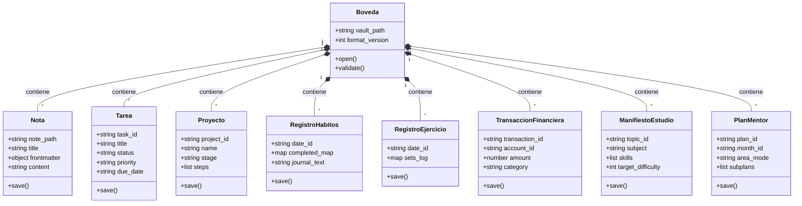

# 04. Domain Model & ERD Conceptual

**Fase:** 04 — Modelado del Sistema  
**Entregable:** 04  
**Proyecto:** NoteVault (PC, Mac, Android, iPhone)

---

## 1. Diagrama de Dominio Relacional y Agregados

---

## 2. Marco Conceptual: Entidad Raíz de Agregado (Aggregate Root)

1. **Entidad principal e independiente.**
2. **Es la entidad líder del conjunto de datos:** posee un identificador global único para que todo el sistema la consulte o invoque directamente (`vault_id`, `note_path`, `task_id`, `project_id`, `date_id`, `account_id`, `topic_id`, `plan_id`).
3. **Existe por sí misma en el almacenamiento en disco sin depender de una entidad padre**, y es la única responsable de validar que todas las reglas obligatorias de su grupo se cumplan antes de permitir guardar cambios.
4. **Punto de entrada y límite de consistencia transaccional:** Cada agregado delimita su propia frontera de atomicidad en el sistema de archivos.

