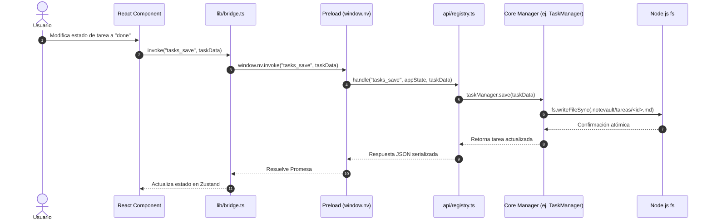

# 05. System Sequence Diagrams

**Fase:** 04 — Modelado del Sistema  
**Entregable:** 05  
**Proyecto:** NoteVault (PC, Mac, Android, iPhone)

---

## 1. Diagrama de Secuencia: Despacho de API e IPC en Desktop

---

## 2. Marco Conceptual: Interacción Temporal de Secuencia

1. **Entidad principal e independiente.**
2. **Es la entidad líder del conjunto de datos:** posee un identificador global único que fija el protocolo de intercambio temporal (`sequence_interaction_id`: `SEQ-IPC-TASK-SAVE`) consultado en las pruebas de integración.
3. **Existe por sí misma en el diseño de comunicación sin depender de los componentes gráficos**, y es la única responsable de definir el orden cronológico de mensajes entre la interfaz y el almacenamiento.
4. **Punto de entrada y límite de consistencia:** Si un mensaje intermedio falla, se asegura el retorno ordenado de un error controlado.

