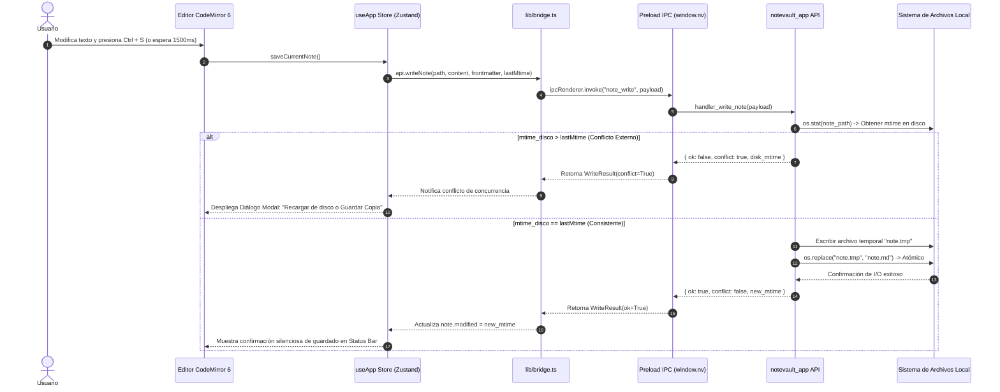
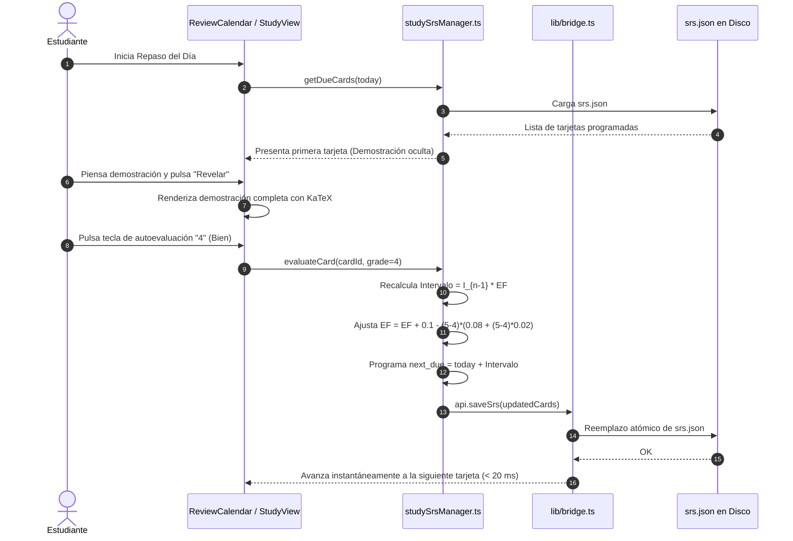
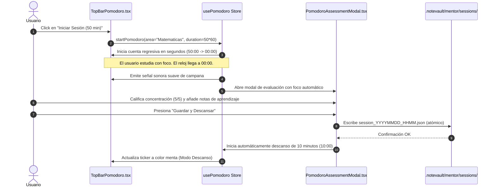
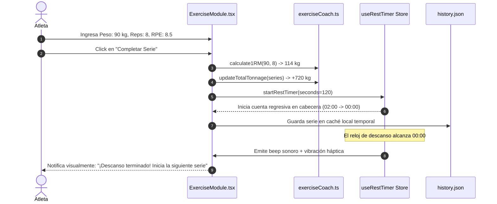
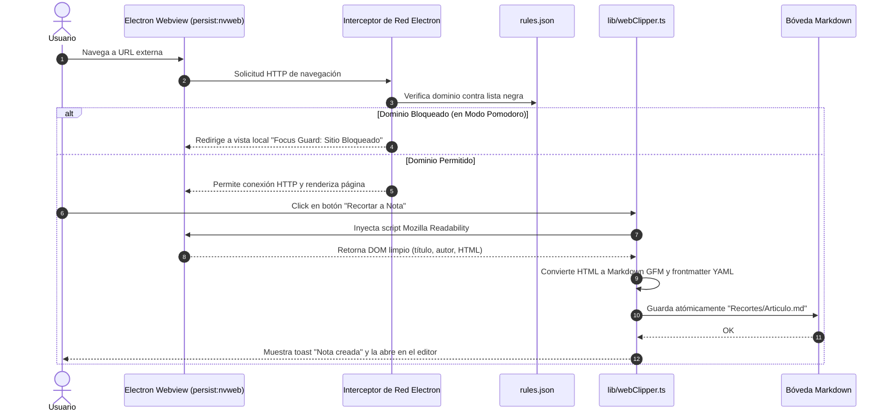

# 05. System Sequence Diagrams

**Fase:** 04 — Modelado del Sistema  
**Entregable:** 05 de 15  
**Proyecto:** NoteVault (PC Windows, macOS, Linux, Android, iOS / iPhone)  
**Estado:** Formalizado y Certificado  

---

## 1. Diagramas de Secuencia de Flujos Críticos del Sistema

Los diagramas de secuencia UML formalizan la coreografía temporal de mensajes, despacho de IPC y persistencia atómica en los flujos más sensibles del ecosistema:

### 1.1 Flujo 1: Edición y Guardado Atómico de Nota con Detección de Conflictos (MOD-NOTES)

---

### 1.2 Flujo 2: Ciclo de Repetición Espaciada Activa (MOD-STUDY)

---

### 1.3 Flujo 3: Sesión Pomodoro y Evaluación Post-Sesión (MOD-MENTOR)

---

### 1.4 Flujo 4: Registro de Serie de Entrenamiento y Rest Timer (MOD-EXERCISE)

---

### 1.5 Flujo 5: Navegación Protegida y Web Clipper a Markdown (MOD-WEB)

---

## 2. Marco Conceptual: Interacción Temporal de Secuencia

1. **Entidad principal e independiente.**
2. **Es la entidad líder del conjunto de datos:** posee un identificador global único que fija el protocolo de intercambio temporal (`sequence_interaction_id`: `SEQ-IPC-ATOMIC-SAVE`), consultado en las suites de pruebas de integración y simulación de carga.
3. **Existe por sí misma en el diseño de comunicación sin depender de los componentes gráficos**, y es la única responsable de gobernar el orden cronológico y los mecanismos de rollback ante fallos intermedios.
4. **Punto de entrada y límite de consistencia:** Si cualquier paso de la cadena falla (ej. error de I/O en disco), se garantiza el retorno ordenado de un error controlado sin mutar el estado en memoria.

