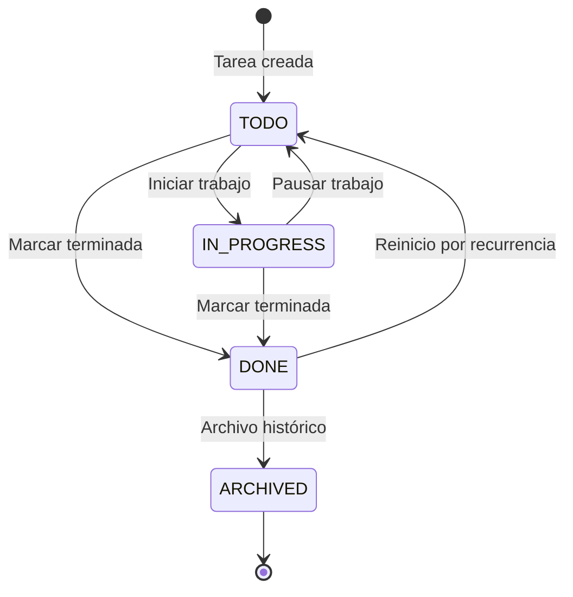
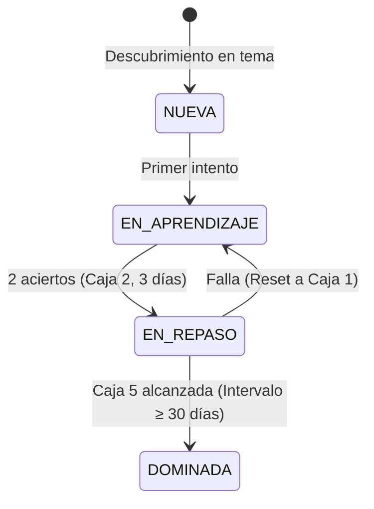

# 06. State Machine Diagrams

**Fase:** 04 — Modelado del Sistema  
**Entregable:** 06  
**Proyecto:** NoteVault (PC, Mac, Android, iPhone)

---

## 1. Diagramas de Máquinas de Estado

### Estado de Tarea (`Task`)

### Repetición Espaciada (`SRS Flashcard`)

---

## 2. Marco Conceptual: Máquina de Estados Finitos (FSM)

1. **Entidad principal e independiente.**
2. **Es la entidad líder del conjunto de datos:** posee un identificador global único que modela el ciclo de vida de una entidad (`fsm_lifecycle_id`: `FSM-SRS-ALGORITHM`) consultado en los cálculos del motor de práctica.
3. **Existe por sí misma en las reglas de dominio sin depender de la UI**, y es la única responsable de restringir las transiciones permitidas y calcular los nuevos valores de retención.
4. **Punto de entrada y límite de consistencia:** Una transición no permitida es bloqueada inmediatamente.

