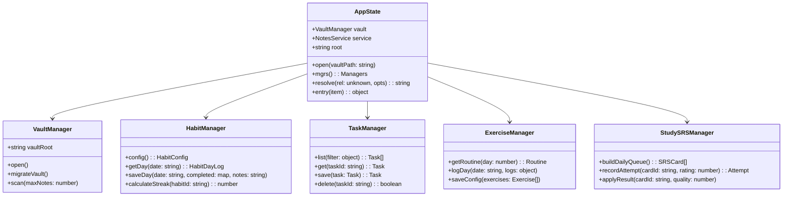

# 05. Class & Entity Diagrams (TypeScript & Dart)

**Fase:** 06 — Diseño Técnico  
**Entregable:** 05  
**Proyecto:** NoteVault (PC, Mac, Android, iPhone)

---

## 1. Diagramas de Clases UML Homólogos

---

## 2. Marco Conceptual: Clase de Servicio de Dominio

1. **Entidad principal e independiente.**
2. **Es la entidad líder del conjunto de datos:** posee un identificador global único que fija la interfaz pública de la clase (`domain_class_id`: `CLASS-HABIT-MANAGER`) consultado en los diagramas de clases UML.
3. **Existe por sí misma en el diseño de código sin acoplamiento a frameworks de terceros**, y es la única responsable de encapsular los métodos de negocio, invariantes y serializaciones de su agregado.
4. **Punto de entrada y límite de consistencia:** Todas las mutaciones de datos del módulo pasan obligatoriamente por sus métodos públicos.

