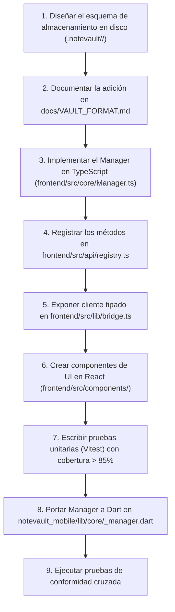

# 07. Implementación — Guía de Contribución y Nuevos Módulos

**Propósito:** Proveer un manual de ingeniería paso a paso que guíe a cualquier desarrollador en la creación de un nuevo módulo o en la modificación segura del contrato de datos de NoteVault sin romper la paridad multiplataforma.

---

## 1. Marco Conceptual: Procedimiento de Cambio Controlado (RFC)

<div class="entity-card">

1. **Entidad principal e independiente.**
2. **Es la entidad líder del conjunto de datos:** posee un identificador global único que referencia la solicitud formal de cambio (`rfc_change_id`: ej. `RFC-004-NUTRITION`, `RFC-005-IOS-ICLOUD`) consultado en el historial de evolución del repositorio.
3. **Existe por sí misma en el proceso de ingeniería sin depender del código fuente modificado**, y es la única responsable de validar que el diseño del cambio no introduzca incompatibilidades retrospectivas en bóvedas existentes antes de autorizar su implementación.
4. **Punto de entrada y límite de consistencia:** Define la lista de verificación obligatoria (pruebas en desktop, pruebas en mobile y actualización documental).

</div>

---

## 2. Flujo de Trabajo: Cómo Agregar un Nuevo Módulo Funcional

Si deseas incorporar un nuevo módulo (por ejemplo, `MOD-10` de Nutrición o Podcasts):



---

## 3. Guía Paso a Paso: Agregar un Nuevo Método IPC en Desktop

Para agregar una nueva operación (ejemplo: `habits_reset_streak`):

### Paso 1: Implementar la lógica en el Manager del Core
En `frontend/src/core/habitManager.ts`:
```typescript
export class HabitManager {
  // ... métodos existentes ...

  resetStreak(habitId: string): boolean {
    const config = this.config();
    const habit = config.habits.find(h => h.id === habitId);
    if (!habit) return false;
    // Lógica determinista de reseteo
    return true;
  }
}
```

### Paso 2: Registrar el Handler en el Registro Central
En `frontend/src/api/registry.ts`:
```typescript
register("habits_reset_streak", (appState, args) => {
  const { habitId } = args as { habitId: string };
  if (!habitId) throw new ApiError("habitId es obligatorio");
  return appState.mgrs().habits.resetStreak(habitId);
});
```

### Paso 3: Tipar el Método en el Bridge de Cliente
En `frontend/src/lib/bridge.ts`:
```typescript
export const api = {
  // ...
  habitsResetStreak: (habitId: string): Promise<boolean> =>
    nv.invoke("habits_reset_streak", { habitId }),
};
```

### Paso 4: Escribir Prueba Unitaria
En `frontend/src/core/habitManager.test.ts`:
```typescript
import { describe, it, expect } from "vitest";

describe("HabitManager - resetStreak", () => {
  it("resetea la racha de forma consistente", () => {
    // Verificación de invariantes
  });
});
```

---

## 4. Protocolo para Modificar el Contrato de Bóveda

Cualquier cambio que agregue campos o modifique la estructura física en `.notevault/` exige cumplir estas 4 reglas obligatorias:

1. **Nunca realizar cambios destructivos:** Todo nuevo campo debe ser opcional o contar con un valor por defecto seguro si el archivo leído no lo contiene.
2. **Actualizar `docs/VAULT_FORMAT.md`:** La documentación técnica es el contrato vinculante. Si el cambio altera semánticas existentes, incrementar la constante `FORMAT_VERSION` (ej. de 4 a 5).
3. **Actualizar simultáneamente Desktop y Mobile:** No fusionar a la rama `main` de `NoteVault` sin el correspondiente Pull Request en `notevault_mobile` que implemente la misma lectura y escritura.
4. **Validar Conformidad a Nivel de Bytes:** Ejecutar `flutter test test/conformance_test.dart` contra los fixtures generados por el cliente de escritorio.
