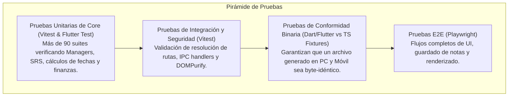

# 08. Operaciones y Calidad — Estrategia de Testing y Resiliencia

**Propósito:** Especificar la pirámide de pruebas automatizadas, las pruebas de conformidad binaria entre plataformas y los protocolos de resiliencia ante fallos del sistema de archivos y conflictos de sincronización.

---

## 1. Marco Conceptual: Estrategia de Prueba Automatizada

1. **Entidad principal e independiente.**
2. **Es la entidad líder del conjunto de datos:** posee un identificador global único que categoriza el nivel y alcance de la verificación (`test_suite_id`: ej. `test_unit_core`, `test_conformance_mobile`, `test_security_ipc`) ejecutado por los runners de CI/CD.
3. **Existe por sí misma en el arnés de pruebas sin alterar el estado real de la bóveda del usuario**, y es la única responsable de simular escenarios límite (archivos corruptos, desconexiones, concurrencia) para certificar que el software no falle antes de compilar para producción.
4. **Punto de entrada y límite de consistencia:** El fallo de un solo test en la suite bloquea de forma inmediata la generación del instalador de producción.

---

## 2. Pirámide de Pruebas de NoteVault

---

## 3. Catálogo de Baterías de Pruebas

| Tipo de Prueba | Framework / Runner | Archivo / Comando | Qué Certifica |
| :--- | :--- | :--- | :--- |
| **Pruebas de Tipos** | TypeScript Compiler (`tsc`) | `npm run typecheck` | Cero discrepancias de tipos estáticos en el código base. |
| **Pruebas Unitarias Core** | Vitest 5 | `npx vitest run` | Lógica pura de `HabitManager`, `TaskManager`, `StudySRSManager`, etc. |
| **Seguridad de IPC y Rutas** | Vitest 5 | `frontend/src/api/windowSecurity.test.ts`, `appStateResolve.test.ts` | Confinamiento de rutas a la bóveda y prevención de *Path Traversal*. |
| **Contraste y Accesibilidad**| Vitest + JSDOM | `frontend/src/styles.contrast.test.ts` | Cumplimiento del ratio de contraste WCAG 2.1 AA (≥ 4.5:1). |
| **Conformidad Móvil** | Flutter Test (Dart) | `notevault_mobile/test/conformance_test.dart` | Escritura de archivos byte a byte idéntica a la generada por PC. |
| **Pruebas E2E de Interfaz** | Playwright | `npm run test:e2e` | Navegación entre vistas, atajos de teclado y guardado interactivo. |

---

## 4. Runbook de Resiliencia y Recuperación de Desastres

### Escenario 1: Conflicto de Sincronización Syncthing (`*.sync-conflict-*`)
- **Síntoma:** Dos dispositivos editaron notas o registros mientras estaban desconectados. Syncthing crea un archivo duplicado con la marca `.sync-conflict-YYYYMMDD-HHMMSS`.
- **Comportamiento Automático de NoteVault:**
  1. El escáner de archivos (`vaultScan.ts` y homólogo en Dart) detecta la subcadena `.sync-conflict-`.
  2. El archivo de conflicto **nunca se borra ni se sobrescribe**, protegiendo ambas versiones.
  3. Se excluye del cálculo normal de estadísticas y se despliega una alerta visual no bloqueante en la barra de estado.
  4. El usuario puede comparar ambas notas en la interfaz y decidir cuál conservar con un solo clic.

### Escenario 2: Corte Repentino de Energía Durante el Guardado
- **Mecanismo de Protección:** Las operaciones de guardado crítico utilizan el patrón de **escritura atómica**:
  1. El contenido se escribe primero en un archivo temporal con extensión `.tmp` en el mismo directorio.
  2. Una vez que el sistema operativo confirma que los bytes están en disco (`fsync`), se ejecuta una operación atómica de renombrado (`fs.renameSync` / `file.renameSync`) sobre el archivo destino.
  3. Si ocurre un fallo en medio del proceso, el archivo original permanece 100% intacto y el archivo temporal se limpia en el siguiente arranque.

### Escenario 3: Bóvedas Creadas en Versiones Antiguas (Migración Transparente)
- **Mecanismo de Protección:**
  1. Al abrir cualquier bóveda, `vaultManager.ts` revisa si existen carpetas heredadas en la raíz (`habits`, `ejercicio`, `tareas`, `proyectos`).
  2. Si existen, ejecuta una migración no destructiva hacia `.notevault/`.
  3. Si un archivo destino ya existe, **el destino gana** y la copia antigua se preserva en disco sin sobreescrituras destructivas.
