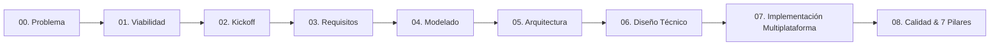

# Ingeniería — portal de arquitectura de NoteVault

**Proyecto:** NoteVault (Ecosistema de Productividad, Estudio y Toma de Notas Local-First)  
**Propósito:** Este portal constituye la referencia canónica de arquitectura, diseño técnico y guía de desarrollo para NoteVault. Sigue rigurosamente la metodología **Full Stack Development** (SDLC de ingeniería de software) y documenta la arquitectura técnica orientada a su expansión multiplataforma en **PC (Windows, Linux, macOS)** y **Móviles (Android, iOS / iPhone)**.

---

## 1. Visión del Sistema y Estrategia Multiplataforma

NoteVault es un entorno de estudio personal, gestión de hábitos, entrenamiento, finanzas y toma de notas construido bajo la filosofía **Local-First** y **Zero-Backend**:

1. **Sin servidor central ni base de datos propietaria:** Todo el estado del usuario vive en una carpeta en disco (la **bóveda** o *vault*), compuesta por archivos Markdown (`.md`) con frontmatter YAML y archivos JSON formateados.
2. **Sincronización P2P / Nube transparente:** La sincronización entre dispositivos no depende de una API en la nube con suscripción; opera a nivel de sistema de archivos mediante herramientas como Syncthing, iCloud Drive, Google Drive o Git.
3. **Contrato de Almacenamiento Unificado:** El formato de bóveda (`VAULT_FORMAT.md` versión 4) es el único contrato formal que acopla los clientes. Dos clientes distintos leyendo y escribiendo la misma bóveda operan con absoluta simetría determinista.

### Ecosistema de Plataformas Objetivo

| Plataforma | Entorno / OS | Stack Tecnológico | Estado / Rol |
| :--- | :--- | :--- | :--- |
| **PC (Windows / Linux)** | Windows 10/11, Ubuntu/Debian | Electron + TypeScript + React 19 + Vite | **Producción activa** (`frontend/`) |
| **PC (macOS)** | macOS 12+ (Apple Silicon & Intel) | Electron + TypeScript + React 19 + Vite | **Producción / Empaquetado DMG** |
| **Android** | Android 8.0+ (API 26+) | Flutter / Dart (Material 3) | **En desarrollo / Paridad activa** (`notevault_mobile/`) |
| **iPhone / iPad (iOS)** | iOS 15+ / iPadOS | Flutter / Dart (Cupertino / Adaptive) | **Objetivo de compilación compartido** |

---

## 2. Metodología de Documentación Full Stack

Este portal está estructurado como una **carpeta guía pedagógica** que enseña cómo se documenta formalmente un sistema de software integral desde el reconocimiento del problema hasta la observabilidad y los 7 pilares de calidad:

---

## 3. Regla Canónica de Marco Conceptual y Teoría de Dominio

En estricto apego a las directivas de arquitectura del proyecto, **toda entidad conceptual, agregado o teoría de dominio** a lo largo de este portal se define de forma directa, simple y priorizada bajo el siguiente estándar de 4 puntos:

!!! info "Estándar de Definición Conceptual (4 Puntos)"
    1. **Entidad principal e independiente.**
    2. **Es la entidad líder del conjunto de datos:** posee un identificador global único para que todo el sistema la consulte o invoque directamente (`vault_id`, `note_path`, `task_id`, `habit_id`, `goal_id`, `account_id`, `topic_id`, `plan_id`).
    3. **Existe por sí misma en el almacenamiento/base de datos sin depender de una entidad padre**, y es la única responsable de validar que todas las reglas obligatorias de su grupo se cumplan antes de permitir guardar cambios.
    4. **Punto de entrada y límite de consistencia transaccional.**

---

## 4. Índice Maestro de Entregables Canónicos

### [00. Reconocimiento del Problema](00-reconocimiento-del-problema/01.%20Declaración%20del%20Problema.md)
Catálogo completo de entregables de reconocimiento de necesidad y gobernanza temprana:
- **01. Declaración del Problema** | **02. Clasificación del Problema** | **03. Estimación de Impacto**
- **04. Matriz de Impacto** | **05. Objetivos del Proyecto** | **06. Mapa de Interesados**
- **07. Registro de Riesgos** | **08. Go No-Go Signal** | **09. Brief de Cierre**

### [01. Viabilidad Temprana](01-viabilidad-temprana/01.%20Perfil%20de%20Usuario.md)
Catálogo exhaustivo de viabilidad técnica, económica y operativa (18 entregables):
- **01. Perfil de Usuario** | **02. Validación de Mercado** | **03. Análisis Competitivo**
- **04. Mapa de Partes Interesadas** | **05. Registro de Factibilidad Técnica** | **06. Accesibilidad de Datos**
- **07. Despeje Legal y Regulatorio** | **08. Capacidad del Equipo** | **09. Viabilidad de la Solución**
- **10. Registro de Riesgos** | **11. Supuestos Críticos** | **12. Definición del MVP**
- **13. Lean Canvas** | **14. OKRs y Objetivos** | **15. Plan Inicial de Proyecto**
- **16. Proceso de Trabajo y Herramientas** | **17. Decisión Go-NoGo** | **18. Resumen Ejecutivo Fase 1**

### [02. Project Kickoff](02-project-kickoff/01.%20Identidad%20del%20Proyecto.md)
Acuerdos de trabajo, convenciones de código y matriz de herramientas (13 entregables):
- **01. Identidad del Proyecto** | **02. Restricciones No Funcionales** | **03. Decisión de Stack**
- **04. Estructura del Repositorio** | **05. Branching Strategy** | **06. Definición de Entornos**
- **07. Estándares de Codificación** | **08. Estrategia de Pruebas** | **09. Definition of Done & Ready**
- **10. Tooling** | **11. Protocolos de Comunicación** | **12. Actualización Registro de Riesgos**
- **13. Resumen Ejecutivo Fase 2**

### [03. Ingeniería de Requisitos](03-requirements/01.%20Diagrama%20de%20Contexto%20del%20Sistema.md)
Especificación de frontera, lenguaje ubicuo, los 15 módulos funcionales y Libro Blanco SRS:
- **01. Diagrama de Contexto del Sistema (C4 Nivel 1)** | **02. Definición de Actores y Roles**
- **03. Glosario de Dominio (Lenguaje Ubicuo)** | **04. Elicitación de Requerimientos (FURPS+)**
- **05. Descomposición Modular Funcional (15 Módulos)** | **06. Requerimientos No Funcionales (ISO 25010)**
- **07. Especificaciones de Módulos:** `MOD-NOTES`, `MOD-HOME`, `MOD-CANVAS`, `MOD-CALENDAR`, `MOD-HABITS`, `MOD-EXERCISE`, `MOD-NUTRITION`, `MOD-TASKS`, `MOD-PROJECTS`, `MOD-GOALS`, `MOD-FINANCE`, `MOD-STUDY`, `MOD-ENGLISH`, `MOD-MENTOR`, `MOD-WEB`
- **08. System Requirements Specification (SRS) & Matriz RTM (39 Requisitos Trazados)**
- **09. Phase 3 Brief (Gate 3 Closure)**

### [04. Modelado del Sistema](04-system-modeling/01.%20Content%20Strategy%20&%20Information%20Architecture.md)
Diseño conceptual, experiencia de usuario y arquitectura de datos (15 entregables):
- **01. Content Strategy & Information Architecture** | **02. User Flows & Task Flows**
- **03. Design System UI Kit** | **04. Domain Model and ERD (15 Entidades)**
- **05. System Sequence Diagrams (5 Flujos Críticos)** | **06. State Machine Diagrams**
- **07. API Conceptual Design (IPC Contracts)** | **08. Security & Authorization Model**
- **09. Accessibility Standards (WCAG 2.1 AA)** | **10. Notification Matrix**
- **11. Wireframes & Spatial Layout** | **12. Architectural Signals hacia Fase 5**
- **13. Localization Strategy (i18n)** | **14. High-Fidelity Mockups**
- **15. Phase 4 RTM Update & Brief (Gate 4 Closure)**

### [05. Diseño Arquitectónico](05-architectural-design/01-quality-attributes-map.md)
Macro-decisiones técnicas, topología distribuida y registro inmutable de ADRs:
- **01. Quality Attributes Map** | **02. Bounded Context Formalization**
- **03. Deployment Topology Decision (ADR-001)** | **04. System Decomposition Decision (ADR-002)**
- **05. Architectural Style Selection (ADR-003)** | **06. Communication Pattern Decision (ADR-004)**
- **07. Cross-Cutting Concerns** | **08. CI-CD & Environments Strategy**
- **09. Component Diagram (C4 Nivel 3)** | **10. ADR Consolidation**
- **11. Phase 5 RTM Update & Brief**

### [06. Diseño Técnico](06-technical-design/01-codebase-&-folder-architecture.md)
Planos de construcción detallados previos a la implementación:
- **01. Codebase & Folder Architecture** | **02. Physical Data Modeling (Vault Format v4)**
- **03. Configuration & Environment Secrets** | **04. Security Implementation & Middleware**
- **05. Class & Entity Diagrams** | **06. Data Access & Repositories**
- **07. API Contracts (IPC Specification)** | **08. Third-Party Integrations & Sync**
- **09. Frontend Component & State Architecture** | **10. Async Workers & Job Scheduling**
- **11. Semantic HTML & ARIA Contracts** | **12. i18n Technical Implementation**
- **13. Data Seeding & Legacy Migration Plan** | **14. Phase 6 RTM Update & Brief**

### [07. Implementación y Multiplataforma](07-implementation-y-multiplataforma/01-onboarding-desarrollador-day-1.md)
Guías prácticas de compilación, onboarding y expansión:
- **01. Onboarding de Desarrolladores (Day 1)**: Paso a paso para ser productivo en un día.
- **02. Expansión Multiplataforma (PC, Android, iOS, Mac)**: Estrategia de compilación y almacenamiento por SO.
- **03. Guía de Contribución y Nuevos Módulos**: Manual de desarrollo y evolución del contrato de datos.

### [08. Operaciones y Calidad](08-operaciones-y-calidad/01-los-7-pilares-de-calidad.md)
Certificación de calidad industrial y runbooks de contingencia:
- **01. Los 7 Pilares de Calidad**: Evaluación formal de Funcionalidad, Seguridad, Rendimiento, Escalabilidad, Mantenibilidad, Accesibilidad y Confiabilidad.
- **02. Estrategia de Testing y Resiliencia**: Pirámide de pruebas, conformidad binaria cruzada y runbook de recuperación de desastres.
